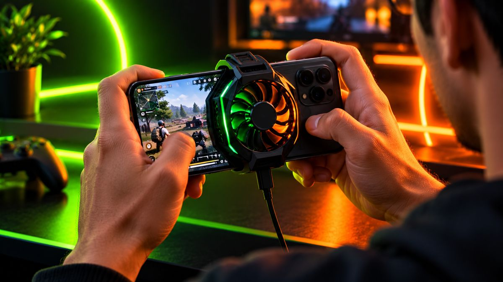
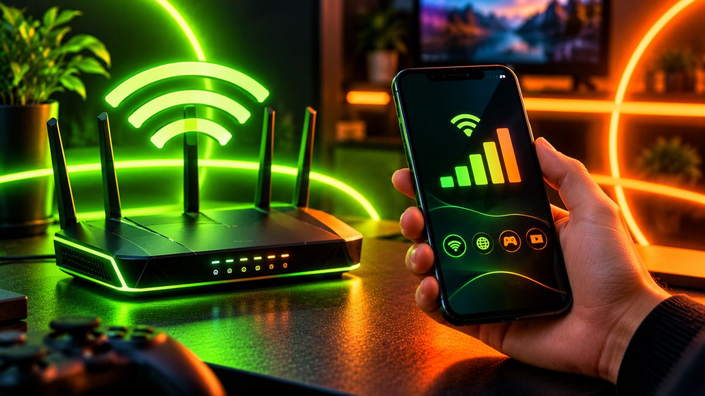

Nothing ruins a match like sudden lag or a phone that turns into a hand warmer. You can't turn a budget phone into a gaming flagship, but you can usually get noticeably smoother gameplay with the right settings and a few habits. Here's what actually works.

<!--more-->

## 1. Turn on your phone's game mode

Most Android brands include a built-in **game mode** or **game space**. It can block notifications during matches, free up memory, and prioritise performance for the game. Look for it in Settings, often under "Special features", "Advanced features" or "Game".

Where to find it on popular brands:

| Brand | What it's called | Where to look |
|---|---|---|
| Samsung | Game Booster (with the Gaming Hub app) | Swipe in the in-game panel, or open Gaming Hub |
| Xiaomi, Redmi, POCO | Game Space (replaced Game Turbo on HyperOS) | Game Space app or Security app |
| OnePlus | Game Space / Games | The Games app on the home screen |
| Realme | Games (previously Game Space) | The Games app or Settings |
| Other brands | Game mode / Game assistant | Search "game" in Settings |

Since Android 12, some phones also support Android's own **Game Mode**, which lets a game run in **standard**, **performance** or **battery** mode. Pick **performance** for short, intense matches and **battery** for long, casual sessions. Not every phone or game supports it, so don't worry if you don't see it.

## Quick fix table: what's causing your lag?

| What you notice | Likely cause | What to try first |
|---|---|---|
| Smooth at first, then stutters after 10–15 minutes | Heat (thermal throttling) | Remove the case, stop charging, lower graphics |
| Characters jump or teleport, but the screen is smooth | Network (high ping) | Switch to 5GHz Wi-Fi or a stronger 4G/5G signal |
| Game takes ages to load or crashes | Low storage or RAM | Free 15–20% storage, close background apps |
| Choppy from the very first second | Settings too high for the chip | Drop to "Smooth" or "Balanced", lower the frame rate |

## 2. Choose the right in-game graphics settings

This makes the biggest difference. In the game's own settings:

- **Prefer a stable frame rate over high graphics.** Smooth 60fps with "Smooth" or "Balanced" graphics plays better than choppy "Ultra" graphics.
- **Turn off shadows and anti-aliasing** if you're getting drops.
- Use the **highest frame rate your phone can hold steadily** for 10+ minutes, not just the first minute.

## 3. Keep the phone cool

<figure class="inline-figure">
  
  <figcaption>Illustration</figcaption>
</figure>

Phones slow themselves down when they get hot, which is called **thermal throttling**. To avoid it:

- **Don't game while charging.** Charging adds a lot of heat. The exception is phones with **bypass charging**, which power the phone straight from the charger without charging the battery. Some gaming phones, like the iQOO Neo 10R and Realme P4 Pro, have it; check your phone's game mode settings.
- **Remove thick cases** during long sessions.
- Play in a cool place, out of direct sunlight.
- Take short breaks between long matches.

## 4. Free up memory and storage

- **Close background apps** before starting a match. This is one of the few times closing apps really helps.
- Keep at least **15–20% storage free**. Phones slow down when storage is nearly full.
- Uninstall apps you don't use. Many run in the background.

## 5. Fix your network, not just your phone

<figure class="inline-figure">
  
  <figcaption>Illustration</figcaption>
</figure>

A lot of "lag" is actually **ping**, meaning network delay, not phone performance:

- Use **Wi-Fi on the 5GHz band** if your router supports it, and sit close to it.
- On mobile data, check that you're on **4G or 5G**, not a weak signal.
- Pause big downloads and streaming on the same network.

## 6. Keep the game and phone updated

Game updates often include performance fixes for specific phones, and system updates can improve both performance and battery. Install them, but avoid big updates right before an important match.

> **Tip:** Avoid "game booster" or "RAM cleaner" apps from unknown developers. Most do nothing useful, some show heavy ads, and some are outright malware. Your phone's built-in game mode is enough.

## What NOT to do

- **Don't use GFX tools or modded game files** to unlock settings. They can get your account banned in games like BGMI and Free Fire.
- **Don't root your phone** just for gaming. It can break security and banking apps, and void your warranty.
- **Don't keep the phone at 100% brightness** for hours. It adds heat and drains the battery fast.



If your phone still struggles after these tweaks, it may be time to upgrade. Our [iQOO Neo 10R vs Realme P4 Pro comparison](/iqoo-neo-10r-vs-realme-p4-pro/) looks at two popular gaming phones around ₹30,000.

**Related reading:** [12 Simple Ways to Make Your Phone Battery Last Longer (That Actually Work)](/make-phone-battery-last-longer/) · [Best Gaming Phones Under ₹30,000 in India (November 2026)](/best-gaming-phones-under-30000/) · [Phone Overheating? 10 Simple Fixes That Actually Work](/phone-overheating-fixes/)

## The bottom line

Use your phone's game mode, pick a stable frame rate over fancy graphics, keep the phone cool, and fix your network. Those four steps solve most lag and heating problems. If your phone still struggles after all this, it may simply be time to upgrade to a phone with a stronger processor and better cooling.
