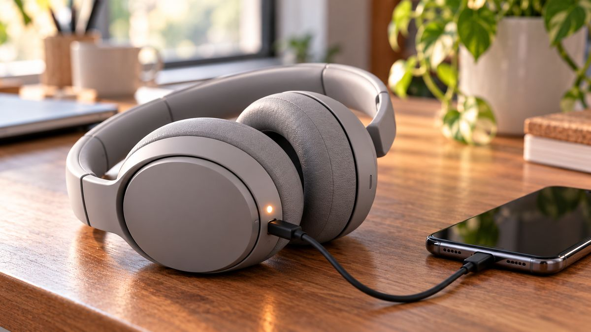

You no longer need to spend $300 or more to block out a noisy commute or open-plan office. In November 2026, several over-ear headphones with active noise cancellation (ANC) sell for under $100, and a few of them come close to the premium models on battery life and features. Here are the ones worth buying, and what you give up compared with a flagship pair.

<!--more-->

## Quick picks

| Headphones | Price (Nov 2026) | Battery (ANC on) | Hi-res codec | Multipoint | Best for |
|---|---|---|---|---|---|
| Sony WH-CH720N | around $88 (list $179.99) | up to 35 hours | No (SBC, AAC) | Yes | Most people, light weight |
| Soundcore Space One | around $65 to $100 | up to 40 hours | LDAC | Yes | Strong ANC for the money |
| CMF Headphone Pro | around $49 to $79 | up to 50 hours | LDAC | Yes (dual device) | Battery life and style |
| JLab JBuds Lux ANC | list $84.99, cheaper on sale | 40+ hours | No | Yes | Tightest budgets |

Prices are US prices seen at Amazon, Best Buy, Walmart and Target in November 2026. Headphone prices change almost weekly, so check before you buy.

## 1. Sony WH-CH720N: the best pick for most people

Sony's entry-level noise cancelling headphones have a list price of $179.99, but in November 2026 they are selling for around $88 at Best Buy and Amazon (some colors cost more). At that price, they are the easiest recommendation on this list. In the UK, they have been listed for around £63.

The biggest draw is comfort. At 192 grams, Sony calls them its lightest wireless ANC headphones, and the low weight makes a real difference on long flights or a full workday. Battery life is rated at up to 35 hours with ANC on and 50 hours with it off, and a three-minute charge adds about an hour of playback.

Reviewers praise the noise cancellation and Sony's Adaptive Sound Control, which adjusts the sound settings based on what you're doing. The Sony app also offers an EQ, and the headphones support Bluetooth multipoint, so you can stay connected to a phone and a laptop at the same time.

The trade-offs: the plastic build feels cheap, the headphones don't fold, there's no carrying case, the microphone quality is only average, and there's no LDAC support or wear detection (music won't pause when you take them off).



## 2. Soundcore Space One: strong noise cancelling for the money

Anker's Soundcore Space One has a $99.99 list price, which is what Walmart, Target and Newegg charge in November 2026. Costco members got it for $64.99 in an October deal, so it's worth waiting for a sale. It's a good choice if blocking noise is your top priority.

It uses adaptive ANC, which adjusts the strength of the noise cancelling based on your surroundings. Battery life is rated at up to 40 hours with ANC on and 55 hours with it off, and a five-minute charge gives around four hours of listening. It supports multipoint and the LDAC codec for higher-quality Bluetooth audio from Android phones.

At 265 grams, it's noticeably heavier than the Sony, so it may feel less comfortable over a long day. If you can stretch your budget, Anker's newer Space 2 has an MSRP of $129.99 and is a top budget pick at SoundGuys, but it sits outside this price limit unless it's on sale.



## 3. CMF Headphone Pro: the longest battery life

The CMF Headphone Pro comes from CMF, the budget brand of Nothing. It launched with a $99 list price, now lists for $79, and dropped to a record-low $49 on Amazon in mid-November 2026.

Battery life is the headline: CMF rates it at up to 50 hours with ANC on and up to 100 hours with ANC off. It supports LDAC and is Hi-Res Audio certified, and it can connect to two devices at once. The design also stands out, with a click-wheel style control and swappable ear cushions. The Nothing X app adds an EQ and a hearing-test-based sound profile.

The downsides are worth knowing. At 283 grams, it's the heaviest pick here. The headphones don't fold, extra pairs of cushions cost about $25, and reviewers have raised concerns about build quality. Reviews of its noise cancelling are also mixed: SoundGuys measured strong noise reduction, while other comparisons rated it weaker than the Sony and Soundcore.



## 4. JLab JBuds Lux ANC: the best on a tight budget

If you want to spend closer to $50, the JLab JBuds Lux ANC is the one to watch. JLab has raised its list price to $84.99 (Best Buy charges the same in November 2026), but it has sold for $49.95 in past Amazon deals, so wait for a sale.

JLab rates it at more than 40 hours with ANC on and over 70 hours with it off, and it supports multipoint. SoundGuys named it its best pick under $100, noting good sound, comfort and USB-C audio support, along with an app with EQ. The catches are that it has no water resistance rating and fewer extra features than the pricier picks above. It's a sensible choice for a student, a second pair for the office, or anyone who wants basic noise cancelling without spending much.

> **Tip:** Budget noise cancelling works best on steady, low sounds like airplane engines, bus rumble and air conditioning. It's less effective against voices and sudden noises. A good fit matters just as much as the ANC itself: if the ear cushions don't seal around your ears, even the best noise cancelling will sound weak.

<figure class="inline-figure">
  
  <figcaption>Illustration</figcaption>
</figure>

## What you give up under $100

Cheaper ANC headphones have come a long way, but there are still gaps compared with premium models like Sony's 1000X series or Bose QuietComfort headphones:

- **Noise cancelling strength:** Budget models reduce steady noise well, but premium pairs handle a wider range of sounds, including voices.
- **Microphones:** Call quality in noisy places is usually the weakest point at this price.
- **Build and extras:** Expect more plastic, fewer folding designs and fewer cases. Features like wear detection are often missing.
- **Codecs:** LDAC only helps if you use an Android phone that supports it. iPhones use AAC, so the Sony sounds just as good as the others on an iPhone.

<figure class="inline-figure">
  
  <figcaption>Illustration</figcaption>
</figure>

## How to choose

- **Want the most comfortable all-rounder?** Get the Sony WH-CH720N while it's around $88.
- **Care most about blocking noise?** The Soundcore Space One is the better choice.
- **Hate charging?** The CMF Headphone Pro lasts the longest between charges.
- **Spending as little as possible?** Wait for a JLab JBuds Lux ANC deal near $50.

Black Friday is less than two weeks away, and headphones are among the most heavily discounted products each year. If none of these is at the price listed above, waiting for the sales may save you more. Our guide to [spotting a real Black Friday discount](/black-friday-2026-tech-deals-how-to-spot-real-discount/) shows how to check a deal's price history.

## Our take

**What do you use, and does it have ANC?**

I use earbuds now. If there is ANC it is good, but for me sound and battery are more important. Earbuds should be such that they feel right to use and I don't have to charge again and again.

**What problem do you face listening outside?**

While listening to songs outside or in bus, the sound around comes a lot. If there is ANC it helps a little, but in normal earbuds also if the fit is right then the outside sound becomes some less. I feel ANC is a good feature, but it is not needed for everyone.

**Related reading:** [TWS Earbuds Buying Guide: ANC, Codecs, Battery and Mics Explained Simply](/tws-earbuds-buying-guide/) · [Best Bluetooth Speakers Under $50 in 2026: Small, Waterproof and Loud Enough](/best-bluetooth-speakers-under-50/) · [Sony WH-CH720N vs Soundcore Space One: Which to Buy](/sony-wh-ch720n-vs-soundcore-space-one/)

## The bottom line

For most people, the **Sony WH-CH720N** at around $88 is the best noise cancelling headphone under $100 right now, thanks to its light weight, solid ANC and multipoint support. Choose the **Soundcore Space One** (best on sale) if you want stronger noise cancelling and LDAC, the **CMF Headphone Pro**, now as low as $49, for the longest battery life, and watch for **JLab JBuds Lux ANC** sales if your budget is closer to $50.
