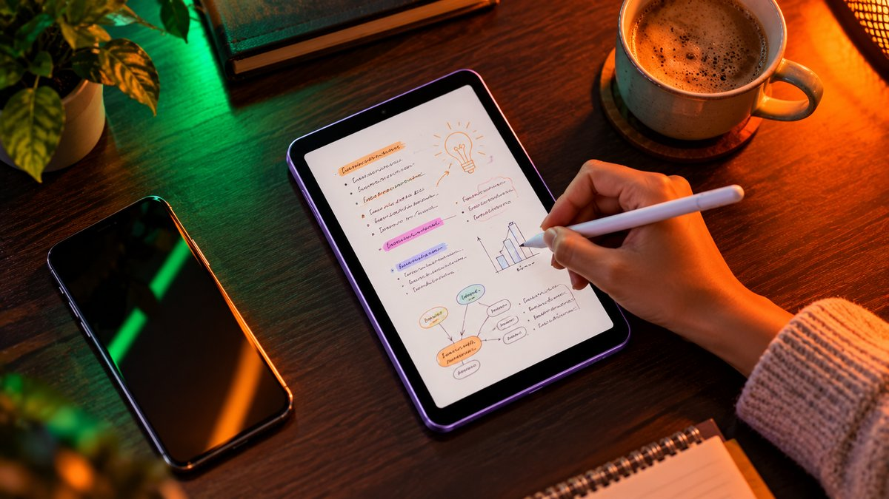

OPPO has launched the Pad Mini in India, a small 8.8-inch Android tablet with a matte OLED screen and a flagship Snapdragon 8 Gen 5 chip. It was announced on October 22 alongside the Find X10 phones and costs ₹94,999. It went on sale on October 29 and is now available on Flipkart and OPPO's online store.

<!--more-->

## Price and availability in India

OPPO is selling just one version in India, the "Matte Display Edition", in a single Lavender colour.

| Variant | Price in India |
|---|---|
| 8GB RAM + 256GB storage (Wi-Fi) | ₹94,999 |
| OPPO Pad Mini Smart Case (sold separately) | ₹3,999 |
| OPPO Pencil 3 Pro stylus (sold separately) | ₹7,999 |

- **Sale date:** Thursday, October 29, 2026 (on sale now)
- **Where to buy:** OPPO's online store and Flipkart. Flipkart listed it at ₹94,999 with bank offers when we checked on November 13.

**Launch offers** (for a limited period that started on October 22, as reported by Indian tech sites):

- The Pencil 3 Pro and Smart Case free with the tablet, worth about ₹11,000 together
- Up to 15% instant cashback with eligible bank cards
- No-cost EMI for up to 24 months, or zero down payment for up to 30 months

Reports differ on when the free-accessory offer ends, so check the end date on OPPO's or Flipkart's page before you order.

## Key specifications

| Spec | OPPO Pad Mini |
|---|---|
| Display | 8.8" OLED, matte finish, 2520 x 1680 (2.5K), up to 144Hz, up to 1,600 nits full-screen (3,200 nits peak in small areas) |
| Processor | Qualcomm Snapdragon 8 Gen 5 (3nm) |
| RAM and storage | 8GB LPDDR5X, 256GB UFS 4.1 |
| Battery | 8,000mAh |
| Charging | 67W SUPERVOOC wired |
| Cameras | 13MP rear, 8MP front |
| Software | ColorOS 16 (Android 16) |
| Size and weight | About 5.46mm thin, about 282g |
| Connectivity | Wi-Fi 7, Bluetooth 6.0, USB-C (USB 3.2 Gen 1) |
| Stylus | Works with OPPO Pencil 3 and Pencil 3 Pro |

## What's new

This is OPPO's first compact tablet in India, so there's no older Pad Mini to compare it with. The idea is a small tablet you can hold in one hand for reading, notes and video, but with the same kind of top-end chip you'd find in a premium phone.

The screen is the headline. Most tablets have glossy screens, but this one has a matte OLED panel. A matte finish cuts down on reflections, which helps when reading under bright lights or near a window, and it gives a slightly paper-like feel when you write with a stylus. It also refreshes at up to 144Hz, so scrolling should look smooth.

<figure class="inline-figure">
  
  <figcaption>Illustration</figcaption>
</figure>

It's also very thin and light for its battery size. At about 5.46mm and 282g, it packs an 8,000mAh battery with 67W fast charging. OPPO claims up to 19.5 hours of video playback, and says a 10-minute charge adds about four hours of video. These are OPPO's claims.

There's no SIM slot, as the Indian model is Wi-Fi only. Instead, it can use the mobile data of a nearby OPPO phone running ColorOS 16 without you having to turn on a hotspot. It can also sync calls and messages from your phone and transfer files to and from Android phones and iPhones through OPPO's O+ Connect app. Reports say it will be among the first devices to get the ColorOS 17 update, but OPPO hasn't given a date for it.

<figure class="inline-figure">
  
  <figcaption>Illustration</figcaption>
</figure>

## Who should consider it

The Pad Mini is for people who want a premium, pocket-sized Android tablet for reading, handwritten notes, video and games, and who already use an OPPO or OnePlus phone. They'll get the most from the data sharing and syncing features. If you mostly watch videos at home, a bigger and cheaper tablet will serve you better.

Two alternatives to compare:

- **OnePlus Pad 4:** a much bigger 13.2-inch tablet with a faster Snapdragon 8 Elite Gen 5 chip and a 13,380mAh battery. It starts at ₹59,999 for 8GB/256GB, about ₹35,000 less than the Pad Mini, though it's far less portable.
- **Apple iPad mini (2026):** Apple launched a new iPad mini with an 8.5-inch OLED screen and the A20 Pro chip on October 28. It starts at ₹82,900 in India and went on sale on November 6. See the comparison below.

## OPPO Pad Mini vs iPad mini (2026)

These are now the two premium small tablets in India. Here's how they compare on paper:

| | OPPO Pad Mini | iPad mini (2026) |
|---|---|---|
| Starting price | ₹94,999 (8GB/256GB) | ₹82,900 (128GB), ₹94,900 (256GB) |
| Screen | 8.8" OLED, matte, up to 144Hz | 8.5" OLED, 60Hz (matte nano-texture glass costs ₹12,000 extra) |
| Chip | Snapdragon 8 Gen 5 | A20 Pro |
| Thickness | About 5.46mm | 5.4mm |
| Water resistance | Not listed | IP67 |
| Charging | 67W SUPERVOOC | USB-C |
| Cellular option | No, Wi-Fi only | Yes, on pricier models |
| Stylus | OPPO Pencil 3 / 3 Pro (Pencil 3 Pro free at launch) | Apple Pencil Pro or Pencil (USB-C), sold separately |

**Pick the OPPO Pad Mini** if you want a smoother 144Hz screen with a matte finish built in, much faster charging, and you use an OPPO or OnePlus phone. At the same 256GB storage, it costs almost the same as the iPad mini.

**Pick the iPad mini** if you use an iPhone, want a cheaper 128GB starting point, need mobile data built in, or want IP67 water resistance and Apple's long software support.

The prices above are launch prices. Bank offers change often, so compare the final price on both before you buy.



**Related reading:** [Best Tablets for Students in India Under ₹20,000](/best-tablets-for-students-under-20000/) · [Tablet vs Laptop for Students: Which Is Better for Study?](/tablet-vs-laptop-for-students/) · [Apple iPad mini with OLED Launched in India: Price, Specs and Sale Date](/apple-ipad-mini-oled-launched-india-price-specs-sale-date/)

## The bottom line

The OPPO Pad Mini brings something different to Indian tablet buyers: a thin, light 8.8-inch tablet with a matte 144Hz OLED screen, a flagship Snapdragon chip and fast 67W charging. The catch is the price. At ₹94,999, it costs well over the OnePlus Pad 4 and about the same as a 256GB iPad mini (2026). It makes the most sense if you want the best small Android tablet and use an OPPO or OnePlus phone. iPhone users are better off with the new iPad mini.
