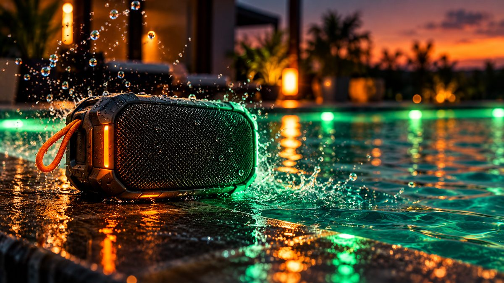
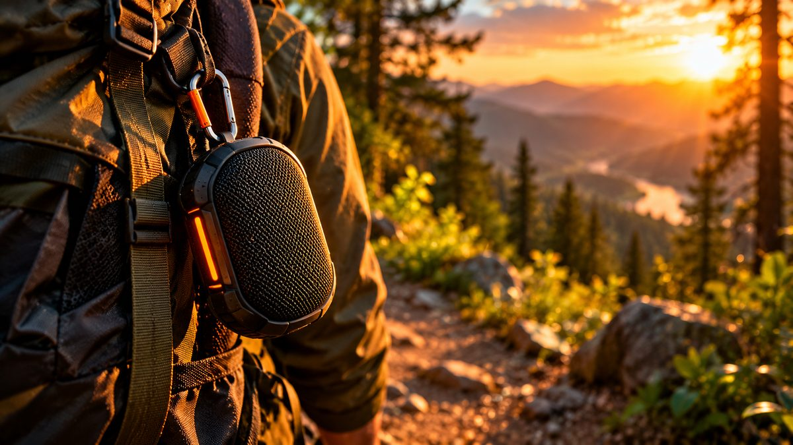

You don't need to spend $100 or more to get a portable speaker that survives the beach, the shower and a backpack. In 2026 the sub-$50 market is full of small, waterproof speakers from JBL, Anker's Soundcore brand and Tribit, and the differences come down to size, battery life and how much bass you expect from something that fits in a jacket pocket. Here are the ones worth buying in November 2026, with early Black Friday prices, plus two that make sense only on sale.

<!--more-->

## Quick picks

| Speaker | Price (Nov 2026) | Battery (rated) | Water rating | Best for |
|---|---|---|---|---|
| Soundcore Select 4 Go | around $23 | up to 20 hours | IP67, floats | Lowest price, longest battery |
| JBL Go 4 | around $32 on sale ($50 list) | up to 7 hours (+2 with Playtime Boost) | IP67 | Smallest and most pocketable |
| JBL Go 5 | around $40 on sale ($55 list) | up to 8 hours (+2 with Playtime Boost) | IP68 | Newest tiny JBL, better battery than the Go 4 |
| Tribit StormBox Micro 2 | around $60 list, under $50 only on sale | up to 12 hours | IP67 | Best sound and features, if you catch a deal |
| JBL Clip 5 | around $50 on sale ($80 list) | up to 12 hours (+3 with Playtime Boost) | IP67 | Clipping to a bag |

Prices move a lot in the run-up to Black Friday (November 27), so check the current price before you buy. Our guide on [how to spot a real Black Friday discount](/black-friday-2026-tech-deals-how-to-spot-real-discount/) explains how to check a "deal" against a product's usual price.

## What actually matters in a cheap speaker

At this price, every speaker uses one small driver or a tiny pair of drivers, so none of them will fill a big backyard party. What separates them:

- **Water and dust rating.** IP67 means dust-tight and able to survive being dunked in about 3 feet (1 m) of water for 30 minutes. All five picks here have it or better (the JBL Go 5 is IP68). Some speakers also float, which matters at the pool.
- **Rated battery life.** Brands measure at moderate volume. Play loud and expect noticeably less.
- **Size and mounting.** A strap or carabiner is more useful than it sounds for showers, bikes and backpacks.
- **Pairing a second unit.** Most of these can join a second identical speaker for stereo sound, which is the cheapest way to get a bigger sound later.

<figure class="inline-figure">
  
  <figcaption>Illustration</figcaption>
</figure>

## 1. Soundcore Select 4 Go: best value

The Select 4 Go is the speaker to buy if you want something cheap that lasts. Soundcore lists it at $34.99, but its own store had it at $22.99 in November 2026, and Amazon has dipped to about $22 in earlier sales. For that you get a 5W single-driver speaker rated at up to 20 hours per charge, which is far longer than the JBL Go 4 at a lower price.

It's IP67 rated and it floats, so it's a good pool or shower speaker. There's a built-in loop for hanging it from a shower caddy, bag strap or handlebars, USB-C charging, and support in the Soundcore app for EQ adjustments. You can also pair two units for stereo, though Soundcore notes the newest version won't pair with older units.

The trade-off is sound: a single 5W driver is fine for podcasts and background music, but it won't give you much bass or volume. It's also slightly heavier than the Go 4 at about 9.3 ounces.



## 2. JBL Go 4: the most pocketable

The JBL Go 4 is the smallest speaker here and the one most people will recognize. Its list price is $49.95, but Amazon cut it to about $32 in an early Black Friday deal in November 2026, which is about as low as it goes. In the UK it typically sells for around £35.

It weighs about 6.7 ounces (190 g), has a 4.2W driver, Bluetooth 5.3 and IP67 protection. JBL rates the battery at up to 7 hours, plus up to 2 more hours with Playtime Boost turned on in the JBL Portable app. That's the weakest battery figure in this list, so it suits short trips more than all-day use.

The Go 4 also supports Auracast, JBL's newer way to link speakers. You can pair two Go 4s for stereo or connect it to other Auracast-capable JBL speakers. One catch: it doesn't link with older JBL speakers that use PartyBoost, such as the Go 3.

## 3. JBL Go 5: the newer, tougher Go

JBL released the Go 5 in spring 2026 as the Go 4's successor. It lists at $54.95, but JBL's own Black Friday sale has it at $39.95, which puts it inside this budget. Compared with the Go 4, it gets a longer rated battery (8 hours, or up to 10 with Playtime Boost), a tougher IP68 rating, Bluetooth 6.0 with the LC3 codec, and lighting strips along the edges. You can pair two Go 5s for stereo by tapping them together, and it supports Auracast for linking more speakers.

It's a little heavier than the Go 4 at about 0.5 lb (230 g), and output is still modest at 4.8W, so it's a pocket speaker, not a party speaker. Tom's Guide picked the Go 5 over the Go 4 in a head-to-head, mainly for its fuller bass and better battery. At $40 it's the better JBL; if the Go 4 stays near $32, that one is still the better pure bargain.



## 4. Tribit StormBox Micro 2: best sound, on sale

The StormBox Micro 2 is the most capable speaker in this group, but its price has crept up. Tribit's own store lists it at $59.99 in November 2026, and it has dropped below $50 at Amazon during past sales, so it's worth buying at that level rather than at full price. In the UK it usually sells for around £50–£60. It it packs a 10W speaker, a rated 12 hours of battery and IP67 protection into a palm-sized body.

What Hi-Fi praises how enjoyable it sounds for its size, though it notes the sound can get a bit messy at high volume. The rubber strap on the back wraps around a bike handlebar, backpack strap or shower head. It can also connect to two phones at once, and it doubles as a small power bank: you can top up a phone or earbud case from its USB-C port in a pinch.

It's fairly heavy for its size at about 315 g (11 ounces), and it does not float. Tribit has since released the StormBox Micro 3 with a longer rated battery and an IP68 rating, but it costs around $60, so the Micro 2 remains the better pick if you find it on sale.



> **Tip:** If you want louder, wider sound later, don't upgrade straight away. Buying a second unit of the same speaker and pairing the two for stereo often costs less than moving up to a $100 model, and you can split them up again for separate rooms.

<figure class="inline-figure">
  
  <figcaption>Illustration</figcaption>
</figure>

## 5. JBL Clip 5: worth it on sale

The JBL Clip 5 is not an under-$50 speaker at full price. It lists at around $80, but JBL's own Black Friday sale has it at $49.95 in November 2026, and it has dropped to about $45 at other retailers before. Near $50, it's a strong pick.

What you get over the Go 4 is a built-in carabiner with a wider opening than the Clip 4, a 7W driver, and a much longer rated battery: up to 12 hours plus up to 3 more with Playtime Boost. It's IP67 rated and supports Auracast, so it links with a Go 4 or another Clip 5. RTINGS notes it has slightly better bass than the Go 4 and sounds more even when you're not directly in front of it. Just don't pay full price unless the carabiner matters a lot to you.



## Which one should you buy?

- **Cheapest that's still good:** Soundcore Select 4 Go. It costs about half of the others and lasts the longest.
- **Smallest for travel:** JBL Go 4 at around $32, as long as 7 to 9 hours of battery is enough.
- **Newest pocket JBL:** JBL Go 5 at around $40 for IP68, a longer battery and Bluetooth 6.0.
- **Best sound:** Tribit StormBox Micro 2 for its fuller sound, strap and power-bank feature, but only when it's under $50.
- **For hiking and backpacks:** JBL Clip 5, at its sale price of around $50.

If you mostly listen indoors and want voice control, a mains-powered smart speaker like the Echo Dot can be a better fit for the money, but it isn't portable or waterproof.

**Related reading:** [Best Noise Cancelling Headphones Under $100 in 2026](/best-noise-cancelling-headphones-under-100/) · [Best Smartwatches for iPhone in 2026](/best-smartwatches-for-iphone/) · [Best Workout Earbuds Under $50 in 2026: Sweatproof Picks That Stay Put](/best-workout-earbuds-under-50/)

## The bottom line

With Black Friday prices, the JBL Clip 5 at around $50 and the JBL Go 5 at around $40 are the easiest recommendations this month: both are recent, rugged and well reviewed. If you want to spend less, the Soundcore Select 4 Go at around $23 is a bargain with a 20-hour battery, and the JBL Go 4 at around $32 is the pick for pure pocketability. The Tribit StormBox Micro 2 still has the fullest sound, but buy it only when it drops under $50. Every speaker here is rated IP67 or better, so a splash or a drop in the pool won't end the party.
