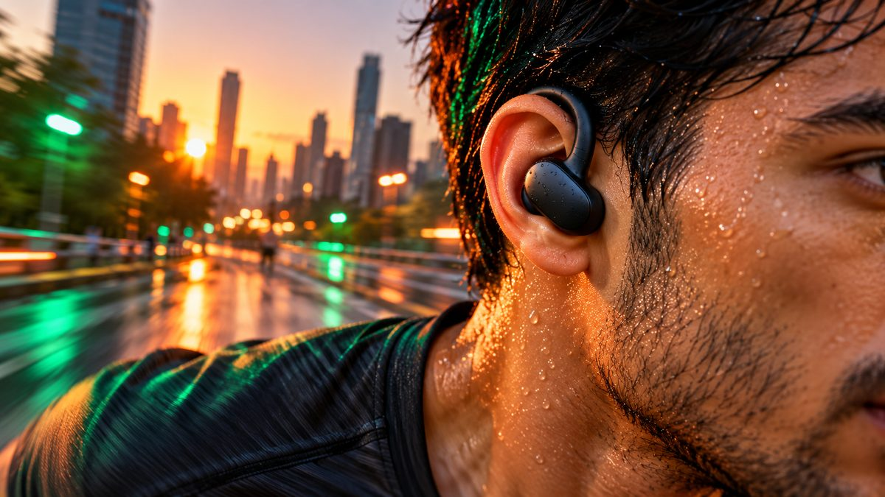
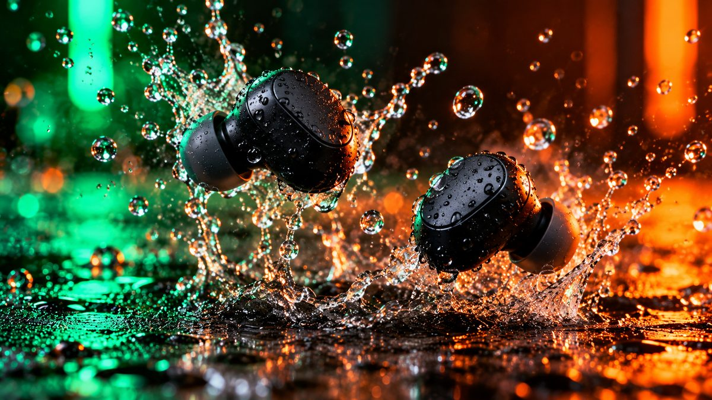

Workout earbuds have two jobs that regular earbuds often fail at: staying in your ears during burpees and sprints, and surviving a steady supply of sweat. You don't need $250 Powerbeats Pro 2 to get either one. Here are the best sweat-resistant earbuds you can buy for under $50 in November 2026 (prices refreshed for Black Friday), plus one step-up pair if you want ear hooks and serious waterproofing.

<!--more-->

## Quick picks

| Earbuds | Price (Nov 2026) | Fit | Water rating | Battery (buds / with case) | ANC |
|---|---|---|---|---|---|
| JLab Go Sport+ | around $23 (list $31.99) | Built-in ear hooks | IP55 | 9 hrs / 35 hrs | No |
| Soundcore P31i | around $30 (list $59.99) | Standard in-ear | IP55 | 10 hrs / 50 hrs (ANC off) | Yes, adaptive |
| TOZO NC9 (upgraded, IPX8 model) | around $40 | Standard in-ear | IPX8 | about 14 hrs / about 60 hrs (ANC off) | Yes |
| Soundcore P30i | list $49.99, often discounted | Standard in-ear | IP54 | 10 hrs / 45 hrs | Yes |
| Soundcore Sport X20 (step up) | around $60–$80 | Adjustable ear hooks | IP68 | 12 hrs / 48 hrs (ANC off) | Yes, adaptive |

Battery figures are the brands' own ratings, and prices are what the brands' own stores and major US retailers listed in November 2026. Budget earbuds go on sale often, especially around Black Friday, so check the live price before you buy. Our guide on [how to spot a real Black Friday discount](/black-friday-2026-tech-deals-how-to-spot-real-discount/) shows how to tell a genuine price drop from an inflated "list price".

## What actually matters in workout earbuds

**Fit comes first.** If an earbud falls out mid-run, nothing else matters. Ear hooks that loop over the top of your ear are the most secure option for running, HIIT and jumping rope. Standard stem or bean-shaped earbuds can work fine for lifting and the treadmill, as long as you find the right tip size.

**Water rating is the second thing to check.** The "IP" code tells you how well earbuds resist dust (first digit) and water (second digit). IP54 handles light sweat and splashes, IP55 adds protection against water jets, and IPX8 or IP68 means the buds are built to survive being submerged. An "X" just means the earbuds weren't rated for dust. For heavy sweaters, IP55 is a sensible minimum.

**Noise cancelling is a bonus, not a must.** ANC helps block out loud gym music and treadmill hum, but if you run outdoors you'll want a transparency or awareness mode so you can hear traffic.

<figure class="inline-figure">
  
  <figcaption>Illustration</figcaption>
</figure>

## 1. JLab Go Sport+: the best pick for running

The JLab Go Sport+ is the cheapest pair here that has proper ear hooks, and that's exactly why it's our top pick for runners. The hooks are built into the earbuds, so they sit over your ear instead of relying only on the silicone tip to hold them in place. JLab's own store had it at around $23 in November 2026, down from a regular $31.99, and Amazon prices tend to track the brand store.

JLab rates the buds at 9 hours per charge and 35 hours in total with the case, with an IP55 rating for sweat and water. You get Bluetooth 5.3, a Be Aware mode that lets outside sound in, and JLab's EQ3 sound presets plus custom EQ in the JLab app. A 10-minute quick charge adds about an hour of playback, and the USB-C cable is built into the case, which is handy when you forget a cable in your gym bag.

The trade-offs: there's no active noise cancelling, and the case is bulkier than a pocket-friendly AirPods-style case. Sound is tuned for energy rather than detail, which suits workouts fine.



## 2. Soundcore P31i: the best all-rounder

If you want one pair for the gym, the commute and the office, the Soundcore P31i is the best value under $50 right now. Its list price is $59.99, but it was selling for around $30 at Amazon and other big US retailers in November 2026, a little below the roughly $33 it sold for most of October.

Anker rates the P31i at IP55, the same as the JLab, so sweat isn't a worry. The big upgrade is adaptive noise cancelling, which Soundcore says reduces noise by up to 52 dB. Battery life is rated at 10 hours per charge with ANC off (8 hours with it on) and up to 50 hours with the case. It also supports connecting to two devices at once, uses Bluetooth 6.1, and a 10-minute charge gives about 3.5 hours of listening.

There are no ear hooks or wings, so the fit depends on picking the right tip. That makes it a better match for lifting, cycling and gym machines than for sprint intervals.



> **Tip:** Before you blame the earbuds for falling out, try every tip size in the box, and don't assume the medium tips that come fitted are right for you. A tip that seals well stays put better, sounds bassier and makes noise cancelling work properly. Many people need a different size in each ear.

<figure class="inline-figure">
  
  <figcaption>Illustration</figcaption>
</figure>

## 3. TOZO NC9: the most waterproof

The upgraded TOZO NC9 stands out for one reason: an IPX8 rating, meaning it's designed to survive being submerged, not just sweated on. That makes it a safe choice if you work out in the rain or tend to rinse your gear. Keep in mind it has no dust rating, and IPX8 earbuds still aren't meant for swimming laps.

You also get hybrid noise cancelling, six microphones for calls, app EQ and a case with a small display that shows how much charge is left. Reviewers report around 10 hours per charge with ANC on and about 14 hours with it off, and TOZO advertises up to about 60 hours in total with the case. TOZO's own store listed most colors at $39.99 in November 2026.

One catch: TOZO also sold an older NC9 that is rated only IPX6. Check that the listing says IPX8, 60 hours and LED display before you buy.

The buds are a little chunky, so people with smaller ears should try them before committing to long runs.



## 4. Soundcore P30i: the cheapest with noise cancelling

If you mainly lift weights or use cardio machines and want to spend as little as possible, the Soundcore P30i is worth a look. It lists at $49.99 but is discounted often, and it has regularly sold for well under $30 at Amazon.

It has adaptive ANC (rated at up to 42 dB), 10 hours per charge and 45 hours with the case, multipoint pairing, and a case that doubles as a phone stand for watching videos on the bike. The catch is the IP54 rating, which is fine for normal sweat but a step below the others here. If you sweat heavily or train outdoors, spend the extra few dollars on the P31i.

## Worth stretching for: Soundcore Sport X20

The Soundcore Sport X20 costs more, with a $79.99 list price on Soundcore's site and deals that have taken it closer to $60, but it's a true sports design. The ear hooks can be extended and rotated for a custom fit, it's rated IP68 against both dust and water, and it adds adaptive ANC. Battery is rated at 12 hours per charge with ANC off (7 hours with it on) and 48 hours with the case (28 hours with ANC on). If it drops close to $50 during holiday sales, it's an easy recommendation for serious runners.

## Which should you buy?

- **You run, jump or do HIIT:** JLab Go Sport+, or the Sport X20 if you can stretch your budget.
- **You want one pair for everything:** Soundcore P31i.
- **You sweat a lot or train in the rain:** TOZO NC9.
- **You just need cheap gym buds:** Soundcore P30i.

**Related reading:** [Best Noise Cancelling Headphones Under $100 in 2026](/best-noise-cancelling-headphones-under-100/) · [AirPods Pro 3 vs AirPods 4 (and AirPods 5): Which to Buy This Black Friday](/airpods-pro-3-vs-airpods-4/) · [Sony WH-CH720N vs Soundcore Space One: Which to Buy](/sony-wh-ch720n-vs-soundcore-space-one/) · [Best Bluetooth Speakers Under $50 in 2026: Small, Waterproof and Loud Enough](/best-bluetooth-speakers-under-50/)

## The bottom line

For most people who work out, the Soundcore P31i is the best mix of sweat resistance, noise cancelling and battery life for around $30. Runners should pick the JLab Go Sport+ for its ear hooks, and anyone who needs a fully waterproof pair should look at the TOZO NC9. Whatever you buy, spend five minutes trying the different tip sizes. It makes a bigger difference to how secure and good they feel than anything else.
