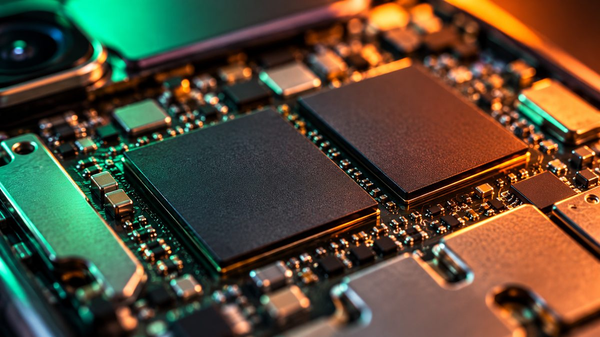

Ai+ Smartphone, the budget phone brand backed by former Realme India chief Madhav Sheth, says it will raise the prices of several of its phones in India from **November 15, 2026**. Select variants will cost **₹1,000 to ₹3,000 more**. The hike has since been moved forward to November 11 (see the update below).

<!--more-->

**Update, November 8:** Ai+ has brought the price hike forward to **November 11, 2026**. In a press release on November 6, the company said demand was higher than expected, stock sold out early, and new stock costs more because of memory and component prices. The current prices apply **until November 10**, while stock lasts. Ai+ has also published the new price of every variant:

| Model | Variant | Price until Nov 10 | Price from Nov 11 | Increase |
|---|---|---|---|---|
| Ai+ Pulse 2 FE | 4GB + 64GB | ₹8,999 | ₹10,999 | ₹2,000 |
| Ai+ Pulse 2 | 4GB + 64GB | ₹8,999 | ₹10,999 | ₹2,000 |
| Ai+ Pulse 2 | 4GB + 128GB | ₹9,999 | ₹11,499 | ₹1,500 |
| Ai+ Pulse 2 | 6GB + 128GB | ₹10,999 | ₹11,999 | ₹1,000 |
| Ai+ Nova 2 5G | 4GB + 64GB | ₹11,999 | ₹13,999 | ₹2,000 |
| Ai+ Nova 2 5G | 4GB + 128GB | ₹12,999 | ₹14,499 | ₹1,500 |
| Ai+ Nova 2 5G | 6GB + 128GB | ₹13,999 | ₹14,999 | ₹1,000 |
| Ai+ Nova 2 Neo 5G | 4GB + 64GB | ₹12,499 | ₹14,999 | ₹2,500 |
| Ai+ Nova 2 Neo 5G | 4GB + 128GB | ₹12,999 | ₹15,999 | ₹3,000 |
| Ai+ Nova 2 Neo 5G | 6GB + 128GB | ₹14,999 | ₹16,999 | ₹2,000 |
| Ai+ Nova 2 Power 5G | 6GB + 128GB | ₹15,999* | ₹16,999* | ₹1,000 |
| Ai+ Nova 2 Power 5G | 8GB + 128GB | ₹16,999* | ₹18,999* | ₹2,000 |
| Ai+ Nova 2 Pro 5G | 6GB + 128GB | ₹16,999 | ₹17,999 | ₹1,000 |
| Ai+ Nova 2 Pro 5G | 8GB + 128GB | ₹17,999 | ₹19,999 | ₹2,000 |
| Ai+ Nova 2 Ultra 5G | 6GB + 128GB | ₹18,999 | ₹20,999 | ₹2,000 |
| Ai+ Nova 2 Ultra 5G | 8GB + 128GB | ₹19,999 | ₹22,999 | ₹3,000 |
| Ai+ NovaFlip 5G | 8GB + 256GB | ₹49,999 | ₹49,999 | No change |

*Ai+ marks the Nova 2 Power 5G prices as including bank offers.

The original story from October 29 follows below.

## Which Ai+ phones are getting more expensive

In an announcement on October 29, Ai+ said the increase applies to select variants of seven models:

- Ai+ Pulse 2 FE
- Ai+ Pulse 2
- Ai+ Nova 2 5G
- Ai+ Nova 2 Neo 5G
- Ai+ Nova 2 Power 5G
- Ai+ Nova 2 Pro 5G
- Ai+ Nova 2 Ultra 5G

The **Ai+ NovaFlip 5G** is not affected and stays at **₹49,999**.

Ai+ hasn't published the new price for each variant yet, and not every variant of these models will change. It only says that the affected variants will go up by between ₹1,000 and ₹3,000.

## Why prices are going up

Ai+ blamed "elevated input costs" and cost pressure in price-sensitive segments, and said it will keep watching component costs. The company also encouraged buyers to purchase before the new prices apply.

This isn't the brand's first increase this year. In August, Ai+ raised prices across the Pulse 2 and Nova 2 series by up to ₹2,000, citing the global shortage of memory (RAM and storage) chips, according to Beebom. At the time, the Nova 2 Pro 5G went from ₹15,999 to ₹17,999 for the 6GB + 128GB model.

<figure class="inline-figure">
  
  <figcaption>Illustration</figcaption>
</figure>

Ai+ is far from alone. Memory chips have become much more expensive in 2026 as AI data centres buy up supply, and almost every major brand in India, including Samsung, Xiaomi, OnePlus, Realme, Vivo and Motorola, has raised phone prices this year, according to Beebom's price-hike tracker.

> **Tip:** Before you buy, check the final price after bank offers and exchange, not just the listed price. A good bank offer in an ongoing sale can save you more than the size of this price hike.

## Should you buy an Ai+ phone now?

<figure class="inline-figure">
  
  <figcaption>Illustration</figcaption>
</figure>

- **If you've already chosen an affected Ai+ model,** buying by November 10 saves you up to ₹3,000. Check which variant you want, because the hike only applies to some variants.
- **If you're still comparing phones,** don't rush just because of this deadline. Compare the Ai+ phone with rivals at the same price on specs that matter, such as the processor, display, battery and software update promise.
- **If you're waiting for a sale,** remember that prices across the industry have been rising, not falling, this year. Waiting may not get you a lower price.



**Related reading:** [Lava Phones to Get Costlier by Up to ₹3,000 From November 15](/lava-smartphone-price-hike-november-15/) · [How to Choose a Smartphone Under ₹20,000: 7 Specs That Actually Matter](/how-to-choose-a-smartphone-under-20000/) · [Diwali Gadget Buying Tips: How to Get the Best Deal Online](/diwali-gadget-buying-tips/) · [Upcoming Phone Launches in India This Week (October 26 to November 1)](/upcoming-phone-launches-india-this-week-october-26/)

## The bottom line

Ai+ will raise prices of select Pulse 2 and Nova 2 series variants by ₹1,000 to ₹3,000 from **November 11**, four days earlier than first announced, while the NovaFlip 5G stays at ₹49,999. If you've already decided on one of these phones, buy it by November 10. If not, compare it carefully with rivals first, since a few thousand rupees matters less than picking the right phone.
