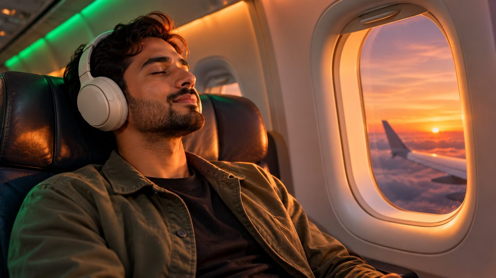
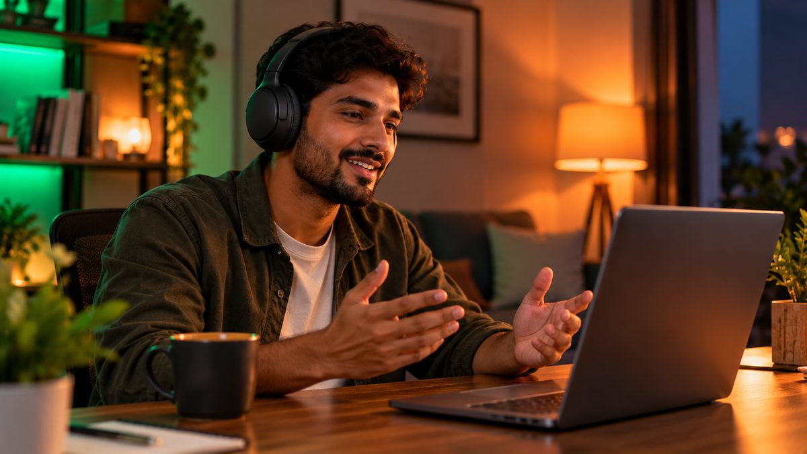

The Sony WH-CH720N and the Soundcore Space One are two of the most popular noise cancelling headphones you can buy for under $100. Both block steady noise well, last a long time on a charge and connect to two devices at once. They differ in weight, sound, extras and call quality, and those differences decide which one suits you.

<!--more-->

## Quick comparison

| | Sony WH-CH720N | Soundcore Space One |
|---|---|---|
| **Price (November 2026)** | around $104 at Amazon (list $179.99) | around $75 at major stores; $54.99 for Costco members until Nov 30 |
| **Weight** | 192g | about 265g |
| **Battery (claimed)** | up to 35 hours with ANC, 50 hours without | up to 40 hours with ANC, 55 hours without |
| **Quick charge** | 3 minutes for about 1 hour | 5 minutes for about 4 hours |
| **Codecs** | SBC, AAC | SBC, AAC, LDAC |
| **Multipoint** | Yes | Yes (not while LDAC is on) |
| **Folds / case** | Earcups swivel flat, no case | Folds, comes with a pouch |
| **Wear detection** | No | Yes (pauses when you take them off) |
| **Wired listening** | 3.5mm cable included | 3.5mm jack |

Prices are US prices checked in the week before Black Friday (November 2026). They change often, so check before you buy.

## Price: the Soundcore is cheaper this Black Friday

The Sony's list price is $179.99. In October it dropped as low as $88 at Amazon, but in the run-up to Black Friday it was listed at around **$104 at Amazon (November 2026)**, and Best Buy was asking more. The Soundcore Space One sells for around **$75 (November 2026)** at major stores, and Costco members can get it for **$54.99** with a manufacturer discount that runs until November 30.

That's a gap of roughly $30, or close to $50 if you shop at Costco. If you don't care much about weight or call quality, the Soundcore is the better value right now. If the Sony drops back under $90 during the sale, the choice goes back to features. Our guide to [spotting a real Black Friday discount](/black-friday-2026-tech-deals-how-to-spot-real-discount/) shows how to check whether a "deal" price is actually low.

## Noise cancelling: roughly equal

Both use adaptive noise cancelling that adjusts to your surroundings, and both are good at the steady, low sounds of planes, buses and air conditioning. RTINGS rates their noise isolation as comparable. GSMArena found the Sony's ANC "very good" and a clear step up from older Sony budget models, while Trusted Reviews called the Space One's ANC effective but said it struggles in very noisy places.

Neither matches premium headphones like Sony's 1000X series on voices and sudden noises. If ANC is your only priority, you won't go wrong with either.

<figure class="inline-figure">
  
  <figcaption>Illustration</figcaption>
</figure>

## Comfort and design: Sony for long days, Soundcore for travel

The Sony is the lighter pair by a big margin. At **192 grams**, Sony says it's its lightest over-ear noise cancelling headphone, and that matters on a long flight or a full workday. The Soundcore weighs about **265 grams**, though Trusted Reviews still found it comfortable.

The Soundcore is easier to carry. It **folds** and comes with a pouch, while the Sony's earcups only swivel flat and there's no case in the box. The Soundcore also has **wear detection**, so music pauses when you take it off. The Sony doesn't.

## Sound and app: different tastes

The Sony has a warm, bass-heavy sound with a slightly dull top end, according to GSMArena, though you can fix much of that with the five-band EQ in Sony's Headphones Connect app. The app also includes Sony's DSEE upscaling and 360 Reality Audio.

RTINGS describes the Soundcore as having a more "excited" sound, with more EQ options in its app, although Trusted Reviews felt the EQ presets made little difference. The Soundcore also supports **LDAC**, a higher-quality Bluetooth codec, but only Android phones that support LDAC can use it. On an iPhone, both headphones use AAC, so LDAC makes no difference.

## Battery: Soundcore lasts longer on paper

Soundcore claims up to **40 hours with ANC on**, against Sony's **35 hours**. RTINGS also found the Soundcore lasts longer in continuous use. Real-world numbers vary: GSMArena got more than 47 hours from the Sony with ANC on, while Trusted Reviews measured about 30 hours from the Soundcore with ANC on.

Both will easily get through several days of commuting. The Soundcore's quick charge is stronger, with about four hours of playback from five minutes on the cable.

## Calls: Sony is clearly better

If you take a lot of calls, this is the deciding factor. RTINGS says the Sony has a much better microphone, and GSMArena found voices clear and easy to understand. Trusted Reviews called the Soundcore's call quality disappointing.

<figure class="inline-figure">
  
  <figcaption>Illustration</figcaption>
</figure>

> **Tip:** If you use an Android phone and want LDAC, remember that turning it on disables multipoint on the Soundcore. You'll have to choose between higher-quality audio and staying connected to your phone and laptop at the same time.

## Which should you buy?

**Buy the Sony WH-CH720N if:**
- You wear headphones for hours at a time and want the lightest pair
- You take a lot of calls or video meetings
- You use an iPhone, where LDAC doesn't matter anyway



**Buy the Soundcore Space One if:**
- You travel a lot and want headphones that fold into a bag
- You want auto-pause when you take them off
- You use an Android phone with LDAC, or want the longest battery life



If you can spend a little more, Anker's **Soundcore Space One Pro** adds a more premium design and longer battery life. Soundcore says its Black Friday and Cyber Monday sale runs from November 19 to 30, and Amazon's Black Friday Week sale runs through Cyber Monday (November 30), so watch both pairs until then.

**Related reading:** [Best Noise Cancelling Headphones Under $100 in 2026](/best-noise-cancelling-headphones-under-100/) · [Best Workout Earbuds Under $50 in 2026: Sweatproof Picks That Stay Put](/best-workout-earbuds-under-50/) · [AirPods Pro 3 vs AirPods 4 (and AirPods 5): Which to Buy This Black Friday](/airpods-pro-3-vs-airpods-4/)

## The bottom line

The Sony WH-CH720N and Soundcore Space One offer similar noise cancelling, and this Black Friday the Soundcore costs about $30 less. Choose the **Sony** for lighter weight, better calls and a simple iPhone-friendly setup. Choose the **Soundcore** for travel, thanks to its folding design and pouch, plus wear detection, LDAC and longer battery life. For most commuters and office workers, the Sony's comfort and microphone make it the slightly safer pick.
