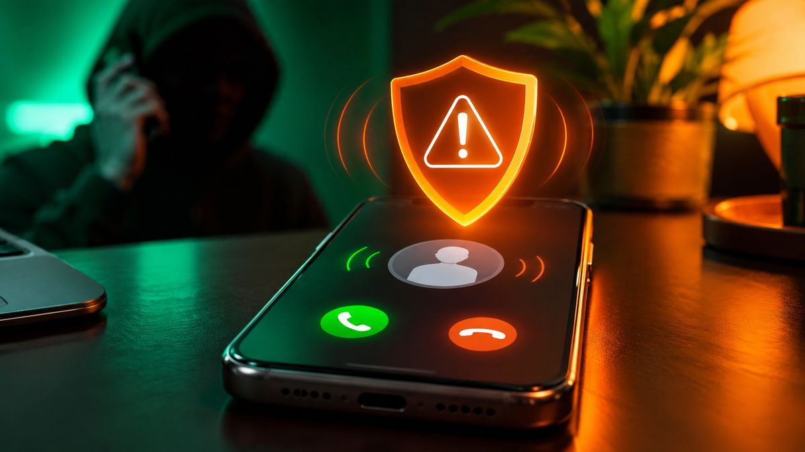

From today, November 1, 2026, mobile operators in India have to show the **name of the person calling you**, not just their number, on calls made over 4G and 5G networks. The feature is called **CNAP (Calling Name Presentation)**, and the Department of Telecommunications (DoT) has made it a default service, so you don't need to install an app or sign up for it.

<!--more-->

## What happened

In a circular dated October 13, 2026, the DoT directed telecom operators to roll out CNAP across their service areas from November 1. The service is switched on by default for every subscriber, without a separate request. It follows recommendations that the telecom regulator TRAI first made in February 2024.

Here is how the name shown on your screen is decided:

| Situation | What you see |
|---|---|
| The number is saved in your contacts | Your saved contact name (it takes priority) |
| An unsaved Indian mobile number on 4G/5G | The name from the caller's telecom account records |
| A business or bulk connection with verified papers | A registered trade name or trademark, if approved by the operator |
| The caller has CLIR (number hiding) enabled | No name is shown |
| An international call from an unsaved number | "International Call" |

The name travels through the telecom network itself. The caller's operator shares the registered name with your operator, which then displays it. According to the order, operators must not keep the looked-up name after the call ends.

<figure class="inline-figure">
  
  <figcaption>Illustration</figcaption>
</figure>

## Who is affected

The order covers **4G and 5G mobile networks**, which means users of Jio, Airtel, Vi and BSNL on those networks. **2G, 3G and landline calls are not covered yet**: the DoT says it will look at them separately.

The circular does not list phone models, and it doesn't mention any phone settings or software updates you need. Whether you see the name depends on the network supporting the service, so it may not show up on every call from day one. The order also doesn't cover WhatsApp or other internet calls, which work through apps rather than the phone network.

<figure class="inline-figure">
  
  <figcaption>Illustration</figcaption>
</figure>

## What it means for you

For most people, this means fewer mystery calls from unsaved numbers. The name comes from the caller's telecom account records rather than from other users' contact lists.

There are limits, though, and they matter for scams:

- **A name isn't proof of identity.** It shows who owns the SIM, not who is speaking.
- **Old or misspelt records** can show a name that doesn't match how someone is known.
- **Spoofed numbers** may display the registered owner's name, not the real caller's.
- **"International Call"** only means the call came from abroad. It doesn't mean the call is a scam, and it doesn't make it safe either.

Third-party caller ID apps such as Truecaller can still be used alongside CNAP. Since they use their own databases, the name in the app and the CNAP name for the same number may differ.

> **Tip:** Treat the caller name like a hint, not a guarantee. If someone claiming to be from your bank, a courier or a government office asks for an OTP, PIN or payment, hang up and call back on the number printed on the official website or your card, whatever name was on the screen.

## Our take

**Will CNAP reduce the need for apps like Truecaller?**

Yes. Now that CNAP is here, Truecaller's basic caller ID feature will matter less. But for spam detection, scam alerts and call blocking, people may still want Truecaller.

**Will showing the caller's name really reduce spam and fraud calls?**

Seeing the caller's name will make it easier to decide whether to pick up an unknown call, but it can't stop spam and fraud completely. Scammers will find other ways to trick people, so awareness and spam detection will still be important.

**Is it fine for your name to show on other people's screens?**

In my view, seeing the caller's name on screen is useful, but privacy matters too. People should have control over what personal information is shown to others.

## What to do next

1. **Nothing to switch on.** CNAP is on by default on 4G and 5G, so just keep your phone and operator service as usual.
2. **Check your own registered name.** If your SIM was registered with a typo or under a family member's name, that is what others will now see. Ask your operator how to update it.
3. **Report a wrong name.** Operators must set up a complaint system for incorrect caller names, so use your operator's customer care if a name looks wrong.
4. **Businesses** that want to show a brand name instead of a person's name need a registered trademark or a GST-registered trade name, verified by the operator.

**Related reading:** [CERT-In Warns iPhone, iPad and Mac Users: Update Now to Fix High-Risk Flaws](/cert-in-apple-security-warning-update-iphone-mac/) · [How to Sell Your Old Phone Safely in India: 9 Steps Before You Hand It Over](/sell-old-phone-safely-india-steps/)

## The bottom line

From November 1, 2026, the caller's registered name should appear on your screen for calls over 4G and 5G, with your own saved contact names still taking priority. It's a useful step against unknown and spam calls, but it doesn't verify who is actually speaking. 2G, 3G and landline calls aren't included yet, so expect the rollout to grow over time.
