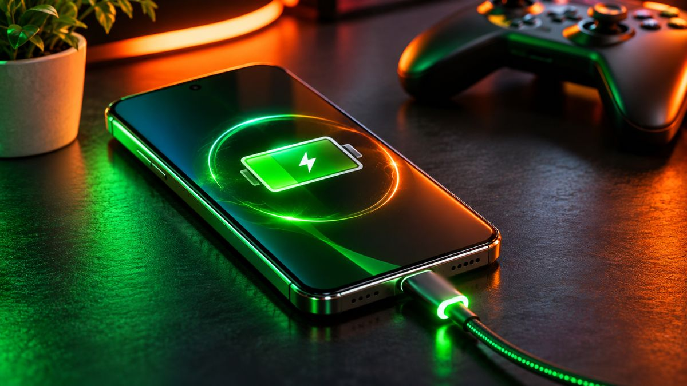

The iQOO Neo 10R and Realme P4 Pro are two of the most popular gaming phones in India around the ₹30,000 mark. One has the faster chip, the other has the bigger battery, the brighter screen and a separate graphics chip. Here's how they compare in November 2026, and which one suits you.

<!--more-->

## Quick comparison

| | iQOO Neo 10R | Realme P4 Pro |
|---|---|---|
| **Price (Nov 2026)** | around ₹24,000–29,000 (8GB+128GB), stock patchy | around ₹28,999 (8GB+128GB), ₹30,999 (8GB+256GB) |
| **Launched** | March 2025 at ₹26,999 | August 2025 at ₹24,999 |
| **Chip** | Snapdragon 8s Gen 3 | Snapdragon 7 Gen 4 + HyperVision AI chip |
| **Display** | 6.78-inch 1.5K AMOLED, 144Hz (in supported games) | 6.8-inch 1.5K AMOLED, 144Hz, 6,500 nits peak |
| **Cooling** | 6,043 sq mm vapour chamber | 7,000 sq mm vapour chamber |
| **Battery / charging** | 6,400mAh, 80W, bypass charging | 7,000mAh, 80W, bypass charging |
| **Rear cameras** | 50MP main (OIS) + 8MP ultrawide | 50MP Sony IMX896 main (OIS) + 8MP ultrawide |
| **Selfie camera** | 32MP | 50MP (4K 60fps video) |
| **Water resistance** | IP65 | IP65 and IP66 |
| **Thickness / weight** | 7.98mm, about 196g | 7.68mm, about 189g |
| **Updates promised** | 3 Android upgrades, 4 years of security | 3 Android upgrades, 4 years of security |

Prices are the range seen on Amazon, Flipkart and price trackers at the time of writing. Both phones have been hit by the memory-chip price increases of 2026, so expect a few thousand rupees of movement week to week.

<figure class="inline-figure">
  
  <figcaption>Illustration</figcaption>
</figure>

## Performance: the Neo 10R is faster

This is the biggest difference. The **Snapdragon 8s Gen 3** in the iQOO is a near-flagship chip, while the **Snapdragon 7 Gen 4** in the Realme is a strong upper mid-range chip. In heavy games and long sessions, the Neo 10R has more headroom, so it can hold higher graphics settings for longer before it needs to slow down.

iQOO says the Neo 10R holds a stable 90fps in BGMI for five hours, based on its own internal test that averaged 88.5fps. Reviewers have also reported smooth 90fps in BGMI and Call of Duty: Mobile. Its 144Hz mode works only in a handful of supported games, and in most apps the screen runs at up to 120Hz.

The Realme takes a different route. Its separate **HyperVision AI chip** boosts frame rate and resolution in supported games. Realme claims 144fps in more than 100 popular games. In 91mobiles' review, the P4 Pro reached 144fps in BGMI with GT Mode, AI frame boost and high refresh rate switched on. That's AI-generated smoothness on top of a slower chip, though, not the same thing as raw power.

## Heat and cooling

Both phones use vapour chambers, and Realme's is larger on paper (7,000 sq mm against iQOO's 6,043 sq mm). Size isn't everything. 91mobiles found the P4 Pro warmed up noticeably during 30-minute gaming sessions, rising 8.5°C in BGMI and running hotter than rivals they tested it against. Reviews of the Neo 10R generally described its heat as under control for its class.

Both phones support **bypass charging**, which runs the phone directly from the charger while you play, so the battery isn't heating up as it charges. If you game plugged in, this is a useful feature on either one.

<figure class="inline-figure">
  
  <figcaption>Illustration</figcaption>
</figure>

## Battery and charging

The Realme has the edge here with a **7,000mAh** battery against the iQOO's **6,400mAh**. Both charge at 80W, and both reach a full charge in under an hour with the bundled charger. In 91mobiles' testing, the P4 Pro went from 20% to 100% in about 43 minutes.

Either phone will get most people through a full day of heavy use. If you play for hours away from a plug, the Realme's extra 600mAh is a real bonus.

## Display and design

Both have big 1.5K AMOLED screens. The Realme's is rated much brighter, with a claimed 6,500 nits peak, which helps outdoors. It's also slightly curved on all four sides and protected by Gorilla Glass 7i.

The P4 Pro is the slimmer and lighter phone, at 7.68mm and about 189g. The Neo 10R is a little thicker at 7.98mm and about 196g. Both are splash and dust resistant, with the Realme's IP66 rating covering stronger water jets. Neither should be treated as waterproof.

## Cameras

Neither is a camera phone, but the Realme is the better all-round pick. Its 50MP Sony IMX896 main sensor and its **50MP selfie camera** with 4K 60fps video beat the iQOO's 32MP front camera for video calls and vlogging. Reviewers found the Neo 10R's main camera good in daylight but noisier at night, and its selfie camera weaker in low light.

## Software and updates

Both promise three Android upgrades and four years of security updates, so there's no clear winner. Both also come with a lot of preinstalled apps, which you can uninstall. The Neo 10R launched on Funtouch OS 15 and has since moved to iQOO's newer OriginOS in India. The P4 Pro runs Realme UI on Android.

> **Tip:** The Neo 10R is now more than 18 months old and some variants go in and out of stock. If you buy one, check that the seller is Amazon, Flipkart or iQOO itself, and that the listing shows a full manufacturer's warranty. Listings with unusually low prices from unknown sellers are the ones to avoid.

## Our take

**iQOO Neo 10R or Realme P4 Pro?**

I'd choose the iQOO Neo 10R, because its Snapdragon 8s Gen 3 processor is more powerful and better suited to heavy gaming and multitasking. For me, gaming performance matters more than battery life or the selfie camera.

**Is AI-boosted smoothness as good as a faster chip?**

In my view, the smoothness that AI adds is good, but it can't replace real processor power. For heavy gaming, a powerful chipset is more reliable, especially in long gaming sessions.

**What matters most in a gaming phone?**

For me, performance and heat control are the most important, because I want my phone to run smoothly without lagging during long gaming sessions.

## Which one should you buy?

- **Buy the iQOO Neo 10R if** gaming performance comes first. It's the faster phone, it handles heavy games with more headroom, and it's often cheaper when it's in stock.
- **Buy the Realme P4 Pro if** you want a better all-rounder: bigger battery, brighter and slimmer design, better selfie camera, and AI frame boosting for smooth high-fps play in supported games.
- **Skip both if** you need a phone that will stay current for many years. Their update promises end sooner than some rivals, such as Samsung or OnePlus models at similar prices.





**Related reading:** [Best Gaming Phones Under ₹30,000 in India (November 2026)](/best-gaming-phones-under-30000/) · [How to Improve Gaming Performance on Your Android Phone](/improve-gaming-performance-android-phone/) · [Fast Charging Explained: Watts, USB-C PD and the Right Charger](/fast-charging-explained/)

## The bottom line

For pure gaming muscle, the **iQOO Neo 10R** still wins thanks to its Snapdragon 8s Gen 3 chip, and it's the better value if you find it in stock from a trusted seller. The **Realme P4 Pro** is the better everyday phone, with a bigger battery, a brighter screen, a slimmer body and a sharper selfie camera, but it costs more after this year's price hikes and runs warmer during long sessions. Compare prices on both stores and watch for bank offers before you decide.
