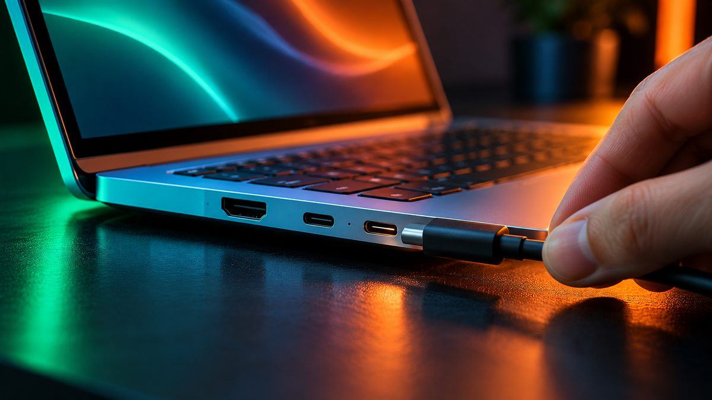

> **Update (November 8):** The Zenbook 14 (UX3480) launched in India on November 5 at **₹1,36,990** (Snapdragon X), **₹1,56,990** (AMD Ryzen AI 7 345) and **₹1,67,990** (Intel Core Ultra 9 Series 3). It's sold on the Asus e-shop, Asus stores, Amazon, Croma, Reliance Digital and Vijay Sales. Full details are in the price section below.

Asus launched its new **Zenbook 14 (UX3480)** in India on **November 5, 2026**. It's a thin and light 14-inch laptop with a choice of three chip makers, Qualcomm, AMD and Intel, and a new Ceraluminum body that Asus says resists scratches and smudges. Here are the India prices, the specs and what is still unknown.

<!--more-->

The India prices and stores come from launch reports by Digit and Analytics Insight. The chips, colours and weight come from Asus India's launch announcement, as reported by FoneArena, PCQuest and MobiGyaan. Display and port details come from Asus's own spec page in another market, and we've marked them clearly.

## Price and availability in India

| Model | Processor | India price |
|---|---|---|
| Zenbook 14 UX3480QA | Qualcomm Snapdragon X | ₹1,36,990 |
| Zenbook 14 UX3480KA | AMD Ryzen AI 7 345 | ₹1,56,990 |
| Zenbook 14 UX3480AA | Intel Core Ultra 9 (Series 3) | ₹1,67,990 |

The launch reports don't break the prices down by RAM or storage, so check the exact configuration on the listing before you buy.

- **Launched:** November 5, 2026
- **Where to buy:** Asus e-shop, Asus Exclusive Stores, Amazon, Croma, Reliance Digital, Vijay Sales and other authorised retailers
- **EMI:** Analytics Insight reports no-cost EMI from ₹7,611 a month for 18 months, and low-cost EMI from ₹6,471 a month for up to 24 months



## Key specifications

| Spec | Asus Zenbook 14 (UX3480) |
|---|---|
| Processor options | Qualcomm Snapdragon X, AMD Ryzen AI 7 345, or up to Intel Core Ultra 9 (Series 3) |
| AI engine (NPU) | Up to 50 TOPS on selected models |
| Display | 14-inch OLED touchscreen: 3K, 120Hz, up to 1,100 nits HDR on the Intel model; Full HD+ 60Hz on the AMD and Snapdragon models (per Analytics Insight) |
| Weight | From about 1.1 kg |
| Thickness | 1.39 cm |
| Battery life (Asus claim) | Up to 33 hours, depending on model and use |
| Build | All-metal design with Asus Ceraluminum |
| Colours | Arctic Blue, Komodo Coral, Zabriskie Beige |
| Ports (Intel model, per Asus spec page abroad) | Thunderbolt 4 USB-C, USB-C 10Gbps, USB-A, HDMI 2.1, audio jack |

RAM and storage for each India model haven't been confirmed in the launch reports. Abroad, the Zenbook 14 UX3480 is sold with 16GB or 24GB of memory and 512GB or 1TB of storage, but India configurations could be different.

<figure class="inline-figure">
  
  <figcaption>Illustration</figcaption>
</figure>

## What's new

**The Ceraluminum body.** Asus first used this ceramic-coated aluminium on its pricier Zenbook S models. Asus says it resists scratches, wear and fingerprints, and it carries the three colours across the whole body. Bringing it to the regular Zenbook 14 is the biggest design change over the older Zenbook 14 OLED (UX3405).

**Three chip choices in one design.** Most laptops come with one chip family. Here you pick:

- **Snapdragon X** if battery life matters most. It runs Windows on Arm, so most apps work, but some older software, certain games and a few security tools may not run well.
- **AMD Ryzen AI 7 345** as a middle option with full Windows app support.
- **Intel Core Ultra Series 3**, going up to a Core Ultra 9, the top chip option in the range.

**Light weight with a big battery claim.** At around 1.1 kg (for the lightest model) and 1.39 cm thick, it's easy to carry all day. The 33-hour battery figure is Asus's own lab claim. Real use with browsing, video calls and higher screen brightness will be lower.

> **Tip:** The Snapdragon model is ₹20,000 cheaper than the AMD one. Before you pick it, check that every app you need (especially office, exam or college software) runs on Windows on Arm. If you're not sure, the AMD or Intel model is the safer pick.

<figure class="inline-figure">
  
  <figcaption>Illustration</figcaption>
</figure>

## Who should consider it

The Zenbook 14 (UX3480) suits students and office workers who want a light Windows laptop with an OLED screen and long battery life, and who care about a body that won't scratch easily.

Close rivals to compare:

- **Apple MacBook Air M5 (13-inch):** launched in India in March 2026 at ₹1,19,900 for 16GB RAM and 512GB storage. It's a little heavier at 1.23 kg and runs macOS. Pick it if you already use an iPhone or need Mac-only apps.
- **Asus Zenbook 14 OLED (UX3405):** the older model. If it gets a price cut after the new one arrives, it can still be a good deal for buyers who don't need the newest chips or the Ceraluminum finish.

## Our take

**Which processor would you choose: Snapdragon, AMD or Intel?**

I will choose AMD because it gives good performance, better multitasking and the best value for its price.

**Battery life or performance in a thin and light laptop?**

For me, battery life is more important, because the main use of a thin and light laptop is portability. But good performance is also important, so that daily tasks can be done easily.

**Is a laptop around ₹1.3 lakh worth it, or the MacBook Air?**

In my view, a ₹1.3 lakh laptop is only worth it when you need that performance. For students and office users, I will choose the MacBook Air, because its battery life, portability and performance are much better.

**Related reading:** [Laptop Buying Guide for College Students in India: What Specs You Really Need](/laptop-buying-guide-for-college-students/) · [Apple MacBook Pro With OLED Touchscreen Launched in India: Price, Specs and Sale Date](/apple-macbook-pro-oled-touchscreen-launched-india-price-specs-sale-date/)

## The bottom line

The Asus Zenbook 14 (UX3480) brings a tougher Ceraluminum body, an OLED screen and a choice of Snapdragon, AMD or Intel chips to India, priced from ₹1,36,990 to ₹1,67,990. That puts even the cheapest model above the MacBook Air M5's ₹1,19,900 launch price, so buy it if you want Windows, an OLED touchscreen and the Ceraluminum finish. If you just need a good laptop for college or office work, our [best laptops under ₹50,000](/best-laptops-under-50000-india/) cost far less.
