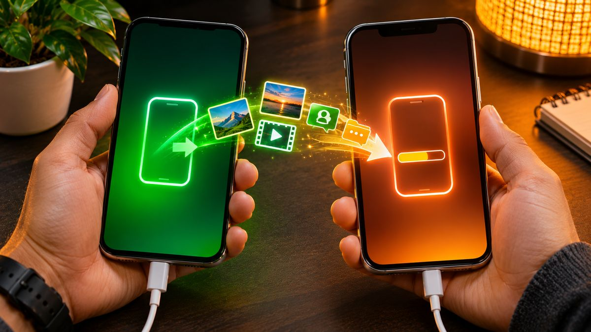
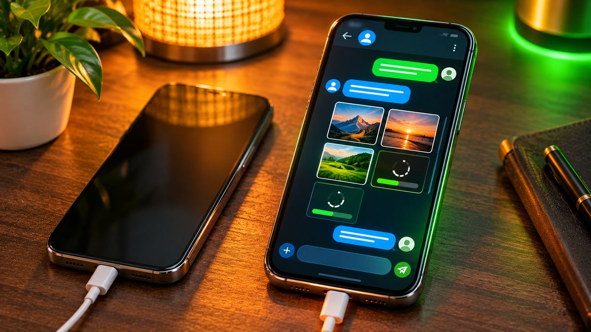

Moving from Android to a new iPhone is much easier than it used to be. Apple's free Move to iOS app copies your contacts, texts, photos, WhatsApp chats and more over a direct Wi-Fi link, and it only takes a few taps. The one catch: you have to do it while you're setting up the iPhone, so it pays to prepare first.

<!--more-->

This guide walks through the whole process, what moves over and what doesn't, and how to fix the most common problems.

## Before you start: a 5-minute checklist

A little prep avoids the most common headaches, including having to wipe your new iPhone and start again.

- **Don't finish iPhone setup yet.** The transfer only works from the setup screens. If you've already reached the home screen, you'll need to erase the iPhone (Settings > General > Transfer or Reset iPhone > Erase All Content and Settings) or move things over manually.
- **Plug both phones into power** and keep them next to each other.
- **Turn on Wi-Fi on the Android phone.** You don't need to be on your home network, but Wi-Fi must be on.
- **Check storage.** Everything you're moving, including anything on a microSD card, has to fit on the iPhone. A 128GB iPhone can't take 200GB of photos.
- **Update Chrome and WhatsApp** on the Android phone. Apple says Chrome needs to be current for your bookmarks to come across.
- **Back up to Google too.** Turn on Google Photos backup and make sure contacts and calendars sync to your Google account. It's a free safety net if anything gets skipped.
- **Sort out two-factor codes.** If you use an authenticator app, export or sync your codes before you switch, or you could be locked out of accounts.

<figure class="inline-figure">
  
  <figcaption>Illustration</figcaption>
</figure>

## Method 1: Move to iOS (works with most Android phones)

This is Apple's main method and the one most people should use.

1. **Turn on the new iPhone** and follow the setup prompts. On the Quick Start screen, tap **Set Up Without Another Device**.
2. On the **Transfer Your Apps & Data** screen, tap **From Android**, then **Transfer with App**.
3. **On the Android phone, install Move to iOS** from Google Play. You can scan the QR code the iPhone shows to find it. Open it, accept the terms and allow the permissions it asks for.
4. **On the iPhone, tap Continue** and wait for a six- or ten-digit code to appear.
5. **Type the code into the Android phone.** If you see a warning about a weak internet connection, you can ignore it.
6. **Join the temporary Wi-Fi network** the iPhone creates when the Android phone asks you to. This is a direct link between the two phones, not your home Wi-Fi.
7. **Pick what to move** on the Android phone and tap Continue.
8. **Leave both phones alone** until the progress bar on the iPhone finishes. Large photo libraries can take a while.
9. **Tap Done** on Android, then Continue on the iPhone and finish setup.

If you have a USB-C cable, Apple says you can connect the two phones with it for a faster transfer. Android may ask you to change its USB setting when you plug it in.

> **Tip:** Don't use the Android phone at all during the transfer, and don't take calls. Switching apps or answering a call can stop the transfer partway through. Turning off mobile data on the Android phone before you start also helps avoid dropouts.

## Method 2: No app on newer Android phones

Apple's support page also lists a newer path that skips the app on compatible phones running **Android 17 or later**, such as recent Pixel and Galaxy models. You start the same way on the iPhone, then scan the QR code it shows with the Android camera and choose what to send. If the code won't scan, tap **Other Options** on the iPhone, then on Android go to **Google Services > Pair with iPhone or iPad > Copy Data** and enter the session ID and pairing code. Not every Android 17 phone supports it, so check with your phone's maker. If yours doesn't, Move to iOS does the same job.

## What transfers and what doesn't

| Moves over | Doesn't move over |
|---|---|
| Contacts and call history | Music, books and PDFs |
| Text messages (SMS) and message history | Paid apps (Google Play purchases don't carry over) |
| Camera photos, videos and albums | Apps that aren't on the App Store |
| Files and folders | WhatsApp call history |
| Calendars, mail accounts and web bookmarks | Most app logins and settings |
| WhatsApp chats and media | |
| Accessibility and display settings, voice memos | |

Some free apps that exist on both stores can be matched, and you can download them from the App Store once setup is done. Everything else you'll need to find and install yourself. Expect to sign in to most apps again, and keep your banking passwords handy, because many banking apps only allow one registered device at a time.

<figure class="inline-figure">
  
  <figcaption>Illustration</figcaption>
</figure>

## How to move WhatsApp chats

WhatsApp is part of the Move to iOS transfer, but only if you're keeping the **same phone number**. Update WhatsApp on the Android phone first, then select it in the list of things to move. After setup, install WhatsApp on the iPhone, sign in with the same number and accept the prompt to import your chats. Your messages and media come across, but call history doesn't, and WhatsApp Business isn't supported.

## Moving your phone number and eSIM

You can activate your SIM or eSIM during the transfer. If you're moving an eSIM after setup instead, Apple supports a direct transfer on an **iPhone 11 or newer running iOS 26 or later** and an Android phone running **Android 16 or later**, as long as your carrier supports it. Major US carriers, including AT&T, T-Mobile and Verizon, are on the list, along with carriers in the UK and Canada. On the iPhone, go to Settings > Cellular > Add eSIM, choose Transfer from Android, and scan the QR code with your Android phone. Once the move finishes, the eSIM on your old phone stops working. If your carrier isn't supported, ask it to activate your eSIM on the new phone.

## If the transfer fails or stalls

- **No code appears:** restart both phones and try again.
- **It keeps dropping:** turn off mobile data on Android, "forget" saved Wi-Fi networks, and switch off any setting that automatically swaps networks (some phones call it Smart Network Switch or similar).
- **Only some content arrived, or the iPhone says it's full:** erase the iPhone and run the transfer again, after checking your data fits.
- **Something is missing afterward:** add your Google account on the iPhone (in Settings, under your mail accounts) to bring in contacts, calendars and mail, and install Google Photos to see your backed-up pictures.

## Our take

**Have you ever switched from Android to iPhone?**

I haven't personally switched phones, but I feel the hardest data to move safely is WhatsApp chats and photos.

**What's the most important data to move when you switch phones?**

From my perspective, WhatsApp chats and photos are the most important, because they hold important memories and personal information. Contacts are equally important too.

**Is a backup really needed before the transfer?**

Yes, absolutely. A backup before the transfer is important so that data isn't lost. If the transfer fails, we can safely recover photos and important files.

**Related reading:** [Best Smartwatches for iPhone in 2026](/best-smartwatches-for-iphone/) · [Pixel 10a vs iPhone 17e: Which to Buy After the Price Hikes](/pixel-10a-vs-iphone-17e/) · [Best Password Manager in 2026: Free and Paid Picks](/best-password-manager-2026/)

## The bottom line

Use Apple's Move to iOS app during iPhone setup, with both phones plugged in and left alone until the transfer ends. It brings across contacts, messages, photos, calendars and WhatsApp chats in one go. Back up to Google first as a safety net, sort out your authenticator codes, and plan to reinstall apps and move music by hand. If your Android phone runs Android 17 and supports it, you may not even need the app. Also, if you wear a Wear OS or Galaxy watch, check it works with iPhone before you switch.
