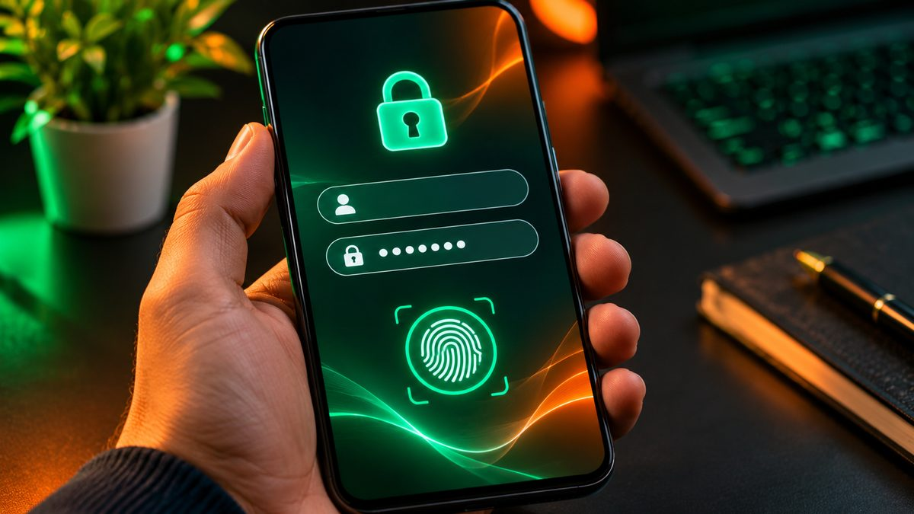

If you still reuse the same few passwords everywhere, one leaked site can open up your email, bank and shopping accounts. A password manager fixes that by creating a strong, different password for every login and filling it in for you. The good news: some of the best options cost nothing, and paid plans for one person run about $20 to $48 a year.

<!--more-->

Below are the best picks right now, what each one costs after this year's price changes, and how to choose between a free built-in option and a paid app.

## Quick picks

| Password manager | Best for | Free plan? | Paid price (billed yearly) |
|---|---|---|---|
| Bitwarden | Best free and best value | Yes, unlimited devices | Premium $19.80/yr; Families (6 users) $47.88/yr |
| 1Password | Easiest to use, families | 14-day trial only | Individual $47.88/yr; Families (5 users) $71.88/yr |
| Proton Pass | Privacy and email aliases | Yes, unlimited logins | Pass Plus $35.88/yr; Pass Family $59.88/yr |
| Apple Passwords | iPhone, iPad and Mac users | Free, built in | — |
| Google Password Manager | Android and Chrome users | Free, built in | — |

Prices are list prices from each company's site, around November 2026. Promotions for new customers are common, so check before you pay.

## 1. Bitwarden: the best free password manager

Bitwarden's free plan is unusually generous. You get unlimited passwords, notes, cards and identities, sync across as many devices as you like, a password generator and passkey support. You can also share logins with one other person through a free two-person organization. The apps cover iPhone, Android, Windows, Mac, Linux and every major browser.

The trade-offs on the free plan are small. The built-in two-factor code generator, emergency access (letting a trusted person reach your vault if something happens to you), vault health reports and encrypted file storage all need Premium.

Premium went up in early 2026, from $10 to **$19.80 a year**, and now includes 5GB of file storage plus alerts for weak, reused and exposed passwords. Families costs **$47.88 a year** and covers six people, each with full Premium features. That still makes Bitwarden the cheapest strong paid option here.

**Good for:** almost everyone, and anyone who wants a capable manager without paying.

## 2. 1Password: the most polished paid option

1Password is the one to pick if you want things to just work, especially when setting it up for less tech-savvy family members. Its Watchtower feature flags weak, reused and leaked passwords, and you get 1GB of storage per person, secure item sharing, and apps on every major platform.

There's no free plan, only a 14-day trial with no card required. Prices also rose in March 2026: Individual is now **$3.99 a month ($47.88 a year)**, and Families is **$5.99 a month ($71.88 a year)** for up to five people with unlimited shared vaults. At the time of writing, 1Password's own site offers new customers a first-year discount (Individual at $2.99 a month and Families at $4.49 a month, billed yearly). It's not available through the app stores.

**Good for:** households that want shared vaults and simple admin controls, and people happy to pay for a smoother experience.

<figure class="inline-figure">
  
  <figcaption>Illustration</figcaption>
</figure>

## 3. Proton Pass: best for privacy

Proton Pass comes from the company behind Proton Mail and is open source. The free plan has no limit on logins or devices and stores credit cards too, so it's a real alternative to Bitwarden Free. Its standout feature is **hide-my-email aliases**: throwaway addresses that forward to your real inbox, so shops and newsletters never see your actual email. Free accounts get 10 aliases, two vaults and can share with two people.

Pass Plus costs **$35.88 a year** ($2.99 a month) and adds unlimited aliases, a built-in two-factor code generator and dark web monitoring. Pass Family costs **$59.88 a year**. If you'd also like Proton's mail, VPN and cloud storage, Proton Unlimited bundles everything for $119.88 a year.

**Good for:** privacy-minded people, and anyone who's tired of spam after signing up for things.

## 4. Apple Passwords and Google Password Manager: free and already installed

You may not need a separate app at all.

**Apple Passwords** is built into iPhone, iPad and Mac (iOS 18, iPadOS 18 and macOS Sequoia or later). It stores passwords, passkeys, Wi-Fi passwords and two-factor codes, warns you about weak, reused or leaked passwords, and lets you share selected logins with family through shared groups. On a Windows PC you can use it in Chrome or Edge through iCloud for Windows. The big gap is Android: there's no app, so it's a poor fit if you own an Android phone.

**Google Password Manager** lives in Chrome and on Android. It syncs passwords and passkeys across Windows, Mac, Linux and Android, and you can protect your passkeys with a Google Password Manager PIN. It's the easiest choice if you already use Chrome everywhere, but it's tied to Chrome, so you're stuck if you prefer Safari or Firefox.

Both are much better than reusing passwords. Switch to a standalone app like Bitwarden or Proton Pass when you mix ecosystems, such as an iPhone with a Windows PC and Firefox, or when you need to share with family members on different platforms.

> **Tip:** Whichever manager you choose, protect it with a long master password you've never used anywhere else, and turn on two-factor authentication for the account. Then change your email and banking passwords first. Those are the accounts attackers want most.

## What about Dashlane and the others?

Dashlane is a solid, easy-to-use manager, but it ended its free plan in September 2025, and its paid plans cost more than the picks above. RoboForm, NordPass and Keeper are also reputable, often with cheap first-year deals. Just check the renewal price before you buy. For most people, though, Bitwarden, 1Password or Proton Pass covers every need.

<figure class="inline-figure">
  
  <figcaption>Illustration</figcaption>
</figure>

## How to choose

Ask yourself three quick questions:

- **Do you stay inside one ecosystem?** All Apple, or Android plus Chrome? Then the free built-in manager is a fine start.
- **Do you want to pay nothing but still work across everything?** Bitwarden Free, or Proton Pass Free if you want email aliases.
- **Are you setting this up for a family?** Bitwarden Families is the cheapest at $47.88 a year for six people. 1Password Families is the friendliest for non-technical relatives.

Switching later is easy. All of these apps can import from a browser or another password manager, usually from a CSV export. Delete that export file as soon as the import finishes, because it holds every password in plain text.

## Add a hardware security key (optional)

For your most important accounts, such as your password manager, email and bank, a physical security key adds strong phishing protection. Bitwarden lets you register security keys for two-step login even on its free plan. Check that your accounts support FIDO2 keys, and buy two so one can serve as a backup.



## Our take

**Do you use a password manager, or save passwords in the browser/phone?**

Yes, I use a password manager because it keeps my passwords secure, and it helps me create a strong password for every account.

**Free or paid password manager: is paying worth it for normal users?**

For normal users, a free password manager is enough. If you need more features and security, choosing a paid plan is a good idea.

**What's your one tip to keep online accounts safe?**

Set a unique and strong password for each account, and always keep two-factor authentication turned on.

**Related reading:** [How to Transfer Data from Android to iPhone](/how-to-transfer-data-from-android-to-iphone/) · [Black Friday 2026 Tech Deals: How to Spot a Real Discount](/black-friday-2026-tech-deals-how-to-spot-real-discount/)

## The bottom line

For most people, **Bitwarden** is the best password manager in 2026. The free plan covers unlimited devices, and Premium is still only $19.80 a year after its price rise. Pick **1Password** if you want the most polished app for a family and don't mind paying $47.88 to $71.88 a year. Choose **Proton Pass** if privacy and email aliases matter most. If you live entirely on Apple or entirely in Chrome, the free **Apple Passwords** or **Google Password Manager** is a perfectly good place to start. The important thing is to stop reusing passwords today.
