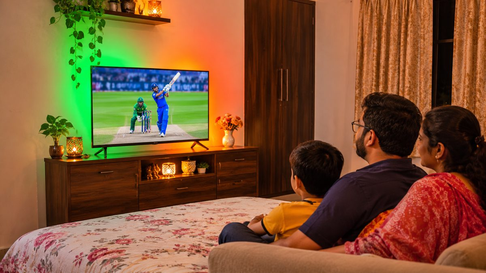
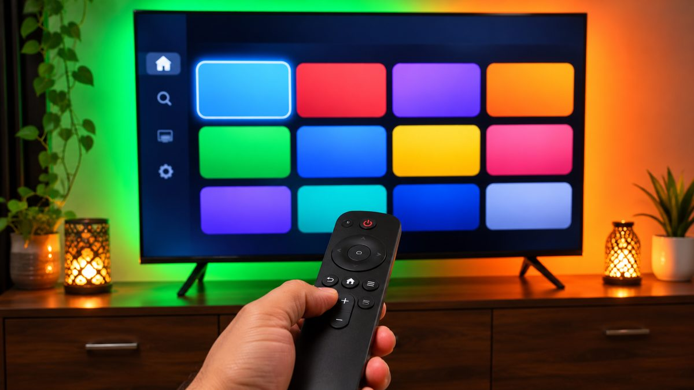

A 43-inch TV is the most popular size for Indian bedrooms and small living rooms, and with Diwali on 8 November, prices are close to their festive lows. The good news is that ₹25,000 to ₹35,000 now gets you a 4K TV from a well-known brand, often with a QLED panel, Dolby Vision and Google TV. Here are five picks across budgets, with prices checked this week.

<!--more-->

We haven't tested these TVs ourselves. The picks are based on their specs, current prices and owner reviews on Amazon and Flipkart, and the sources are listed at the end.

## Quick comparison

| TV | Price (Nov 2026) | Panel | Software | Sound | HDR |
|---|---|---|---|---|---|
| **Xiaomi FX 43** (L43MB-FIN) | about ₹22,800 | 4K LED, 60Hz | Fire TV | 24W | HDR10, HLG |
| **Hisense E75Q 43** (43E75Q) | about ₹29,990 | 4K QLED, 60Hz | VIDAA | 48W, DTS:X | Dolby Vision, HDR10+* |
| **Philips 8100 Series 43** (43PQT8100/94) | about ₹29,999 | 4K QLED | Google TV | 30W, Dolby Atmos | Dolby Vision, HDR10+ |
| **Xiaomi X Pro 43** (L43MB-APIN) | about ₹30,999 | 4K QLED, 60Hz | Google TV | 30W | Dolby Vision, HDR10+ |
| **Samsung UE86AH 43** (UA43UE86AHULXL) | about ₹33,990 | 4K LED, 60Hz | Tizen | 30W | HDR10+ |

Prices are the lowest listed on Amazon.in or Flipkart, according to Smartprix, and change often during the sales. *Smartprix doesn't list the Hisense's HDR formats; Dolby Vision and HDR10+ are from ProductHunter's listing.

## 1. Xiaomi FX 43: best under ₹25,000

The Xiaomi FX is the cheapest way into a 4K TV from a big brand. At around **₹22,800 on Flipkart**, you get a 4K screen, three HDMI ports, 24W speakers and Amazon's **Fire TV** software, which has every major Indian app, including JioHotstar, Prime Video, Netflix and YouTube, plus Alexa voice search.

The catch is picture quality in bright scenes. It's a regular LED panel with HDR10 only, no Dolby Vision, and owners say the Fire TV home screen shows a lot of ads. For a bedroom TV or a first 4K TV on a tight budget, it's still great value.



## 2. Hisense E75Q 43: best sound under ₹30,000

The Hisense E75Q's biggest strength is audio. Its **48W, four-speaker** system with DTS:X is far louder than anything else here, so you may not need a soundbar for a small room. It also has a QLED panel for richer colours and HDMI 2.1 ports, which help with game consoles.

It runs Hisense's own **VIDAA** software. The main apps are there, but the app store is smaller than Google TV's, so check that your favourite regional or niche apps are available before you buy.



<figure class="inline-figure">
  
  <figcaption>Illustration</figcaption>
</figure>

## 3. Philips 8100 Series 43: best all-rounder

If you want one TV that does everything well, the Philips 8100 Series is our pick. For around **₹29,999 on Amazon**, it combines a **QLED** panel, **Dolby Vision** and HDR10+, 30W speakers with **Dolby Atmos**, and **Google TV**, which has the biggest app library and built-in Chromecast for casting from your phone.

Smartprix lists its refresh rate as 120Hz, but other listings say the panel itself is 60Hz, so don't buy it as a gaming TV on that basis alone. For films, cricket and OTT shows, it's the most complete package at this price.



## 4. Xiaomi X Pro 43: Google TV with Dolby Vision

The Xiaomi X Pro is a close rival to the Philips. It also has a **QLED** panel, **Dolby Vision**, HDR10+ and **Google TV**, with 30W speakers, for around **₹30,999**. Choose it if you prefer Xiaomi's design or find it cheaper during a sale. The Philips gets the edge for including Dolby Atmos sound.



## 5. Samsung UE86AH 43: for Samsung fans

The Samsung Crystal UHD UE86AH costs the most of our five picks at around **₹33,990 on Amazon** and doesn't have a QLED panel or Dolby Vision. What you pay for is Samsung's brand, its large service network, and **Tizen**, which is fast and simple and works well with Samsung phones. It has 30W speakers, HDR10+ and three HDMI ports, including one with eARC for a soundbar.



If your budget stretches further, Sony's **BRAVIA 2 II** (K-43S25M2) is the premium option at this size, with Google TV and four HDMI ports. ProductHunter listed it at **₹52,240** in July, nearly double our other picks, so check the current price before you decide.

<figure class="inline-figure">
  
  <figcaption>Illustration</figcaption>
</figure>

## What to check before you buy a 43-inch TV

- **Get 4K, not Full HD.** At ₹22,000 and above, there's no reason to buy a Full HD 43-inch TV.
- **QLED is worth a small premium.** It gives brighter, richer colours than a standard LED panel.
- **Dolby Vision matters for OTT.** Netflix, Prime Video and JioHotstar stream many shows in Dolby Vision.
- **Software decides daily use.** Google TV has the most apps, Fire TV is good with Alexa, and Tizen and VIDAA are simpler but have fewer apps.
- **Sit about 5 to 7 feet away.** That's the comfortable distance for a 43-inch 4K TV, which suits most bedrooms and small living rooms.

Our [smart TV buying guide](/smart-tv-buying-guide/) explains panel types, HDR and refresh rates in more detail.

> **Tip:** Check the model number, not just "43 inch 4K". Brands sell several similar-looking 43-inch models at different prices, and sale listings sometimes show an older version. Also ask whether free installation and the wall mount are included, as some sellers charge extra for them.

## Our take

<!-- Kitek's answers go here, grammar fixes only -->

**Related reading:** [Smart TV Buying Guide: The Specs That Actually Matter](/smart-tv-buying-guide/) · [Diwali Gadget Buying Tips: How to Get the Best Deal Online](/diwali-gadget-buying-tips/) · [New Apple TV 4K (2026) Launched in India at ₹39,900](/apple-tv-4k-2026-india-price-features/)

## The bottom line

For most people, the **Philips 8100 Series** is the best 43-inch TV under ₹30,000 this Diwali, with QLED, Dolby Vision, Dolby Atmos and Google TV for around ₹29,999. On a tighter budget, the **Xiaomi FX** at about ₹22,800 is the cheapest good 4K option, and if sound matters most, the **Hisense E75Q** with 48W speakers is the one to get. Prices change daily during the festive sales, so compare Amazon and Flipkart before you buy.
