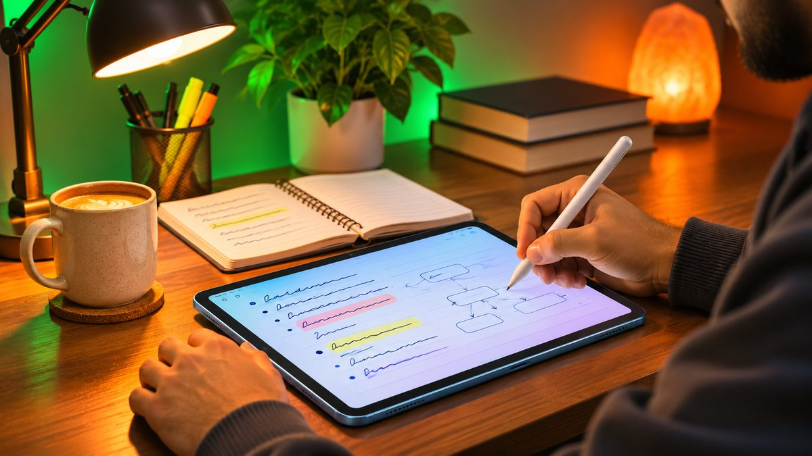
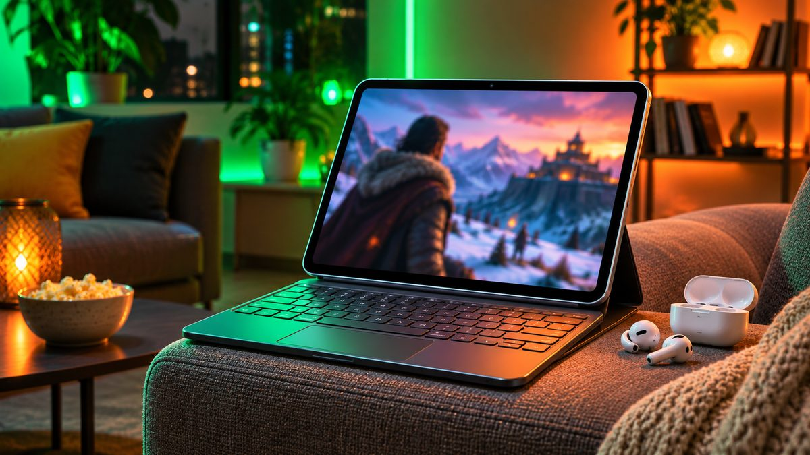

Apple sells two "everyday" iPads: the regular **iPad** with an A16 chip, and the **iPad Air** with an M4 chip. After Apple's price rises in June, the gap between them is now **$300 in the US and £320 in the UK**, so picking the right one matters more than it used to. Here's what the extra money actually gets you.

<!--more-->

## Quick comparison

| | iPad (A16, 11th gen) | iPad Air 11-inch (M4) |
|---|---|---|
| **US price** | From $449 (128GB) | From $749 (128GB) |
| **UK price** | From £429 | From £749 |
| **Chip** | Apple A16 | Apple M4 |
| **RAM** | 6GB | 12GB |
| **Apple Intelligence** | No | Yes |
| **Display** | 11-inch, not laminated, 500 nits | 11-inch, laminated with anti-reflective coating, 500 nits |
| **Bigger size** | No | 13-inch model from $949 / £949 |
| **Apple Pencil** | Apple Pencil (USB-C), Apple Pencil (1st gen) | Apple Pencil (USB-C), Apple Pencil Pro |
| **Keyboard** | Magic Keyboard Folio | Magic Keyboard for iPad Air |
| **Storage** | 128GB to 512GB | 128GB to 1TB |
| **Wireless** | Wi-Fi 6, Bluetooth 5.3 | Wi-Fi 7, Bluetooth 6 |

Prices are Apple's list prices for Wi-Fi models after the June 25 increase, according to 9to5Mac and Hoxton Macs. Before that, the iPad started at $349 and the iPad Air at $599.

## Price: the regular iPad is still far cheaper

The A16 iPad went up from **$349 to $449** (£329 to £429), and the 11-inch iPad Air from **$599 to $749** (£599 to £749). That's a $300 difference for the same 128GB of storage.

Retailers such as Amazon and Best Buy often discount both, especially around Black Friday on November 27, so check the current price before you buy. Our guide on [how to spot a real Black Friday discount](/black-friday-2026-tech-deals-how-to-spot-real-discount/) shows how to check price history.

## Performance and Apple Intelligence: the biggest difference

This is where the Air earns its price. The M4 is the same family of chip Apple uses in Macs, and the Air has **twice the RAM** (12GB vs 6GB). For browsing, YouTube, notes and streaming, you won't notice much difference. For video editing, heavy photo apps, pro drawing apps and big games, the Air is in a different class and should stay fast for more years.

The regular iPad is also **the only current iPad that doesn't support Apple Intelligence**, Apple's AI features such as writing tools, Image Playground and the smarter Siri, according to Macworld. If those features matter to you, that alone decides it.

<figure class="inline-figure">
  
  <figcaption>Illustration</figcaption>
</figure>

## Display: same sharpness, but the Air looks better

Both 11-inch models have a similar-resolution screen with 500 nits of brightness, and neither has a 120Hz ProMotion display. The difference is that the Air's screen is **laminated**, so there's no air gap between the glass and the display. Images look like they sit right on the surface, and the anti-reflective coating helps outdoors. The regular iPad's unlaminated screen looks slightly "deeper", which you notice most when writing with a Pencil.

If you want a bigger screen, only the Air comes in **13 inches**, from $949 or £949.

## Apple Pencil and keyboard support

- **iPad:** works with the **Apple Pencil (USB-C)** and the original **Apple Pencil (1st generation)**, and the **Magic Keyboard Folio**.
- **iPad Air:** works with the **Apple Pencil (USB-C)** and the **Apple Pencil Pro**, which adds squeeze gestures and better precision, and the **Magic Keyboard for iPad Air**.

For handwritten notes and casual sketching, the USB-C Pencil on the regular iPad is fine. For serious drawing, the laminated screen and Pencil Pro make the Air the better tool.

> **Tip:** Budget for accessories before you choose. A Pencil and a keyboard can add a lot to the price of either iPad, and accessories bought for the regular iPad won't all work with the Air, or the other way round. Check compatibility on Apple's site before you buy.

<figure class="inline-figure">
  
  <figcaption>Illustration</figcaption>
</figure>

## Should you wait for a new iPad?

A new 12th-generation iPad with an A18 chip and Apple Intelligence has been rumoured for a while. MacRumors now reports that new entry-level iPads are rumoured for the first half of 2027, and Apple hasn't announced anything. If you need a tablet now, there's no strong reason to wait.

## Which should you buy?

**Buy the iPad if:**
- You mainly watch videos, browse, read, take notes and video call
- You're buying for a child or a student on a budget
- You don't care about Apple Intelligence



**Buy the iPad Air if:**
- You edit photos or video, draw seriously, or play demanding games
- You want Apple Intelligence and a tablet that stays fast for longer
- You want a 13-inch screen or the Apple Pencil Pro



## Our take

**Is the regular iPad enough, or when should you get the iPad Air?**

In my view, the normal iPad is enough for 80% of users. The iPad Air is needed when you genuinely require performance, professional work and advanced creative features.

**What matters most when you buy a tablet: price, performance or Apple Pencil and keyboard support?**

Performance is more important, after that price, and lastly Apple Pencil and keyboard support.

**Related reading:** [Best Tablets Under $300 in 2026: iPad, Galaxy Tab and Budget Picks](/best-tablets-under-300/) · [Tablet vs Laptop for Students: Which Is Better for Study?](/tablet-vs-laptop-for-students/) · [Best Laptops for College Students Under $700](/best-laptops-for-college-students-under-700/)

## The bottom line

The **iPad (A16)** at $449 or £429 is the right choice for most people who want a tablet for streaming, browsing, notes and schoolwork. The **iPad Air (M4)** at $749 or £749 is worth the extra $300 if you need real performance, Apple Intelligence, a better laminated screen, the Apple Pencil Pro or a 13-inch size. Whichever you choose, check for Black Friday discounts before you pay full price.
