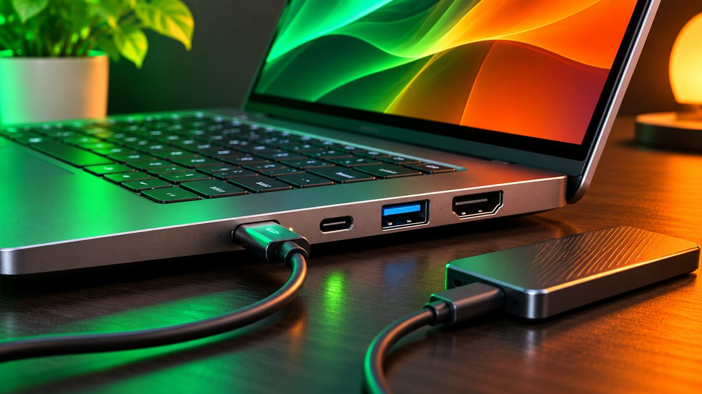

If you last looked at laptops a year ago, ₹50,000 doesn't go as far now. Memory chip prices have nearly doubled, and Business Today reports that laptops from Dell, HP and Lenovo have gone up by **15% to 30%** this year. The Lenovo ThinkBook 16 with a Ryzen 5 and 16GB of RAM, for example, was ₹46,990 in July according to 91mobiles; on Amazon today it's about **₹74,000**.

<!--more-->

So this guide is honest about what ₹50,000 actually buys in November 2026, which models are worth it, which ones to avoid, and when it makes sense to stretch your budget. We haven't tested these laptops ourselves; the picks are based on specs, current prices and published reviews.

## Quick comparison

| Laptop | Price (Amazon, Nov 7) | Processor | RAM / SSD | Screen | Best for |
|---|---|---|---|---|---|
| **Acer Aspire 3** (i3-1315U) | about ₹49,300 | Intel Core i3-1315U | 16GB / 512GB | 15.6" FHD IPS | Multitasking on a budget |
| **Acer Aspire One** (Ryzen 5 40) | about ₹45,990 | AMD Ryzen 5 40 | 8GB / 512GB | 14" | Students, with Office included |
| **HP Professional 15** (Core 3 100U) | about ₹48,000 | Intel Core 3 100U | 8GB DDR5 / 512GB | 15.6" | Office work, Windows 11 Pro |
| **HP 15** (Ryzen 3 7320U) | about ₹48,990 | AMD Ryzen 3 7320U | 8GB / 512GB | 15.6" FHD anti-glare | Basic study and streaming |

Prices change daily, often by a few thousand rupees during sales, so check the exact model and price before you buy.

## 1. Acer Aspire 3 (Core i3-1315U, 16GB): best for multitasking

At around **₹49,300**, this is one of the few laptops under ₹50,000 that still comes with **16GB of RAM** and a **512GB SSD**. The Core i3 isn't fast, but 16GB matters more for everyday use: dozens of Chrome tabs, Zoom calls and Office files at the same time won't slow it to a crawl the way 8GB laptops do. It has a 15.6-inch Full HD IPS screen.



## 2. Acer Aspire One (Ryzen 5 40): best for students

For around **₹45,990**, you get a 14-inch laptop with an AMD **Ryzen 5 40**, 8GB of RAM, a 512GB SSD and **Office 2024** included, which saves you a subscription. Note that the "Ryzen 5 40" is a renamed Ryzen 5 7520U, a 4-core chip from 2023, according to Notebookcheck. That's fine for notes, browsing, online classes and Office, but not for video editing or gaming.

The 8GB of RAM is soldered on many thin laptops like this one, so check the listing before buying if you think you'll need more later.



<figure class="inline-figure">
  
  <figcaption>Illustration</figcaption>
</figure>

## 3. HP Professional 15 (Core 3 100U): best for office work

At around **₹48,000**, this HP has Intel's **Core 3 100U**, 8GB of DDR5 RAM, a 512GB SSD and **Windows 11 Pro**, which is useful if your office needs Pro features such as BitLocker encryption. Be careful: HP also sells a similar "HP 15" with the same chip for slightly less that ships with **DOS**, meaning no Windows at all. Check the listing says Windows 11 before you pay.



## 4. HP 15 (Ryzen 3 7320U): for basic use

The HP 15 with an **AMD Ryzen 3 7320U**, 8GB of RAM and a 512GB SSD costs around **₹48,990**. Its anti-glare Full HD screen is easy on the eyes for long study sessions, but performance is basic. Buy it only if you mainly browse, stream and use Office.



## What to avoid under ₹50,000

- **Old processors in new boxes.** Some listings sell a "Ryzen 5 16GB" laptop for around ₹50,000, but with the **Ryzen 5 3500U**, a chip from 2019. Newer Core i3 or Ryzen 5 40 laptops are a better buy.
- **256GB storage.** Windows and updates take a big chunk of it. Get 512GB.
- **DOS laptops** unless you already have a Windows licence.
- **Celeron, Athlon and older Ryzen 3** chips. They're fine for a child's browsing, but frustrating for college or work.

> **Tip:** Search by the exact model number, not just "i5 16GB laptop". Sellers often list several versions of the same laptop with different chips, RAM and Windows editions at very different prices.

<figure class="inline-figure">
  
  <figcaption>Illustration</figcaption>
</figure>

## Should you stretch to ₹60,000 to ₹65,000?

If you need a laptop for coding, light video editing or several heavy apps at once, a **Core i5 or Ryzen 5 with 16GB of RAM** makes a real difference, and on November 7 those started at around:

- **Acer Aspire 3 (2026)** with Core i5-1334U, 16GB and 512GB: about **₹61,390**
- **Asus Vivobook Go 15 (2026)** with Ryzen 5 40, 16GB and 512GB: about **₹64,500**
- **Lenovo IdeaPad Slim 3** with Ryzen 5 7520U, 16GB and 512GB: about **₹65,745**

If that's out of reach, the 16GB Acer Aspire 3 at the top of this list is the best compromise. Our [laptop buying guide for college students](/laptop-buying-guide-for-college-students/) explains what each spec means.

## Our take

**What do you look at first when buying a laptop under ₹50,000?**

First, I look at the processor and RAM — at a minimum, an Intel Core i5 or Ryzen 5, 16GB of RAM, and a 512GB SSD. The battery should also be good.

**Would you suggest a Windows laptop to students, or something else like a Chromebook or MacBook?**

For students, I would suggest a Windows laptop, as it offers better performance, software compatibility, and good value for money within a budget of ₹50,000.

**Related reading:** [Laptop Buying Guide for College Students in India: What Specs You Really Need](/laptop-buying-guide-for-college-students/) · [Tablet vs Laptop for Students: Which Is Better for Study?](/tablet-vs-laptop-for-students/) · [Diwali Gadget Buying Tips: How to Get the Best Deal Online](/diwali-gadget-buying-tips/)

## The bottom line

Laptop prices have risen sharply in 2026, so ₹50,000 now mostly buys Core i3, Core 3 and entry-level Ryzen laptops. The **Acer Aspire 3 with 16GB of RAM** (about ₹49,300) is the best all-rounder, the **Acer Aspire One** (about ₹45,990) is the best value for students thanks to Office 2024, and the **HP Professional 15** (about ₹48,000) suits office work. If you need a Core i5 or Ryzen 5 with 16GB, plan for ₹60,000 to ₹65,000, or wait for a big sale.
