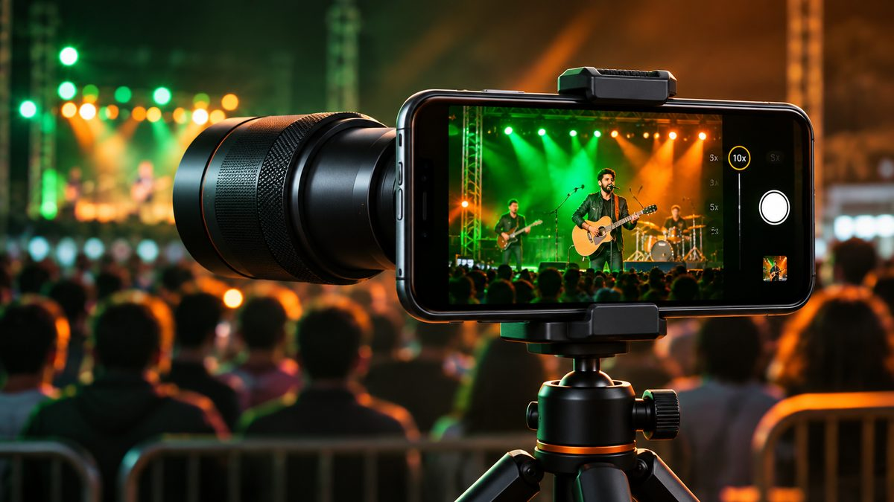

Vivo has started teasing the **X500 series** in India. Its India website now shows the X500 phones, a new **Zeiss telephoto extender** and the **Vivo Watch GT 2**, and launch pages have gone live on **Amazon** and **Flipkart**. Vivo hasn't announced the launch date or prices yet, but a well-known tipster says the phones arrive on **November 25**.

<!--more-->

The X500, X500 Pro and X500 Pro Max launched in China in September, so we already know what the hardware looks like. Here's what's confirmed for India, what's only tipped, and what to expect.

## What Vivo has confirmed for India

According to My Mobile India, which reported the teasers on November 5 and 6:

- The **X500 series** is listed as "coming soon" on Vivo's India website.
- Launch pages (microsites) are live on **Amazon** and **Flipkart**, so the phones will be sold on both, as well as on Vivo's own store.
- Vivo is also teasing the **Zeiss Telephoto Extender Gen 2 Ultra**, a clip-on lens for long zoom shots, and the **Vivo Watch GT 2** smartwatch.

That's all that's official so far. The exact models for India, the date and the prices haven't been announced.

## What's tipped, not confirmed

- **Launch date:** **November 25**, according to tipster Debayan Roy. My Mobile India calls the date tentative.
- **Models:** all three, the **X500**, **X500 Pro** and **X500 Pro Max**, are expected.
- **Pre-bookings:** The Tech Outlook reports, citing tipster Passionategeekz, that some offline shops have started taking pre-bookings. Vivo hasn't confirmed this, so treat it with caution.

## Specs (China models)

These are the specs of the phones sold in China. India models usually match, but Vivo hasn't confirmed that yet.

| | X500 | X500 Pro | X500 Pro Max |
|---|---|---|---|
| **Display** | 6.59-inch 1.5K OLED, 144Hz | 6.36-inch 1.5K OLED, 144Hz | 6.85-inch 2K OLED, 144Hz |
| **Chip** | Dimensity 9600M | Dimensity 9600 Pro | Dimensity 9600 Pro |
| **Main camera** | 50MP, OIS | 50MP Sony LYT-910, OIS | 50MP Sony LYT-910, OIS |
| **Telephoto** | 64MP, 3x | 64MP periscope, 3.5x | 200MP periscope, 3.5x |
| **Ultrawide** | 50MP | 50MP | 50MP |
| **Front camera** | 50MP | 50MP | 50MP |
| **Battery** | 7,500mAh | 6,510mAh | 8,000mAh |
| **Charging** | 90W wired, 40W wireless | 90W wired, 40W wireless | 90W wired, 40W wireless |

The **X500 Pro Max** is the one to watch. Its 200MP periscope camera and the Gen 2 Ultra extender, which My Mobile India says works only with the Pro Max, are aimed squarely at people who shoot concerts, wildlife and sport.

<figure class="inline-figure">
  
  <figcaption>Illustration</figcaption>
</figure>

## Expected price in India

Vivo hasn't announced India prices. In China, the X500 Pro starts at **CNY 6,499** and the X500 Pro Max at **CNY 6,999**, both for 12GB + 256GB. A tipster, reported by My Mobile India, expects these India prices:

| Model | Tipped India price |
|---|---|
| X500 | around ₹79,000 |
| X500 Pro | around ₹93,000 |
| X500 Pro Max | around ₹1,00,000 |

Other reports suggest a wider range, from about ₹60,000 to ₹1 lakh, so treat all of these as estimates until launch day.

> **Tip:** If you're thinking of pre-booking at a shop, ask whether the booking amount is fully refundable and get it in writing. Prices aren't announced yet, and you don't want to be locked in if the final price is higher than expected.

<figure class="inline-figure">
  
  <figcaption>Illustration</figcaption>
</figure>

## Should you wait for it?

**Wait if** you want one of the best camera phones of the year, especially for zoom, and your budget is ₹80,000 or more. The launch is only a few weeks away.

**Don't wait if** your budget is under ₹60,000, or you need a phone right now.

The Motorola Signature 27, also confirmed for India this month, is a strong alternative with a 200MP zoom camera, a 7,000mAh battery and seven years of updates. Our [Motorola Signature 27 US launch post](/motorola-signature-27-launch-us-price-specs/) has its full specs.

## Our take

<!-- Kitek's answers go here, grammar fixes only -->

**Related reading:** [Upcoming Phones Launching in India in November 2026: What's Confirmed](/upcoming-phones-launching-india-november-2026/) · [Motorola Signature 27 India Launch Confirmed for November: Expected Price and Specs](/motorola-signature-27-india-launch-november-expected-price-specs/) · [How to Sell Your Old Phone Safely in India: 9 Steps Before You Hand It Over](/sell-old-phone-safely-india-steps/)

## The bottom line

Vivo has officially started teasing the **X500, X500 Pro and X500 Pro Max** for India, with pages live on Amazon and Flipkart, but it hasn't confirmed the date or price. A tipster points to **November 25**, with prices from roughly ₹79,000 to ₹1 lakh. The X500 Pro Max, with its 200MP periscope camera and 8,000mAh battery, is the model camera fans should watch. We'll update this page as soon as Vivo announces the details.
