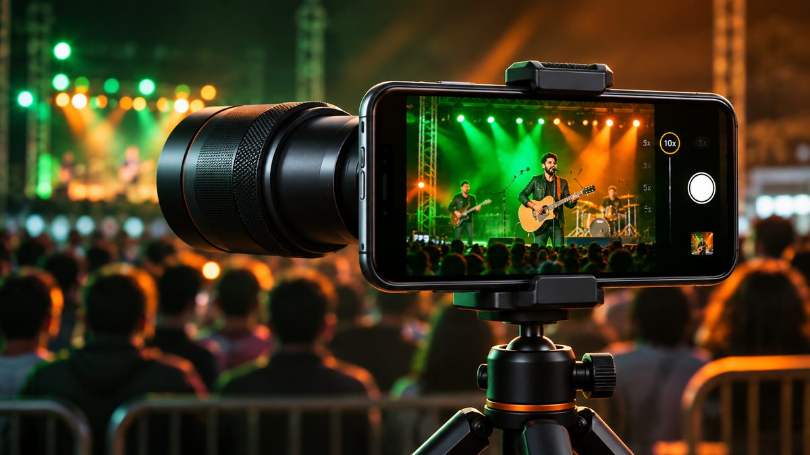

Vivo launched the **X500**, **X500 Pro** and **X500 Pro Max** in India on **November 26**, from **₹1,19,999**, with sales starting on **December 3**. This page began as our pre-launch coverage; the official prices are in the update below, and the older notes show how the tips compared.

<!--more-->

**Update, November 28:** The X500 series is now official in India (launched November 26). Per Beebom, Business Upturn and Sunday Guardian Live, the **X500** costs **₹1,19,999** (12GB + 256GB), the **X500 Pro** **₹1,49,999** (12GB + 256GB) and the **X500 Pro Max** **₹1,64,999** (12GB + 256GB) or **₹1,79,999** (12GB + 512GB). The **X500 Pro Max Photographer Kit** edition (12GB + 512GB) is **₹2,29,999**; sold separately, the Imaging Grip Kit is ₹11,999 and the 200mm Zeiss extender ₹15,999. Pre-bookings are open and **sales start December 3** on Vivo's online store; Gadgets360 (cited by Business Upturn) also lists Amazon and Flipkart. Vivo hasn't spelled out bank offers yet. One change from China: the India Pro Max has a **7,800mAh** battery, not 8,000mAh. The Pro Max price is ₹5,000 more than the tip we reported earlier.

**Update, November 25:** The launch is tomorrow, **November 26 at 12 PM IST**. Beebom and 91mobiles report that Vivo will also bring the **X500 Pro Max Photographer Kit** and the **Vivo Imaging Grip Kit** to India, alongside the Watch GT 2. India prices, RAM/storage options and the sale date are still unannounced; the ₹1,19,999 (X500) to ₹1,79,999 (Pro Max 12GB + 512GB) figures and the December 2 sale date are tipster claims until Vivo confirms them.

**Update, November 22:** Vivo's official teasers now show the India colours, as reported by My Mobile India and Cashify: the **X500** comes in **Ember Red** and **Titanium Black**, and the **X500 Pro** and **X500 Pro Max** in **Apex Orange** and **Eternal Black**. The red X500 finish wasn't sold in China. The launch is still on **November 26 at 12 PM IST**; prices, RAM/storage options and the sale date will only be announced then, so the ₹1.2 lakh-plus figures and the December 2 sale date doing the rounds are still tips.

**Update, November 15:** Newer leaks point to much higher India prices than earlier tips. Digit reports a tipster's estimate of about ₹1,19,999 for the X500, ₹1,49,999 for the X500 Pro and ₹1,59,999 for the X500 Pro Max (12GB + 256GB), and a leak of box MRPs starts at ₹1,69,999. MRP is the maximum printed price, and selling prices are usually lower. None of this is official; Vivo will announce prices on November 26.

**Update, November 12:** Vivo has now officially confirmed the India launch date: the X500 series arrives on **November 26, 2026**, one day later than the tipped November 25. My Mobile India and Business Today report a 12 PM IST launch, and PhoneBunch and My Mobile India say all three models (X500, X500 Pro and X500 Pro Max) are coming, with the **Vivo Watch GT 2** launching the same day. Prices are still unannounced and will be revealed at the event.

The X500, X500 Pro and X500 Pro Max launched in China in September, so we already know what the hardware looks like. Here's what's confirmed for India, what's only tipped, and what to expect.

## What Vivo has confirmed for India

According to My Mobile India, which reported the teasers on November 5 and 6:

- The **X500 series** is listed as "coming soon" on Vivo's India website.
- Launch pages (microsites) are live on **Amazon** and **Flipkart**, so the phones will be sold on both, as well as on Vivo's own store.
- **Colours:** Ember Red and Titanium Black for the X500; Apex Orange and Eternal Black for the X500 Pro and X500 Pro Max (Vivo teasers, reported on November 16).
- Vivo is also teasing the **Zeiss Telephoto Extender Gen 2 Ultra**, a clip-on lens for long zoom shots, and the **Vivo Watch GT 2** smartwatch.

Vivo launched the phones on **November 26**, and the official India prices are in the update at the top and in the price section below.

## What's tipped, not confirmed

- **Launch date:** tipster Debayan Roy had pointed to **November 25**; Vivo has since confirmed **November 26**.
- **Models:** all three, the **X500**, **X500 Pro** and **X500 Pro Max**, are expected.
- **Pre-bookings:** The Tech Outlook reports, citing tipster Passionategeekz, that some offline shops have started taking pre-bookings. Vivo hasn't confirmed this, so treat it with caution.

## Specs

These are the China specs. Launch reports show the India models match, except that the India X500 Pro Max has a 7,800mAh battery.

| | X500 | X500 Pro | X500 Pro Max |
|---|---|---|---|
| **Display** | 6.59-inch 1.5K OLED, 144Hz | 6.36-inch 1.5K OLED, 144Hz | 6.85-inch 2K OLED, 144Hz |
| **Chip** | Dimensity 9600M | Dimensity 9600 Pro | Dimensity 9600 Pro |
| **Main camera** | 50MP, OIS | 50MP Sony LYT-910, OIS | 50MP Sony LYT-910, OIS |
| **Telephoto** | 64MP, 3x | 64MP periscope, 3.5x | 200MP periscope, 3.5x |
| **Ultrawide** | 50MP | 50MP | 50MP |
| **Front camera** | 50MP | 50MP | 50MP |
| **Battery** | 7,500mAh | 6,510mAh | 8,000mAh (India: 7,800mAh) |
| **Charging** | 90W wired, 40W wireless | 90W wired, 40W wireless | 90W wired, 40W wireless |

The **X500 Pro Max** is the one to watch. Its 200MP periscope camera and the Gen 2 Ultra extender, which My Mobile India says works only with the Pro Max, are aimed squarely at people who shoot concerts, wildlife and sport.

<figure class="inline-figure">
  
  <figcaption>Illustration</figcaption>
</figure>

## Price in India

These are the official India prices, as reported on launch day (November 26):

| Model | RAM + storage | India price |
|---|---|---|
| X500 | 12GB + 256GB | ₹1,19,999 |
| X500 Pro | 12GB + 256GB | ₹1,49,999 |
| X500 Pro Max | 12GB + 256GB | ₹1,64,999 |
| X500 Pro Max | 12GB + 512GB | ₹1,79,999 |
| X500 Pro Max Photographer Kit | 12GB + 512GB | ₹2,29,999 |

Sales start on **December 3**. The tipped prices below are kept for comparison: the early tips were far too low.

Before the launch: in China, the X500 Pro starts at **CNY 6,499** and the X500 Pro Max at **CNY 6,999**, both for 12GB + 256GB. A tipster, reported by My Mobile India, expects these India prices:

| Model | Tipped India price |
|---|---|
| X500 | around ₹79,000 |
| X500 Pro | around ₹93,000 |
| X500 Pro Max | around ₹1,00,000 |

Newer tips (as of November 15) are much higher. Digit reports these estimates for the 12GB + 256GB models:

| Model | Newer tipped India price |
|---|---|
| X500 | around ₹1,19,999 |
| X500 Pro | around ₹1,49,999 |
| X500 Pro Max | around ₹1,59,999 (512GB: around ₹1,79,999) |

A separate leak of box MRPs (the maximum printed price, not the selling price) started at ₹1,69,999 for the X500. The newer tips turned out to be right for the X500 and X500 Pro; the Pro Max came in ₹5,000 higher.

> **Tip:** If you pre-book, ask whether the booking amount is fully refundable and get it in writing, and wait for Vivo to confirm the bank offers before you pay the full price.

<figure class="inline-figure">
  
  <figcaption>Illustration</figcaption>
</figure>

## Should you buy it?

**Consider it if** you want one of the best camera phones of the year, especially for zoom, and your budget is ₹1.2 lakh or more. Sales start on December 3.

**Skip it if** your budget is under ₹1 lakh. The official prices are much higher than the early tips of ₹80,000 to ₹1 lakh.

The Motorola Signature 27, also confirmed for India this month, is a strong alternative with a 200MP zoom camera, a 7,000mAh battery and seven years of updates. Our [Motorola Signature 27 US launch post](/motorola-signature-27-launch-us-price-specs/) has its full specs.

## Our take

**Should you buy the Vivo X500 at ₹80,000 to ₹1 lakh, or are OnePlus and Samsung better?**

In my view, within a budget of ₹80,000–₹1 lakh, the Vivo X500, Samsung, and OnePlus are all strong options, but the choice will depend on your priorities.

An important point: The Vivo X500 series has been launched in global markets, but the reported date for its India launch is November 26, 2026 (now confirmed by Vivo). It would be best to wait for the official pricing in India to be confirmed.

**Is a telephoto extender lens useful or just a gimmick?**

In my view, a telephoto extender lens is not a gimmick, but it is also not something that everyone would find useful.

If you are thinking of using it with a flagship phone like the Vivo X500, this could be an interesting accessory.

**Related reading:** [Upcoming Phones Launching in India in November 2026: What's Confirmed](/upcoming-phones-launching-india-november-2026/) · [Motorola Signature 27 Launched at $1,599: Specs, Release Date and India Launch](/motorola-signature-27-launch-us-price-specs/) · [How to Sell Your Old Phone Safely in India: 9 Steps Before You Hand It Over](/sell-old-phone-safely-india-steps/)

## The bottom line

The **X500, X500 Pro and X500 Pro Max** launched in India on **November 26** at **₹1,19,999**, **₹1,49,999** and **₹1,64,999** (₹1,79,999 for 512GB), with sales from **December 3**. These are very high prices, well above the early tips. The X500 Pro Max, with its 200MP periscope camera and 7,800mAh battery, is still the model camera fans should look at.
