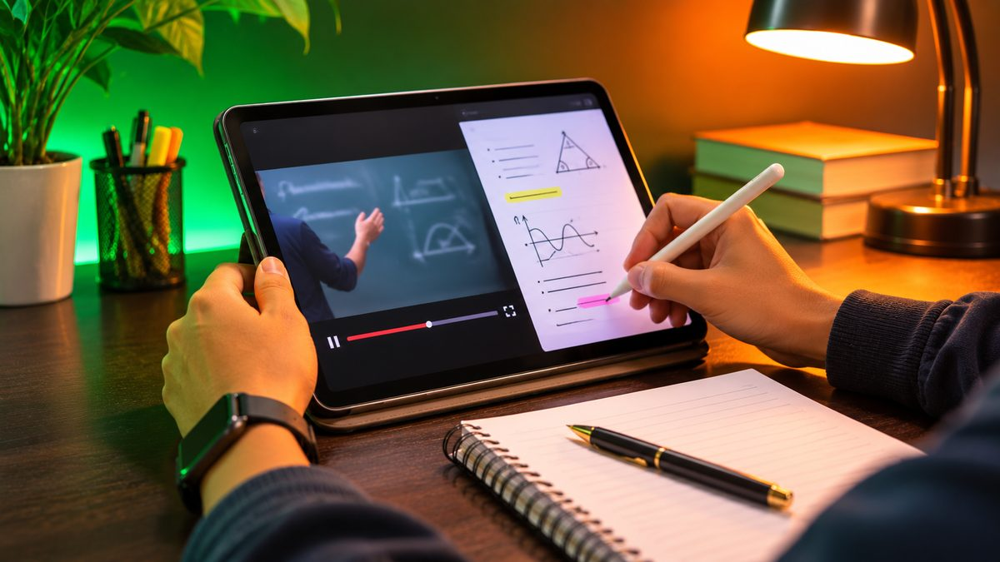
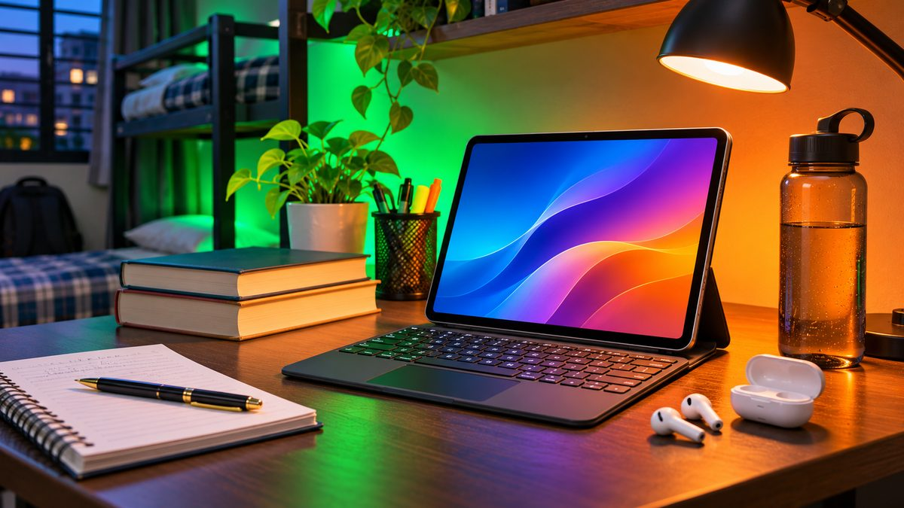

A tablet is one of the cheapest ways for a student to get a big screen for online classes, PDFs and handwritten notes. But tablet prices in India have gone up this year, so ₹20,000 now buys a little less than it did in 2025. Here are the four tablets that still make sense for study under ₹20,000, and how to pick between them.

<!--more-->

We haven't tested these tablets ourselves. The picks are based on official specs, current prices and published reviews.

## Quick comparison

| Tablet | Price (Nov 2026) | Screen | Chip | RAM / storage | Battery | Pen |
|---|---|---|---|---|---|---|
| **Redmi Pad 2** (Wi-Fi) | around ₹17,500 | 11" 2.5K, 90Hz | Helio G100 Ultra | 4GB / 128GB | 9,000mAh, 18W | Optional (₹3,999) |
| **Lenovo Idea Tab** (Wi-Fi) | around ₹18,000 to ₹21,000 | 11" 2.5K, 90Hz | Dimensity 6300 | 6GB / 128GB | 7,040mAh, 20W | Bundled on some listings |
| **OnePlus Pad Lite** (Wi-Fi) | around ₹19,000 | 11" Full HD, 90Hz | Helio G100 | 6GB / 128GB | 9,340mAh, 33W | Not a focus |
| **OPPO Pad SE** (LTE) | around ₹17,000 | 11" Full HD, 90Hz | Helio G100 | 8GB / 128GB | 9,340mAh, 33W | Not a focus |

Prices move every week, and the same tablet is often sold in four or five versions. Always check the exact RAM, storage and Wi-Fi or LTE version before you pay.

## Why prices are higher in 2026

Memory chips have become much more expensive this year, and tablets haven't escaped. In July 2026, Xiaomi raised the price of every Redmi Pad 2 version by ₹1,000, according to Beebom, so the base Wi-Fi model went from ₹16,999 to ₹17,999. The Redmi Pad 2 launched at ₹13,999 in June 2025. The OnePlus Pad Lite has also climbed from its launch price, and some good tablets from last year, such as the Moto Pad 60 Neo, are now listed above this budget outside of sales.

## 1. Redmi Pad 2: best all-rounder for most students

The **Redmi Pad 2** is the easiest recommendation. Its 11-inch **2.5K (2560 x 1600)** screen is sharper than the Full HD panels on the OnePlus and OPPO, which helps when you're reading small text in PDFs and textbooks. It runs on the **MediaTek Helio G100 Ultra**, has a big **9,000mAh battery**, four speakers with Dolby Atmos, and a **3.5mm headphone jack**, which is handy for wired earphones during classes.

It also supports the **Redmi Smart Pen** with 4,096 pressure levels, so you can write notes and annotate PDFs. The pen is sold separately for about ₹3,999, so budget for it if you want handwriting. Two small catches: charging tops out at 18W, and the charger in the box is only 15W, so a full charge takes a while. The base model also has just 4GB of RAM; if you can stretch to the 8GB Wi-Fi version (listed at ₹19,999), it will handle more apps at once.



## 2. Lenovo Idea Tab: best for handwritten notes and long support

The **Lenovo Idea Tab** also has an 11-inch **2.5K, 90Hz** screen with up to 500 nits brightness, and it uses the **Dimensity 6300**, a 5G-capable chip. Lenovo launched it in India in versions sold **with the Lenovo Tab Pen**, which makes it a good pick for students who write a lot by hand. Not every listing includes the pen, though, so make sure the product title says "with Pen".

Its biggest advantage is software support. Lenovo promised two Android upgrades (up to Android 17) and security updates until 2029, which matters if you want the tablet to last through a full degree. The battery is smaller at **7,040mAh** with 20W charging, so expect less screen time than the Redmi or OnePlus. Prices vary a lot by seller: the 6GB/128GB Wi-Fi model ranges from around ₹18,000 to ₹21,000. If you need mobile data, there's also a 5G version, but it costs more than ₹20,000 outside sales.



<figure class="inline-figure">
  
  <figcaption>Illustration</figcaption>
</figure>

## 3. OnePlus Pad Lite: best battery for long lecture days

The **OnePlus Pad Lite** is built for watching. It has the biggest battery here at **9,340mAh** with faster **33W** charging, four speakers, and OnePlus's clean OxygenOS software. That makes it a strong choice for recorded lectures, YouTube classes and streaming after study hours.

The trade-off is the screen: it's an 11-inch **Full HD (1920 x 1200)** panel, which is fine for video but not as crisp as the 2.5K screens above for reading. The **Helio G100** chip is in the same class as the Redmi's. OnePlus launched it in July 2025 at ₹15,999 for the 6GB/128GB Wi-Fi model; it now sells for around ₹19,000. Pen support is not what this tablet is about, so if handwriting matters most, choose the Redmi or Lenovo.

## 4. OPPO Pad SE: best value with mobile data

The **OPPO Pad SE** shares most of its hardware with the OnePlus Pad Lite: an 11-inch Full HD 90Hz screen, the **Helio G100**, a **9,340mAh** battery and **33W** charging. The difference is price. The **8GB RAM, 128GB, LTE** version is around ₹17,000, which gets you more RAM and a SIM slot for less than the Wi-Fi-only OnePlus.

That SIM slot is useful if you study on the bus, in a hostel with weak Wi-Fi, or anywhere without a hotspot. Like the OnePlus, it's better for watching and reading than for writing notes. Its screen also has TÜV Rheinland low blue light and flicker-free certifications, which is a small plus for long study sessions.



## Which one should you buy?

- **Most students, mixed use:** Redmi Pad 2. Sharp screen, big battery and a headphone jack.
- **Lots of handwritten notes, or you want updates until 2029:** Lenovo Idea Tab with the pen in the box.
- **Mainly online classes and video:** OnePlus Pad Lite for its battery and speakers.
- **Need mobile data on a budget:** OPPO Pad SE LTE.

> **Tip:** Before you pay, check four things on the listing: RAM (4GB, 6GB or 8GB), Wi-Fi or LTE, whether a pen is in the box, and the seller. The same tablet name can cover very different versions, and the cheapest listing is often the 4GB Wi-Fi model.

<figure class="inline-figure">
  
  <figcaption>Illustration</figcaption>
</figure>

## What to avoid

- **64GB storage.** Apps, downloaded lectures and PDFs fill it quickly. Get 128GB at least.
- **Old 2022–2023 tablets on "deals".** Older models with Snapdragon 680 or Helio G85 chips still show up under ₹15,000, but they're slower and get fewer updates.
- **Small 8-inch tablets for study.** They're fine for reading, but too cramped for split-screen notes and video classes.

If you're still deciding between a tablet and a laptop, our guide on [tablet vs laptop for students](/tablet-vs-laptop-for-students/) explains which one suits which course.

## Our take

**Is a tablet or a laptop better for studying, and which students should buy a tablet?**

A tablet is best for online classes, reading PDFs and taking handwritten notes. For coding, assignments, projects and multitasking, you should get a laptop.

**What do you check first in a tablet under ₹20,000: screen, battery, stylus or performance?**

First and foremost, I look at the screen quality, as the display is the most important factor for studying and watching videos. After that, I check the performance, battery and stylus support. I would definitely make sure it has at least 6GB of RAM and 128GB of storage.

**Which tablet from this list would you pick for yourself?**

In my view, within a ₹20,000 budget, the Lenovo Idea Tab would be the best choice for me, especially if you're interested in making handwritten notes. If you're not interested in a stylus, the Redmi Pad 2 is also a good choice.

**What's the biggest mistake students make when buying a tablet?**

The biggest mistake people make is buying a tablet based on its price and looks. If you're a student buying it for study, you should definitely look for at least 128GB of storage, a good battery, a decent display and support for a stylus (pen).

**Have you used a tablet for study or work yourself?**

Yes. It's very convenient for students to study and do daily work on a tablet. Making notes, reading PDFs and attending online classes are much easier on a tablet than on a laptop.

**Related reading:** [Tablet vs Laptop for Students: Which Is Better for Study?](/tablet-vs-laptop-for-students/) · [Best Laptops Under ₹50,000 in India (November 2026)](/best-laptops-under-50000-india/)

## The bottom line

Under ₹20,000, the **Redmi Pad 2** (around ₹17,500) is the best tablet for most students thanks to its 2.5K screen and 9,000mAh battery. Choose the **Lenovo Idea Tab** if you want a pen for notes and longer software support, the **OnePlus Pad Lite** (around ₹19,000) for the best battery for video classes, or the **OPPO Pad SE** (around ₹17,000) if you need 8GB of RAM and mobile data on a tight budget. Prices have risen in 2026, so watch for bank offers during sales, but don't settle for a 64GB or 4-year-old tablet just because it's cheaper.
