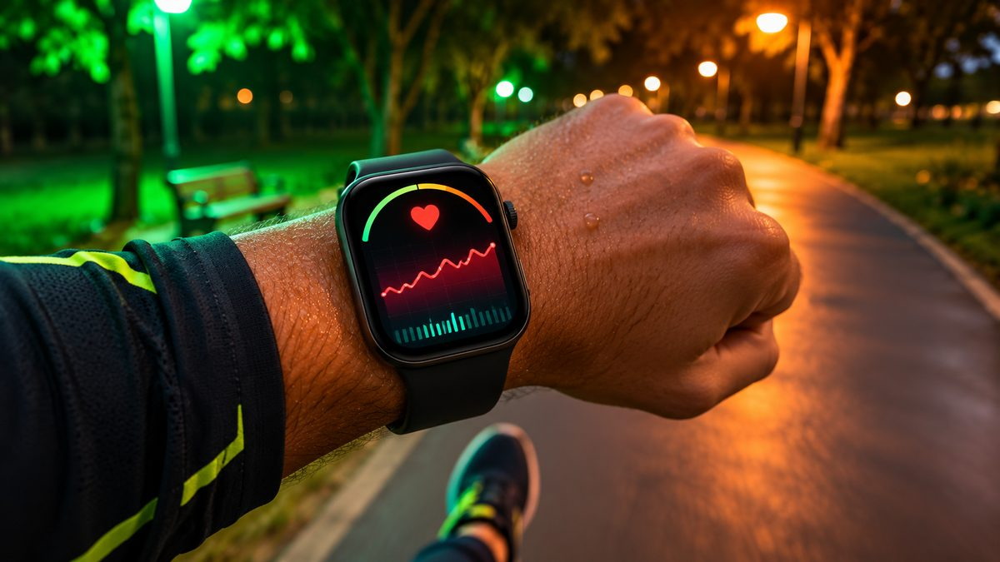
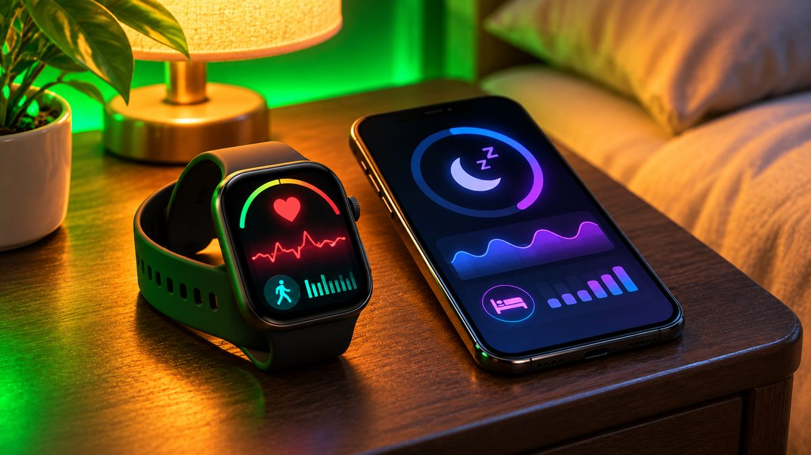

The Apple Watch SE 3 and Samsung's Galaxy Watch 8 are the two smartwatches most people look at when they want a good watch without paying flagship prices. They look like rivals, but the first thing that decides between them is not the screen or the battery. It's the phone in your pocket.

<!--more-->

## The short answer: your phone decides

An Apple Watch only works with an iPhone. Samsung's current Galaxy Watches only work with Android phones. Samsung's own support page lists every Wear OS model from the Galaxy Watch4 onward as not compatible with iPhone, because they depend on Google Play services.

So if you have an iPhone, the SE 3 is the budget pick and the Galaxy Watch is off the table. If you have an Android phone, the reverse is true. The rest of this comparison is for people deciding which phone ecosystem to buy into, households with both kinds of phone, and anyone who wants to know what each watch actually gives you for the money.

## Which Galaxy Watch counts as "budget" now?

Samsung launched the Galaxy Watch 9 in July 2026 at $379.99 for the Bluetooth model, $30 more than the Watch 8 started at. That pushes the Watch 9 out of budget territory, so the fairer match for the SE 3 is last year's Galaxy Watch 8. It is still widely sold and is regularly discounted; it dropped to around $218 for the 40mm model during Amazon's summer 2026 Prime Day sale. The older Galaxy Watch FE, which launched at $199 in 2024, is the cheapest option but runs a much older chip.

## Specs side by side

| | Apple Watch SE 3 | Samsung Galaxy Watch 8 |
|---|---|---|
| List price (Nov 2026) | from $249 (40mm), $279 (44mm) | from $349.99 (40mm), $379.99 (44mm) |
| Works with | iPhone only | Android only |
| Chip | Apple S10 | Exynos W1000 |
| Display | OLED, always-on, up to 1,000 nits | Super AMOLED, up to 3,000 nits |
| Screen glass | Ion-X glass | Sapphire crystal |
| Battery | up to 18 hours (32 in Low Power Mode) | 325mAh (40mm), 435mAh (44mm) |
| ECG | No | Yes (needs a Samsung phone) |
| Blood oxygen | No | Yes |
| Sleep apnea alerts | Yes | Yes (needs a Samsung phone) |
| Software | watchOS | Wear OS 6 with One UI 8 Watch, Gemini |

Both watches come in GPS-only and cellular versions. The SE 3 cellular models support 5G in select countries and are listed at around $299 (40mm) and $329 (44mm).

<figure class="inline-figure">
  
  <figcaption>Illustration</figcaption>
</figure>

## Apple Watch SE 3: what you get

The SE 3, launched in September 2025, closed most of the gap with Apple's pricier watches. It uses the same S10 chip as Apple's Ultra 3, so apps and Siri respond quickly. It also gained the always-on display, which earlier SE models lacked, plus the double-tap and wrist-flick gestures for answering or dismissing things without touching the screen.

On health, the SE 3 adds sleep scores, sleep apnea notifications and wrist temperature sensing for the Vitals app and retrospective ovulation estimates. Charging is about twice as fast as the previous SE, with Apple saying 15 minutes can add up to eight hours of normal use.

What it leaves out: there's no ECG app, no blood oxygen reading and no hypertension alerts. Those are reserved for the Series and Ultra models. Battery life of 18 hours means most people will charge it every day.

## Samsung Galaxy Watch 8: what you get

The Galaxy Watch 8 is Samsung's thinnest regular Galaxy Watch, about 11% slimmer than the Watch 7. Its biggest hardware edge over the SE 3 is the screen: it peaks at 3,000 nits, so it's easier to read in bright sun, and it's covered by sapphire crystal, which resists scratches better than the SE 3's Ion-X glass.

It also has more health sensors. You get ECG, blood oxygen, skin temperature, and Samsung's newer extras, including an Antioxidant Index (a quick reading of carotenoid levels), Bedtime Guidance, Vascular Load tracking during sleep, and a Running Coach. Google's Gemini assistant is built in for voice commands.

The catch is that some of the best health features are Samsung-phone only. Samsung says ECG, irregular heart rhythm notifications and sleep apnea features require a Samsung Galaxy phone. If you use a Pixel, OnePlus or Motorola phone, the Watch 8 still works, but you lose those.

> **Tip:** Check prices against the list price before you buy. Both watches are discounted often, and the SE 3 has sold for around $199 at Amazon several times this year, so a "$50 off" Black Friday tag may be the normal sale price rather than a special deal.

<figure class="inline-figure">
  
  <figcaption>Illustration</figcaption>
</figure>

## Which one should you buy?

**Buy the Apple Watch SE 3 if** you have an iPhone, want the cheapest way into the Apple Watch, and mainly care about notifications, workouts, and sleep tracking. It's the better value of the two on list price.

**Buy the Galaxy Watch 8 if** you have an Android phone, especially a Samsung Galaxy, and want ECG and blood oxygen at a lower price than a flagship. The brighter, tougher screen is a real advantage outdoors.

**Consider stepping up if** you need more. iPhone owners who want ECG and longer battery life should look at the Apple Watch Series 12. Samsung owners who want the newest chip and a larger battery can pay extra for the Galaxy Watch 9.





## Our take

**Is "Apple Watch SE for iPhone users, Galaxy Watch for Android users" the right rule, or are there exceptions?**

Yes, generally, the Apple Watch SE is a good option for iPhone users, while the Galaxy Watch is a good choice for Android users. The exception: the Galaxy Watch is not properly compatible with the iPhone, and the Apple Watch is not properly compatible with Android devices.

**What matters most in a budget smartwatch: health tracking, battery or design?**

Health tracking is the most important aspect, followed by battery life, and then design.

**Related reading:** [Best Smartwatches for iPhone in 2026](/best-smartwatches-for-iphone/) · [Black Friday 2026 Tech Deals: How to Spot a Real Discount](/black-friday-2026-tech-deals-how-to-spot-real-discount/)

## The bottom line

The Apple Watch SE 3 and Galaxy Watch 8 are both strong budget smartwatches, but they don't really compete, because each one only works with its own type of phone. iPhone owners should get the SE 3, which now has an always-on screen and a fast chip from around $249 (November 2026). Android owners should get the Galaxy Watch 8, which adds ECG, blood oxygen and a brighter sapphire screen, and is usually well below its $349.99 list price. Wait for a sale on either one, and compare against recent prices before you call it a deal.
