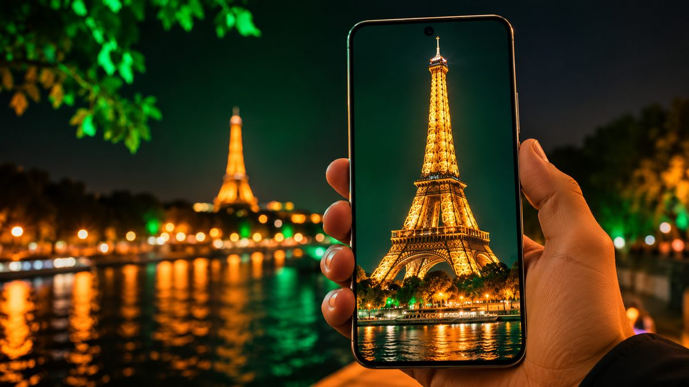
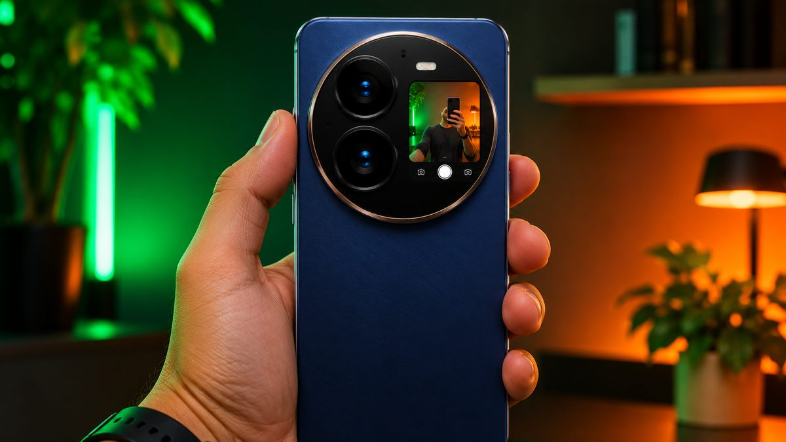

Xiaomi has confirmed that the **Xiaomi 18 Pro** and **18 Pro Max** will launch globally on **November 17, 2026**, at an event in **Paris** at 2:00 PM local time (8:00 AM ET, 1:00 PM UK, 6:30 PM IST). Both phones have been on sale in China since late September, so we already know most of the hardware. Here's what's confirmed, what may change for global buyers, and what it could cost.

<!--more-->

## What Xiaomi has confirmed

- **Date and place:** November 17, Paris. Xiaomi announced it on X with the line "See you in Paris on November 17th", and its livestream pages list the same time.
- **Models:** the Xiaomi 18 Pro and 18 Pro Max. There's no regular Xiaomi 18 at this event; Android Headlines reports it will come later.
- **Colours:** White, Cosmic Blue and Velvet Red, according to Beebom and The Tech Outlook.

Global prices and the exact global specs will be announced at the event.

## Specs (China models)

| | Xiaomi 18 Pro | Xiaomi 18 Pro Max |
|---|---|---|
| **Display** | 6.4-inch OLED, 120Hz, 4,000 nits | 6.9-inch OLED, 120Hz, 4,000 nits |
| **Rear display** | 2.7-inch, 120Hz | 2.9-inch, 120Hz |
| **Chip** | Snapdragon 8 Elite Gen 6 | Snapdragon 8 Elite Extreme Gen 6 |
| **Main camera** | 200MP Leica, OIS | 200MP Leica, OIS |
| **Telephoto** | 200MP periscope, 3.2x optical | 200MP periscope, 3.2x optical |
| **Ultrawide** | 50MP | 50MP |
| **Battery (China)** | 7,000mAh | 8,500mAh |
| **Charging** | 100W wired, 50W wireless | 100W wired, 50W wireless |

Both phones also have a **privacy display** that narrows the viewing angle so people next to you can't read your screen, and a small **screen on the back**, which you can use as a selfie viewfinder or for widgets and notifications.

<figure class="inline-figure">
  
  <figcaption>Illustration</figcaption>
</figure>

## What may change for the global version

Global versions of Chinese phones often have smaller batteries because of shipping and certification rules, and early reports suggest the Xiaomi 18 Pro series is no different:

- **Xiaomi 18 Pro:** an early Italian retail listing points to a **6,000mAh** battery and **90W** charging, according to Beebom.
- **Xiaomi 18 Pro Max:** expected to get a **7,050mAh** battery instead of 8,500mAh, while keeping 100W charging.

These are leaks, not official figures. We'll update this post after the launch.

## Expected price

In China, the phones start at:

| Model | 12GB + 256GB (China) |
|---|---|
| Xiaomi 18 Pro | CNY 5,999 |
| Xiaomi 18 Pro Max | CNY 6,999 |

Xiaomi's flagships usually cost much more in Europe than in China once taxes are added, and Android Headlines expects the global models to arrive at higher prices than last year's. We don't have reliable global price leaks yet, so wait for the official numbers on November 17.

> **Tip:** Don't pre-order from a third-party import seller before the official launch. Wait for Xiaomi's own store and authorised retailers in your country, so you get the right model, a local warranty and any launch offers.

<figure class="inline-figure">
  
  <figcaption>Illustration</figcaption>
</figure>

## Will it come to India?

Xiaomi has teased the **Xiaomi 18 Pro** for India, but it isn't clear whether India is part of the Paris event. A tipster cited by The Tech Outlook expects an Indian launch in **December 2026** and says the Pro Max may not come to India at all. Treat that as a rumour until Xiaomi confirms it.

## Who should wait for it?

**Wait if** you want a dual 200MP camera setup with strong zoom, a very bright screen and a big battery, and you're in Europe or the UK, where Xiaomi sells its flagships officially.

**Look elsewhere if** you're in the US. Xiaomi doesn't officially sell its phones there, so you'd have no local warranty, and some carrier bands may not work. The Motorola Signature 27, on sale from November 26, is the closest official alternative with a 200MP zoom camera.

## Our take

**Is a small screen on the back of a phone useful, or just a gimmick?**

The rear screen on the Xiaomi 18 Pro is useful. It allows for high-quality selfies using the main camera and lets you view notifications. It's not just a gimmick, but it's also not an essential feature for the average user.

**At what price in India would you recommend a phone like the Xiaomi 18 Pro?**

In my opinion, the Xiaomi 18 Pro would be an excellent deal at ₹85,000 to ₹90,000. You could even consider it up to ₹95,000, but I wouldn't recommend it at a price above ₹1 lakh.

**Related reading:** [Motorola Signature 27 Launched at $1,599: Specs, Release Date and Is It Worth It?](/motorola-signature-27-launch-us-price-specs/) · [Vivo X500 Series India Launch Teased: Expected Date, Price and Specs](/vivo-x500-series-india-launch-confirmed-expected-price-specs/) · [Black Friday 2026 Tech Deals: How to Spot a Real Discount](/black-friday-2026-tech-deals-how-to-spot-real-discount/)

## The bottom line

The **Xiaomi 18 Pro** and **18 Pro Max** launch globally on **November 17** in Paris. In China they offer dual 200MP Leica cameras, a rear display, a privacy screen and batteries of up to 8,500mAh, from CNY 5,999. Global versions are expected to have smaller batteries, and prices will likely be higher than last year's. We'll update this post with official prices and availability after the event.
