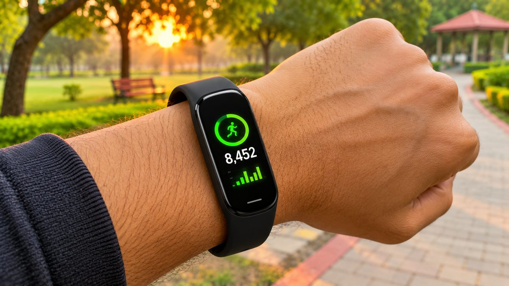
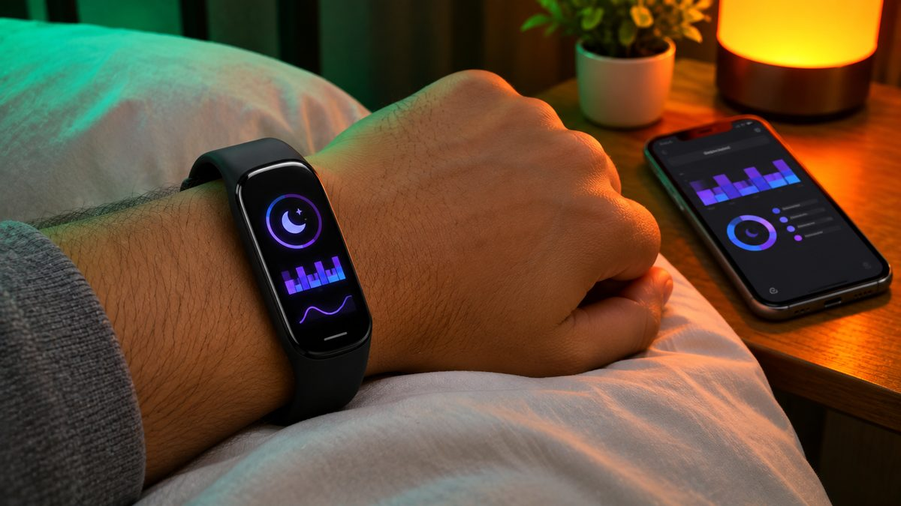

A ₹3,000 budget used to buy you a Mi Band with change to spare. In 2026 the picture is different: big-brand bands with AMOLED screens now sit just above ₹3,000 and drop below it during sales, while most bands that stay under ₹3,000 are screenless trackers or little-known brands. Here are the bands that are actually worth your money around this price, and how to time your purchase.

<!--more-->

## Quick comparison

| Band | Price (Nov 2026) | Display | Claimed battery | Water rating | Best for |
|---|---|---|---|---|---|
| Huawei Band 10 | around ₹3,500 (has dipped to ₹2,999) | 1.47-inch AMOLED | Up to 14 days (8 typical) | 5ATM | Best overall |
| Pebble Qore | around ₹2,700 | None (screenless) | Up to 45 days | 1ATM | Under ₹3,000, screen-free |
| Samsung Galaxy Fit3 | around ₹3,500 to ₹4,500 | 1.6-inch AMOLED | Up to 13 days | 5ATM + IP68 | Samsung phone owners |
| Huawei Band 11 | around ₹4,000 to ₹4,600 | 1.62-inch AMOLED | Up to 14 days (8 typical) | 5ATM | Worth stretching for |

Prices are the lowest we found on Amazon.in, Flipkart and price trackers in early November 2026, and they change often. Battery figures are the brands' own claims. None of these bands has built-in GPS, so carry your phone if you want a map of your outdoor runs.

## 1. Huawei Band 10: best overall

The Huawei Band 10 launched in India in June 2025 with an MRP of ₹6,499, but it has sold far below that ever since. It's around **₹3,500** on Flipkart right now, and price trackers show it has touched **₹2,999** before. If you can catch it at ₹3,000 or a little more, it's the band to get.

You get a **1.47-inch AMOLED screen** with always-on display support, a 9-axis motion sensor, heart rate, SpO2, sleep and stress tracking, and 100 workout modes. Huawei puts a lot of effort into swimming: the band is **5ATM rated** for pool use and the brand claims around 95% accuracy for stroke and lap counts. It weighs just 14 to 15 grams without the strap, depending on the finish.

Huawei claims up to 14 days of battery, but its own spec sheet says about **8 days with typical use** and around 3 days with always-on display switched on. It works with Android 9 or later and iOS 13 or later through the Huawei Health app.

**Best for:** most buyers who want a proper screen, swim tracking and a light band that works with any phone.



## 2. Pebble Qore: best under ₹3,000 if you don't need a screen

The Pebble Qore is part of a new wave of **screen-free wellness bands**, the budget answer to trackers like Whoop. It launched with an MRP of ₹4,999 and sells for around **₹2,700** on Amazon.

With no display, everything happens in the phone app. The band tracks heart rate, SpO2, heart-rate variability (HRV), stress, sleep and steps, offers 100+ sports modes and gives you an overall health score each day. Pebble says there's **no subscription fee**, which matters because some screenless trackers charge monthly for the same insights.

The big win is battery: Pebble claims **up to 45 days** on a charge. The downside is the **1ATM water rating**, which is fine for sweat and splashes but not for swimming. And without a screen, you can't check the time or see a notification on your wrist.

**Best for:** people who mainly care about sleep and recovery, and want something they can forget about for weeks.



> **Tip:** Fitness band prices in India swing by ₹500 to ₹1,500 within the same month. Check a price tracker before you buy, and don't be impressed by a "60% off" label: the MRP on most of these bands is far above what anyone actually pays.

<figure class="inline-figure">
  
  <figcaption>Illustration</figcaption>
</figure>

## 3. Samsung Galaxy Fit3: best for Samsung phone owners

The Galaxy Fit3 launched in India in February 2024 at ₹4,999. Its price moves a lot: it was around **₹3,500** on Amazon in late October 2026 and has been as low as ₹2,699, but some colours were back above ₹4,000 in November. Wait for a dip before you buy.

On paper it's the best-built band here. It has the largest screen of the group, a **1.6-inch AMOLED**, an aluminium body, and both a **5ATM and IP68** rating. Samsung claims up to 13 days of battery, and a 30-minute charge gets you to about 65%. You also get 100+ workout modes, sleep tracking and fall detection.

The catch is compatibility. The Fit3 works with Android phones only, and Samsung says sleep tracking needs a **Samsung Galaxy phone** running Android 10 or later. If you use an iPhone or a phone from another brand, pick the Huawei Band 10 instead. Reports suggest Samsung is preparing a successor, but nothing has been announced yet.

**Best for:** anyone with a Galaxy phone who wants their health data in Samsung Health.



## 4. Huawei Band 11: worth stretching for

The Huawei Band 11 went on sale in India in July 2026 at an MRP of ₹6,499, with a selling price of ₹3,999 at launch. Flipkart currently lists it at around **₹4,600**, so it's a stretch, but it's the newest band in this list.

The upgrades over the Band 10 are mostly about the screen: a bigger **1.62-inch AMOLED** with up to **1,500 nits** of brightness, which helps outdoors in harsh sunlight. Tracking covers heart rate, SpO2, stress and HRV-based sleep analysis, with 100+ workout modes and a 5ATM rating. Battery claims are the same as the Band 10: up to 14 days, or about 8 days with typical use.

**Best for:** buyers who want the newest model and can wait for it to return to around ₹4,000.

## What about the cheap bands under ₹3,000?

Search for fitness bands under ₹3,000 on Flipkart or Amazon and you'll see dozens of screenless bands from little-known brands, often with "MRP ₹6,999" and a big discount. Some may be fine, but be careful:

- **Check the ratings count**, not just the star score. A 5-star rating from six reviews tells you very little.
- **Look for a real brand app.** Your data lives in the app, so a poor app makes the band useless.
- **Ask about subscriptions.** Some screenless bands lock health insights behind a monthly fee.
- **Check warranty and service.** A known brand makes it far easier to get a faulty band replaced.

If you'd rather have a screen you can call from and a bigger display, our [best smartwatches under ₹5,000](/best-smartwatches-under-5000/) guide covers that side of the budget.

<figure class="inline-figure">
  
  <figcaption>Illustration</figcaption>
</figure>

## How to choose

- **Display or no display:** A screen lets you see the time, notifications and live heart rate. Screenless bands last much longer but depend fully on your phone.
- **Your phone:** iPhone owners should skip the Galaxy Fit3. Huawei and Pebble bands work with both Android and iOS.
- **Swimming:** Look for 5ATM. A 1ATM rating is only for splashes.
- **Battery claims:** Brands quote the best case. Expect roughly half with always-on display, frequent notifications or continuous SpO2 tracking switched on.

Not sure whether a band is enough for you? Our [smartwatch vs fitness band](/smartwatch-vs-fitness-band/) explainer walks through the trade-offs.

## Our take

**Should you buy a fitness band for ₹3,000, or spend a little more on a smartwatch?**

If you only need fitness and health tracking for ₹3,000, a fitness band is a better choice. However, if you want calling, a larger display and more features, spend a bit more and get a smartwatch.

**What matters most in a fitness band: battery, accuracy or the screen?**

In my view, accuracy (for steps, heart rate and sleep tracking) is the most important aspect, because the primary function of a fitness band is health tracking.

**Related reading:** [Smartwatch vs Fitness Band: Which Should You Buy?](/smartwatch-vs-fitness-band/) · [Best Smartwatches Under ₹5,000 in India (2026)](/best-smartwatches-under-5000/)

## The bottom line

For most people, the **Huawei Band 10** is the best fitness band around ₹3,000, as long as you buy it during a dip to about ₹3,000 to ₹3,500. If your budget is a strict ₹3,000 and you don't need a screen, the **Pebble Qore** gives you sleep and recovery tracking with very long battery life. Samsung phone owners should watch for a deal on the **Galaxy Fit3**, and the **Huawei Band 11** is the pick if you can spend closer to ₹4,000.
