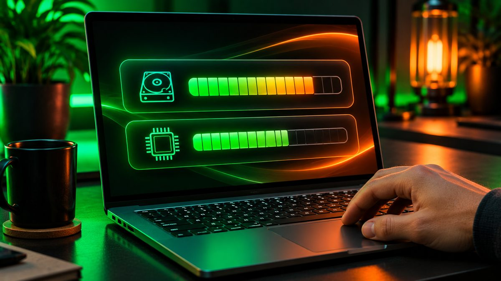
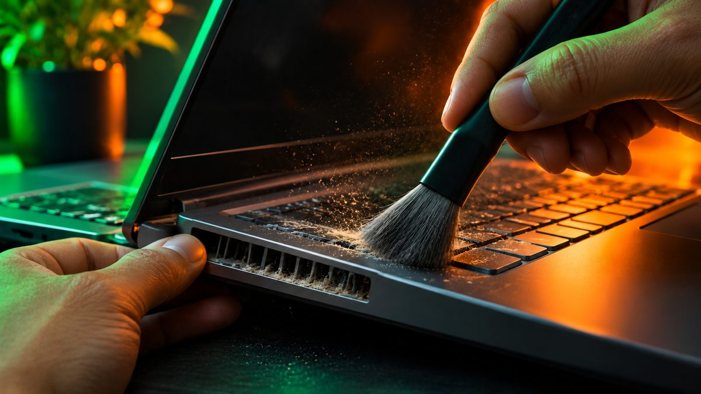

A laptop that once felt quick can slow to a crawl over a year or two, and the cause is rarely the hardware wearing out. Usually it's a pile of startup apps, a nearly full drive, a power setting that holds the processor back, or a fan clogged with dust. Here are 10 fixes in the order worth trying, starting with the free, five-minute ones.

<!--more-->

The steps below use Windows 11 menu names. Most also work on Windows 10, though a few settings sit in slightly different places.

## First, find out what's actually slow

Before you change anything, spend two minutes in Task Manager. Press **Ctrl + Shift + Esc**, then open the **Processes** tab and click the **CPU**, **Memory** and **Disk** column headers to sort by each one.

- **CPU stuck near 100%:** one app or background process is hogging the processor.
- **Memory above about 85–90%:** you're running out of RAM, so Windows starts swapping to the drive, which feels like stutter.
- **Disk at 100% for minutes on end:** common on older laptops with a hard drive, or when an update or antivirus scan is running.

Knowing which one is maxed out tells you which fixes below will help most.

## 1. Restart properly (and do it regularly)

It sounds too simple, but a real restart clears memory leaks and finishes pending updates. Use **Start > Power > Restart** rather than Shut down, because Windows' Fast Startup feature means a shutdown doesn't fully reset the system the way a restart does. If your laptop hasn't restarted in a week or more, start here.

## 2. Turn off startup apps you don't need

This is the single biggest free win on most laptops. Chat apps, game launchers, cloud drives and printer utilities all like to launch the moment you sign in, and each one eats memory in the background.

Open Task Manager, go to **Startup apps**, and look at the **Startup impact** column. Right-click anything you don't need right away and choose **Disable**. You can also do this under **Settings > Apps > Startup**. Disabling only stops the app from launching on its own; you can still open it whenever you want.

Keep your antivirus, touchpad and audio drivers enabled. If you don't recognize a name, search for it before turning it off.

## 3. Free up storage space

Windows needs room to work: space for temporary files, updates and the page file it uses when RAM runs out. A drive that's almost full slows everything down.

- Go to **Settings > System > Storage** and turn on **Storage Sense**, which clears temporary files and the Recycle Bin automatically. Open it and choose **Run Storage Sense now** for an immediate cleanup.
- In the same Storage page, open **Temporary files**, tick what you don't need, and select **Remove files**.
- Check your Downloads folder. It's often the biggest pile of forgotten files.

As a rule of thumb, aim to keep at least 10–20% of the drive free.

<figure class="inline-figure">
  
  <figcaption>Illustration</figcaption>
</figure>

## 4. Uninstall apps you never use

Many laptops ship with trial software, and most of us collect apps we tried once. Go to **Settings > Apps > Installed apps**, sort by size or install date, select the three-dot menu next to anything you don't use, and choose **Uninstall**. Fewer apps means fewer background updaters and services.

You can also stop specific apps from running in the background: in **Installed apps**, open the three-dot menu, choose **Advanced options** and set **Let this app run in the background** to **Never**. (Not every app offers this option.)

## 5. Change the power mode

Laptops often default to a balanced or battery-saving mode that caps performance. Go to **Settings > System > Power & battery** and set **Power mode** to **Best performance** while plugged in.

Expect more fan noise and faster battery drain, so switch back to Balanced when you're on battery. Also check for a performance or "turbo" mode in your laptop maker's own app (for example, Lenovo Vantage, HP's control app or MyASUS), since it can override Windows' setting.

## 6. Tame your browser

On many laptops the browser, not Windows, is what eats the RAM. Dozens of open tabs, each running scripts and video, can fill 8GB on their own.

- Close tabs you don't need, or save them as bookmarks.
- Turn on the built-in memory saver: **Memory Saver** in Chrome (Settings > Performance) or **Sleeping tabs** in Edge (Settings > System and performance).
- Remove extensions you don't use. Each one runs in the background.

> **Tip:** If Task Manager shows memory above 90% and the browser is at the top of the list, try a day with fewer tabs before spending money on anything. It's the cheapest way to find out whether you really need more RAM.

## 7. Update Windows and drivers, and scan for malware

Updates fix bugs that can cause slowdowns, and new drivers can improve graphics, Wi-Fi and battery behavior.

- **Settings > Windows Update > Check for updates**. Then look under **Advanced options > Optional updates** for driver updates.
- Run a scan: **Settings > Privacy & security > Windows Security > Virus & threat protection > Quick scan**. Malware and crypto-mining scripts often show up as unexplained high CPU use.

If you're still on Windows 10, note that ongoing security fixes now depend on the Extended Security Updates (ESU) program. Microsoft extended consumer ESU to October 12, 2027, but it only delivers security fixes, not speed improvements. If your laptop can run Windows 11, upgrading is worth considering.

## 8. Clean the vents and check for overheating

When a laptop gets too hot, the processor slows itself down to protect the hardware. This is called thermal throttling, and it's a very common reason an older laptop feels sluggish under load, especially if the fan sounds loud all the time.

- Use the laptop on a hard, flat surface, not a bed or a cushion that blocks the air intake.
- Shut it down and blow out the vents with short bursts of compressed air, or brush away visible dust.
- A cheap laptop stand that lifts the back improves airflow.

A deeper internal clean can void a warranty, so leave that to a repair shop if you're unsure.

<figure class="inline-figure">
  
  <figcaption>Illustration</figcaption>
</figure>

## 9. Trim visual effects (for older laptops)

Animations and shadows are light work for modern hardware, but they can make a low-end laptop feel laggy. Search Start for **Adjust the appearance and performance of Windows**, open the **Visual Effects** tab and choose **Adjust for best performance**. Windows will look plainer, so if you miss smooth fonts, re-tick **Smooth edges of screen fonts**. Turning off notifications you don't need (Settings > System > Notifications) also cuts background activity.

## 10. Reset Windows, or upgrade the hardware

If nothing above helps, you have two bigger options.

**Reset this PC.** Go to **Settings > System > Recovery > Reset this PC** and choose **Keep my files**. This reinstalls Windows and removes your apps, which clears years of accumulated clutter. Back up your files first anyway, and make a list of the apps you'll need to reinstall.

**Upgrade the hardware.** This helps in two cases: the laptop still has a spinning hard drive, or it has 8GB of RAM or less and memory is always full. First check what you have: in Task Manager, open **Performance > Memory**. If "Slots used" shows a free slot, RAM can be added; if the form factor shows the memory as soldered (often listed as "Row of chips"), it can't be upgraded.

Be aware that upgrades cost more than usual right now because of a global memory chip shortage:

| Upgrade | Typical price (Nov 2026) | When it's worth it |
|---|---|---|
| 1TB NVMe SSD | around $155–$230 | Laptop still uses a hard drive, or the SSD is constantly full |
| 16GB DDR5 laptop RAM | around $240–$345 | Memory regularly above 90% and a free or replaceable slot |
| New laptop | see our under-$700 guide | Laptop is 6+ years old or can't run Windows 11 |

Swapping a hard drive for an SSD is the most dramatic upgrade you can make, and it's also the clearest win at today's prices. Paying close to $300 for RAM on an old laptop is harder to justify when a new machine isn't much more. If you decide to replace it, our guide to the [best laptops for college students under $700](/best-laptops-for-college-students-under-700/) covers good-value options, and Black Friday is close, so read up on [how to spot a real discount](/black-friday-2026-tech-deals-how-to-spot-real-discount/) before you buy.

**Related reading:** [Best Laptops for College Students Under $700](/best-laptops-for-college-students-under-700/) · [Best Password Manager in 2026: Free and Paid Picks](/best-password-manager-2026/)

## The bottom line

Most slow Windows laptops can be fixed for free in under an hour. Start by checking Task Manager to see whether CPU, memory or disk is the bottleneck, then disable startup apps, free up storage, switch the power mode, and clean out the vents. A reset with "Keep my files" clears out stubborn clutter. Only spend money once the free fixes are done, and with SSD and RAM prices high in late 2026, an SSD swap on a hard-drive laptop is the upgrade most worth paying for.
