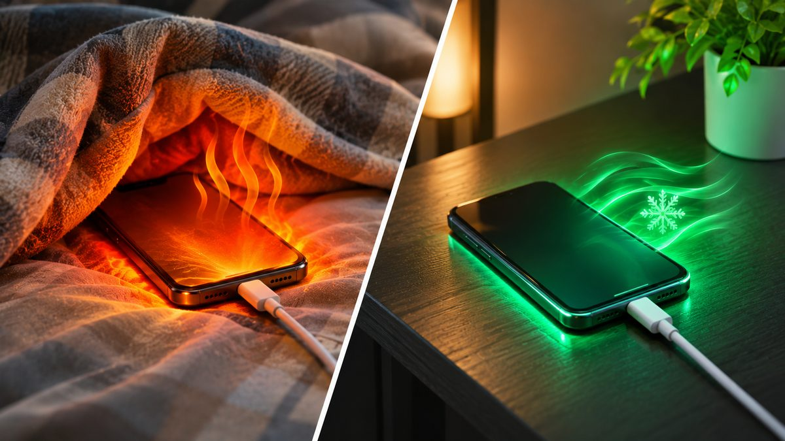
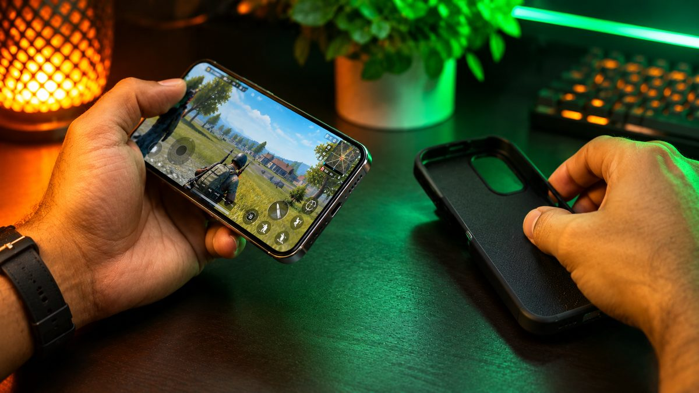

A phone that turns warm during a long game or a video call is normal. A phone that gets hot while sitting idle, shuts the camera off, or stops charging is telling you something. Here are 10 simple fixes that work on both Android phones and iPhones, plus the warning signs that mean it's time to stop using the phone and get it checked.

<!--more-->

## Why phones heat up in the first place

Your phone's processor, screen, modem and battery all produce heat, and a phone has no fan to get rid of it. Apple, Samsung and Google all list the same common causes in their support pages:

- **Heavy tasks:** gaming, streaming, long video recording, video calls, and setting up a new phone or restoring a backup.
- **Charging**, especially fast or wireless charging, and more so if you use the phone at the same time.
- **Hotspot and navigation** running for a long time, sometimes together with music or video.
- **Weak mobile signal**, which makes the modem work harder to stay connected.
- **Hot surroundings:** direct sun, a parked car, or a phone buried in a pillow, blanket or tight pocket.

Apple says iPhones are designed to be used between 0°C and 35°C. On a 40°C afternoon in Delhi or Nagpur, the air around your phone is already above that, which is why summer heating complaints are so common in India.

When a phone gets too hot, it protects itself. It may slow down charging (or pause it), dim the screen, lower game frame rates, turn off the camera flash, drop to a weaker network mode, and in extreme cases show a temperature warning or switch off. That slowdown is called **thermal throttling**, and it is a safety feature, not a fault.

## Quick reference: what's heating your phone?

| When it gets hot | Most likely cause | First fix to try |
|---|---|---|
| While charging | Charger, cable, case or using the phone while it charges | Unplug, remove the case, let it cool, then charge on a hard surface |
| During games or long video calls | Processor and screen working hard | Lower graphics and brightness, take breaks, remove the case |
| In the car or outdoors | Sun and hot air | Move it to shade, keep it off the dashboard |
| On the go with mobile data | Weak signal, hotspot or navigation | Switch to Wi-Fi, turn off hotspot when not needed |
| While idle in your pocket or on a table | A misbehaving app or a battery problem | Check battery usage, update apps, restart |

## 1. Stop, unplug and let it cool naturally

If the phone feels hot, the first fix is the simplest: stop what you're doing, unplug the charger and put the phone on a hard surface in the shade or under a fan. Apple's advice when a temperature warning appears is to turn the phone off, move it somewhere cooler and wait until it has cooled completely.

Don't put it in the fridge or freezer, and don't press ice or a cold bottle against it. A sudden temperature change can cause moisture to condense inside the phone, which is a bigger problem than the heat.

## 2. Charge it the right way

Charging is the number one heating situation for most people. A few habits make a big difference:

- **Don't charge on a bed, sofa or under a pillow.** Soft surfaces trap heat. Charge on a table or shelf.
- **Avoid heavy use while charging.** Gaming or a long video call while plugged in combines two big heat sources.
- **Use the original charger or a good branded one.** Samsung specifically lists non-genuine chargers and cables as a cause of heating. In India, look for a known brand with the BIS registration mark rather than a cheap roadside charger.
- **Keep the charging port clean.** Dust, lint or moisture in the port can cause a poor connection that gets warm.
- **For wireless charging,** remove anything metal, magnetic or card-like between the phone and the pad.

<figure class="inline-figure">
  
  <figcaption>Illustration</figcaption>
</figure>

If you want to understand watts, USB-C PD and which charger is safe for your phone, our [fast charging guide](/fast-charging-explained/) explains it simply.

## 3. Take the case off for heavy tasks

Thick rugged cases, leather wallet cases and cases with a metal plate for car mounts all hold heat in. Google recommends using only cases made for your exact model. If your phone gets hot during charging or gaming, take the case off for those sessions and see if it runs cooler.

## 4. Lower the screen brightness

A bright screen is one of the hungriest parts of a phone. Keeping it at full brightness for long periods (outdoors, or while watching videos) adds heat and drains the battery. Turn on auto-brightness and drop the slider manually when you're indoors.

## 5. Ease off during games

Games push the processor and graphics chip hard for a long time. If your phone heats up during BGMI, Free Fire or Call of Duty:

- Pick a lower graphics setting or a stable frame rate instead of the maximum.
- Play in shorter sessions, with a few minutes of break in between.
- Don't game while charging, unless your phone supports bypass charging in its game mode.

<figure class="inline-figure">
  
  <figcaption>Illustration</figcaption>
</figure>

Our guide on [how to improve gaming performance on your Android phone](/improve-gaming-performance-android-phone/) has more settings that cut lag and heat together.

## 6. Keep it out of the sun and the car

Apple warns against leaving a phone in a parked car, because the inside of a car can get far hotter than the phone's safe storage limit. The same goes for a dashboard mount in direct sun while you use Google Maps. In summer, keep the phone in shade or near an AC vent, and avoid long camera sessions in direct sunlight.

## 7. Find the app that's misbehaving

If your phone gets warm while you're not using it, a background app is often the culprit. Check battery usage:

- **Android:** Settings > Battery (the exact path varies by brand). Look for an app using a lot of battery that you barely opened.
- **iPhone:** Settings > Battery, and scroll to the list of apps.

Update or uninstall the app that stands out. On Samsung phones, **Settings > Device care > Optimise now** closes background activity in one tap.

## 8. Use Wi-Fi and switch off what you don't need

Weak signal makes the modem work harder, and hotspot keeps it running flat out. At home or in the office, use Wi-Fi instead of mobile data. Turn off hotspot when nobody is connected, and close navigation apps once you've reached.

## 9. Turn on a power-saving or lighter performance mode

Most phones have a mode that limits peak speed, which also limits heat:

- **Samsung:** Settings > Device care > Battery > Power saving, and Settings > Device care > Performance profile > Light.
- **iPhone:** Settings > Battery > Low Power Mode.
- **Other Android phones:** look for Battery saver or a balanced performance mode in Settings > Battery.

You won't notice much difference in daily use, but the phone will run cooler during long tasks.

> **Tip:** Pixel 6 and newer phones can tell you if they're running hot. Go to Settings > Battery > Battery diagnostics and look for the "Phone is very warm" check. Samsung owners can run a battery test in the Samsung Members app under Phone Diagnostics.

## 10. Update and restart

Software updates sometimes fix bugs that keep the processor busy. Install the latest system update and app updates, then restart the phone. Expect some warmth for a few hours right after a big update, because the phone re-indexes files and optimises apps in the background. That's normal and settles down by itself.

## Warning signs: when to stop using the phone

Most heating is harmless, but some signs point to a battery or hardware problem:

- The back or screen is **bulging, lifting or warped**, which can mean a swollen battery.
- The phone has an **unusual smell**.
- It is **hot while idle** and stays hot even after a restart.
- The **charger, cable or port gets very hot**.
- The battery drains much faster than it used to.

If you notice any of these, stop using and charging the phone straight away, and don't press on or try to remove the battery yourself. Take it to the brand's authorised service centre. A swollen lithium-ion battery is a fire risk, so this isn't something to put off.

If the battery is simply old and worn, our list of [simple ways to make your phone battery last longer](/make-phone-battery-last-longer/) covers the settings that protect battery health.

## Our take

**When does your phone get hot the most: gaming, charging or in the sun?**

My phone gets hot mostly while gaming and charging, especially when both happen at the same time. Using the phone in direct sunlight can also increase its temperature.

**What do you do to cool down a hot phone?**

I stop using my phone for some time, unplug the charger and also remove its cover. Then I place the phone somewhere with cool air so that it can cool down naturally.

**Do you use your phone while it's charging, or avoid it?**

I try to avoid using my phone while charging, especially for gaming and heavy tasks. This way, the phone doesn't get too hot and the battery health stays better.

**Related reading:** [Fast Charging Explained: Watts, USB-C PD and the Right Charger](/fast-charging-explained/) · [How to Improve Gaming Performance on Your Android Phone](/improve-gaming-performance-android-phone/)

## The bottom line

A warm phone during gaming, charging or a long video call is normal, and the phone slows itself down to stay safe. To keep heat in check, charge on a hard surface with a good charger, take thick cases off for heavy tasks, lower brightness, keep the phone out of the sun and the car, and use Wi-Fi where you can. Never cool it in a fridge. If the phone gets hot while idle, smells odd or starts to bulge, stop using it and get it to a service centre.
