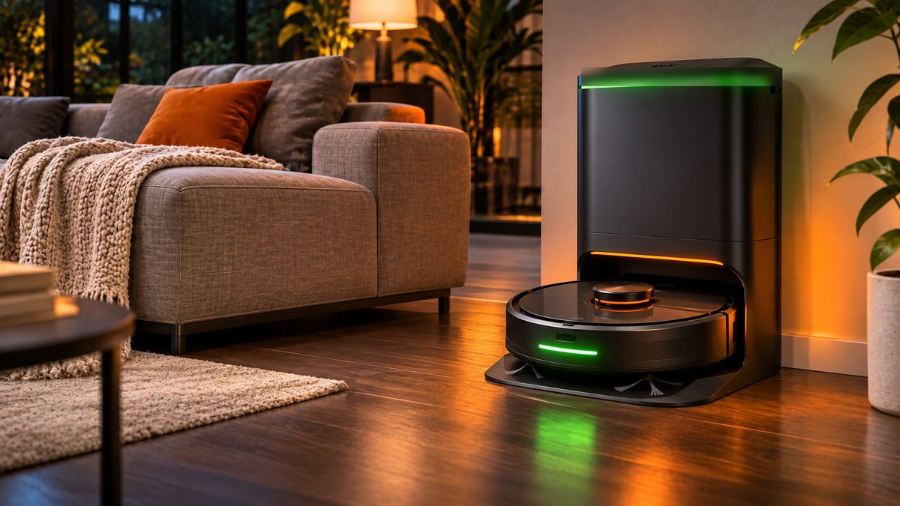
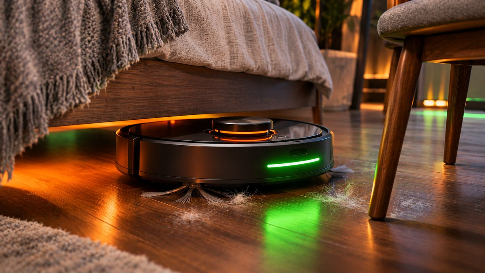

You no longer need to spend $800 to get a robot vacuum that maps your home and empties itself. Under $300 you can now get laser (LiDAR) navigation, strong suction and, on most models, a self-emptying dock. Here are the best picks at current US prices, plus the features this budget still can't buy.

<!--more-->

We haven't tested these robots ourselves. The picks are based on specs, current prices and results from established testers such as RTINGS and Vacuum Wars, listed in the sources at the end.

## Quick comparison

| Robot | Price (Nov 2026) | Navigation | Self-empty dock | Mopping | Best for |
|---|---|---|---|---|---|
| **Roborock Q7 M5+** | around $250–$300 | LiDAR | Yes (2.7L bag, up to 7 weeks) | Basic pad | Most homes |
| **Dreame D20 Air Plus** | around $228 | LiDAR | Yes (4L bag, up to 120 days) | Basic pad | Best value with a dock |
| **Roborock Q7 M5** (no dock) | around $200 | LiDAR | No | Basic pad | Smaller homes |
| **MOVA S10** | often under $200 | LiDAR | No (Plus version has one) | Vibrating pad with carpet lift | Tightest budgets |

Prices change almost daily in November, so check the listing before you buy.

## What to look for at this price

**LiDAR navigation is the big one.** A spinning laser on top of the robot maps your rooms, so it cleans in neat rows, knows where it has been and lets you set no-go zones and room-by-room schedules in the app. Cheaper "bump and go" robots wander randomly and take much longer to cover the same floor. Every pick below has LiDAR.

**A self-emptying dock saves the most effort.** After each run, the dock sucks the dirt out of the robot into a sealed bag. You only change the bag every few weeks. Without a dock, you empty a small bin by hand after every clean or two.

**Don't chase suction numbers.** Brands quote huge Pa (pascal) figures, from 7,000Pa to 20,000Pa, but they're measured differently and don't predict cleaning well. Independent test results and brush design (especially anti-tangle brushes if you have pets or long hair) matter more.

**Expect basic mopping.** At this price, mopping means a damp pad dragged behind the robot. It's fine for wiping dust off hard floors, but it won't scrub dried stains, and you fill the water tank by hand.

<figure class="inline-figure">
  
  <figcaption>Illustration</figcaption>
</figure>

## 1. Roborock Q7 M5+: best overall under $300

The **Roborock Q7 M5** is RTINGS' top budget robot vacuum, and the **Q7 M5+** is the same robot bundled with a self-emptying dock. Its LiDAR maps up to four floors, so it works in a multi-story home if you carry it between levels.

Roborock rates it at 10,000Pa with a Carpet Boost mode that raises suction on rugs. It uses a rubber comb-style main brush and an anti-tangle side brush to reduce hair wrapping. The dock holds a 2.7-liter bag that Roborock says lasts up to seven weeks. The mop has three water levels and is meant for light cleaning.

It costs around $300 on Roborock's US store and has recently sold for around $250 at Amazon (November 2026). Reviewers' main complaints: the mop only handles light dirt, and it doesn't have camera-based obstacle avoidance, so pick up cables and socks before a run.



## 2. Dreame D20 Air Plus: best value with a dock

The **Dreame D20 Air Plus** gets you LiDAR and a self-emptying dock for less than the Roborock. Dreame rates it at 20,000Pa, and the dock holds a 4-liter bag that Dreame says can last up to 120 days, which is the most hands-off option here. Dreame lists the battery at up to 150 minutes per charge, enough for an apartment or a typical single floor.

Mopping happens in the same pass as vacuuming, with an electronically controlled water tank. But the pad doesn't lift on carpet, so you'll want to remove it or set no-go zones over rugs when mopping.

It costs around $228 on Dreame's US store, in a sale that Dreame says runs until December 6 (November 2026). The downsides: like most budget robots, it can't spot small objects such as cables, it connects only to 2.4GHz Wi-Fi, and the LiDAR turret makes it too tall for some low sofas. If you see the closely related **Dreame D20 Plus** under $300 instead, Vacuum Wars rates it highly for carpet and pet hair pickup, though it scored poorly on obstacle avoidance.



## 3. Roborock Q7 M5 (no dock): best for smaller homes

If you live in a small apartment and don't mind emptying a bin, the standard **Roborock Q7 M5** gives you the same robot as our top pick without the dock. That saves money and floor space. It's around $200 on Roborock's US store (November 2026), and it has been cheaper at Amazon during some sales.

Tom's Guide praised its suction, carpet cleaning and edge detection, while noting that hair can still tangle in the brush and the mop is only for light cleaning. The docked version is sold as a separate bundle, so if you think you'll want self-emptying, get the Q7 M5+ from the start.

## 4. MOVA S10: best for tight budgets

The **MOVA S10** is the cheapest way to get LiDAR mapping from a known brand. It's often under $200, and Vacuum Wars has seen it listed for as little as about $135 on Amazon. In their testing, it scored well on deep carpet cleaning and had a long battery life, rated at up to 260 minutes on low power.

It also has a better mop than most budget robots: a vibrating pad that lifts about 7mm when it reaches carpet. The trade-offs are real, though. The standard version has no self-emptying dock, measured suction was below average and its obstacle avoidance caught only a few of Vacuum Wars' test objects. A dock version (S10 Plus) exists but is harder to find.



> **Tip:** Before the first run, spend five minutes "robot-proofing" each room: lift phone chargers and cables off the floor, tuck in curtain cords and move shoes. None of these budget robots reliably avoid small objects, and a tangled cable is the most common reason a robot gets stuck. Then use the app's no-go zones for pet bowls and rug tassels.

<figure class="inline-figure">
  
  <figcaption>Illustration</figcaption>
</figure>

## What you won't get under $300

Be realistic about the limits of this price range:

- **Camera-based obstacle avoidance** that recognizes pet messes, cables and socks is still largely missing at this price.
- **Mop washing and drying docks** (often called "omni" stations) occasionally drop near $300 in big sales, but they usually cost more.
- **Roller or spinning mops** that actually scrub are rare under $300. Budget pads mainly wipe.
- **Hot-water washing, auto-refill and detergent dispensing** are premium features.

If any of these matter, it's worth watching Black Friday prices on step-up models, but check the price history first so you don't pay for a fake discount.

**Related reading:** [Black Friday 2026 Tech Deals: How to Spot a Real Discount](/black-friday-2026-tech-deals-how-to-spot-real-discount/) · [Best 65 Inch TV in 2026: Top Picks Before Black Friday](/best-65-inch-tv-2026/)

## The bottom line

For most homes, the **Roborock Q7 M5+** is the safest buy under $300: reliable LiDAR mapping, good carpet cleaning and a dock that empties it for weeks. If you want the longest gap between bag changes for less money, the **Dreame D20 Air Plus** at around $228 is the value pick. In a small apartment, the dockless **Roborock Q7 M5** or the **MOVA S10** keeps your floors clean for around $200 or less. Whichever you choose, clear cables off the floor first, and treat the mop as a quick wipe rather than a replacement for real mopping.
