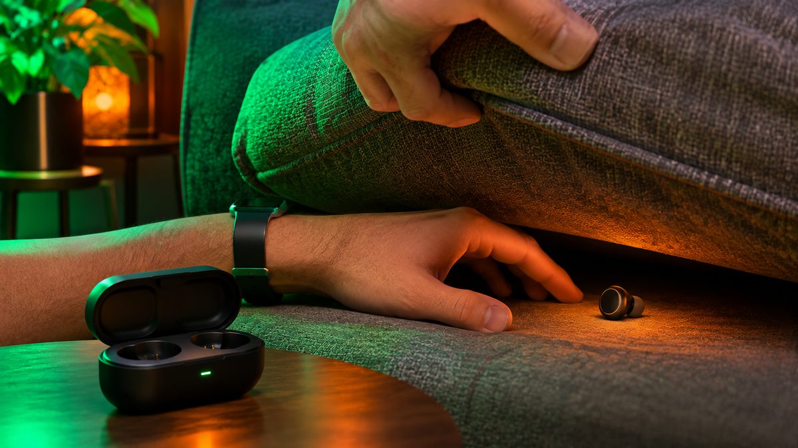

Neckbands were the default wireless earphones in India a few years ago, and they still sell well even though most shelves are now full of TWS earbuds. Both cost about the same, so the choice comes down to how you live, not how much you spend. Here's a plain comparison of where each type wins, plus the neckbands still worth buying right now.

<!--more-->

## The short answer

- **Buy a neckband** if you wear earphones for many hours a day, take a lot of calls, travel by bus or bike, or tend to lose small things.
- **Buy TWS earbuds** if you want something that fits in a pocket, you work out a lot, or you want the widest choice of models and features.

Now the details.

## Neckband vs TWS at a glance

| Feature | Neckband | TWS earbuds |
|---|---|---|
| Battery on one charge | Usually 35 to 60 hours, all in the band | 5 to 13 hours per bud, 40 to 54 hours with the case |
| Charging habit | Charge the band itself | Buds go back in the case, case needs charging |
| Risk of losing a bud | Very low, buds are attached | Real, one bud can fall out or get left behind |
| Portability | Bulkier, doesn't fit a small pocket | Case fits any pocket |
| Comfort for 6+ hours | Good, but the band sits on your neck | Good, nothing on your neck |
| Workouts and running | Band can bounce and collect sweat | Usually better, nothing moving around |
| Model choice in 2026 | Small, a handful of brands | Huge, every brand at every price |
| Typical price for ANC | Around ₹1,900 to ₹2,100 | From under ₹2,000 |

Battery figures are brand claims with noise cancelling (ANC) off.

## Battery life: neckbands usually win

A neckband has room for a bigger battery inside the band, so you charge it less often. The boAt Rockerz 255 Pro+ is rated at up to 60 hours, and even the slim OnePlus Bullets Wireless Z3 claims up to 36 hours. Many neckbands also have strong fast charging: OnePlus says 10 minutes on the Z3 gives about 27 hours of playback.

TWS earbuds can match the *total* number, but only with the case. Each bud runs for 5 to 13 hours, then needs to go back in the case. For a long train journey or a full workday with music on, a neckband is simply less hassle.

There's another point that matters if you keep earphones for years. TWS buds have tiny batteries, and they usually wear out first, often unevenly, so one bud dies before the other. A neckband's larger battery tends to age more gracefully.

<figure class="inline-figure">
  
  <figcaption>Illustration</figcaption>
</figure>

## Comfort and fit

TWS earbuds are the lighter, cleaner option. There's nothing on your neck or collar, and they're easy to wear under a helmet or with a hoodie.

Neckbands spread the weight around your neck instead of in your ears, and the buds themselves are often light. The downsides are the band under a shirt collar, sweat building up in summer, and the cable "thump" you can hear when the wires brush against clothes while you walk.

For running, gym sessions and sports, TWS earbuds are usually the better pick, because nothing bounces. If that's your main use, see our [TWS earbuds buying guide](/tws-earbuds-buying-guide/) for what to look for in fit and water resistance.

## Calls and microphones

Both types now use several mics and AI noise reduction for calls, so the gap is smaller than it used to be. Neckbands have one practical advantage: you can take a call with one bud in and let the other hang, without worrying about where you put it. Delivery riders, salespeople and anyone on calls all day often prefer neckbands for this reason.

TWS earbuds let you do the same with one bud, but the other one has to go back in the case or your pocket.

## Losing them (and replacing them)

This is the biggest reason people go back to neckbands. Drop a TWS bud on a metro platform or leave it in an auto and the pair is half useless, and single replacement buds are often hard to get from budget brands. Neckband buds are tied to the band, and most have magnetic backs that snap together when you take them out. On many models, snapping them together also pauses music or turns the earphones off, which saves battery too.

> **Tip:** If you choose TWS, check whether the brand's app has a "find my earbuds" option (the Nothing X app does on CMF and Nothing earbuds, for example). Making a lost bud play a loud sound is often the quickest way to find it under a sofa or a bag.

<figure class="inline-figure">
  
  <figcaption>Illustration</figcaption>
</figure>

## Noise cancelling, latency and features

TWS earbuds get the newest features first: stronger ANC, Bluetooth 6.0 and above, better apps and wireless charging cases. That's simply because brands launch far more TWS models.

Neckbands still cover the basics well. Several have real ANC rated around 50dB, a low-latency game mode, dual-device connection and app support. What you won't find is much choice above about ₹2,500, where TWS earbuds clearly take over.

## Neckbands worth buying in November 2026

If you've decided on a neckband, these are the models we'd shortlist. Prices are the lowest we found in mid-November 2026 and can change during sales.

### OnePlus Bullets Wireless Z3: best all-rounder without ANC

Around **₹1,850 (November 2026)** on Amazon. It has 12.4mm drivers, Bluetooth 5.4, IP55, AI call noise reduction and up to 36 hours of battery, with that 10-minute, 27-hour fast charge. There's no ANC, so it suits people who mostly listen at home, at work or outdoors.



### Realme Buds Wireless 5 ANC: best neckband with ANC

Around **₹1,900 to ₹2,000 (November 2026)**. You get up to 50dB ANC, a 13.6mm driver, a 45ms game mode, dual-device connection and IP55. Realme claims up to 38 hours with ANC off and about 20 hours with it on. This is the one for noisy daily commutes.



### CMF by Nothing Neckband Pro: ANC with a dial

Around **₹2,000 to ₹2,100 (November 2026)**, mostly on Tata Cliq and Vijay Sales, so stock can be patchy. It offers 50dB hybrid ANC, a 13.6mm driver, dual-device connection, IP55 and a handy control dial. Battery is rated at 37 hours with ANC off and 23 hours with it on.

### boAt Rockerz 255 Pro+: cheapest long-battery pick

Around **₹1,199 (November 2026)** on boAt's own store. It's a basic neckband with 10mm drivers and IPX7 water resistance, but boAt claims up to 60 hours of battery. Good as a backup pair or for someone who just wants music and calls on a small budget.



## And if you choose TWS

At the same ₹1,800 to ₹2,000 budget, TWS earbuds like the Realme Buds T310 also give you hybrid ANC and around 40 hours with the case. Our list of the [best TWS earbuds under ₹3,000](/best-tws-earbuds-under-3000/) compares the current options from OnePlus, Realme and CMF.

## Who should buy which

- **Long commutes and all-day listening:** neckband, for the battery and no case to manage.
- **Heavy callers:** neckband, for one-bud calls and buds that can't get lost.
- **Gym, running and sports:** TWS, because nothing bounces or soaks up sweat.
- **Small pockets and minimal carry:** TWS.
- **Gifting a parent or first-time user:** neckband. It's simpler, with no pairing confusion between two buds and a case.
- **Want the latest ANC and features:** TWS, especially above ₹2,500.

**Related reading:** [TWS Earbuds Buying Guide: ANC, Codecs, Battery and Mics Explained Simply](/tws-earbuds-buying-guide/) · [Best TWS Earbuds Under ₹3,000 in India (2026)](/best-tws-earbuds-under-3000/)

## The bottom line

Neckbands aren't outdated. They're still the more practical choice if you value long battery life, lots of calls and never losing a bud, and the **Realme Buds Wireless 5 ANC** or **OnePlus Bullets Wireless Z3** cover most needs for under ₹2,000. TWS earbuds are better for pockets, workouts and the newest features, and they give you far more models to choose from. Pick based on where and how long you'll wear them, not on what's trending.
