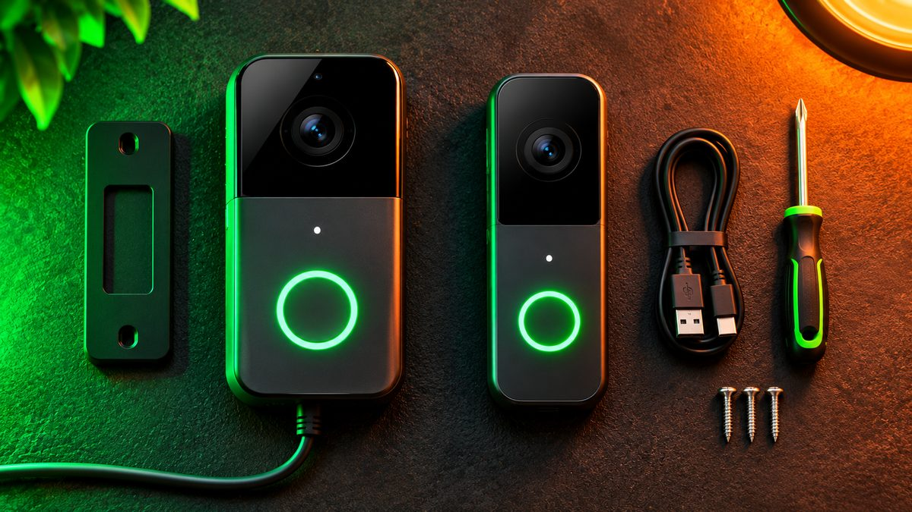

A good video doorbell no longer costs $250. Under $150 you can get sharp 2K video, alerts that tell a person from a passing car, and in several cases no monthly fee at all. The catch is that the cheapest doorbell to buy is not always the cheapest to own, because some of them need a subscription before they save any video. Here are the best picks at current US prices, with that running cost included.

<!--more-->

We haven't tested these doorbells ourselves. The picks are based on specs, current prices and results from established testers such as Consumer Reports and Expert Reviews, listed in the sources at the end.

## Quick comparison

| Doorbell | Price (Nov 2026) | Power | Saves video without a subscription? | Best for |
|---|---|---|---|---|
| **TP-Link Tapo D225** | around $80–$100 | Battery or wired | Yes (microSD card) | Most people |
| **Eufy Video Doorbell E340** | around $120–$140 on sale | Battery or wired | Yes (8GB built in) | Package theft |
| **Ring Battery Doorbell 2K** | $39.99 in Ring's Black Friday sale | Battery or wired | No (paid Ring plan) | Alexa homes |
| **Wyze Battery Video Doorbell** | around $66 | Battery or wired | Yes (microSD card) | Cheapest no-fee pick |
| **Blink Video Doorbell** | around $50, often less | AA batteries or wired | Only with a Sync Module and USB stick | Renters and simple setups |

Prices change almost daily in November, so check the listing before you buy.

## What to look for at this price

**Check what's beside your door first.** If you already have a wired doorbell, a wired-capable model never needs charging. If you don't, pick a battery model and plan to recharge it every few months, depending on how busy your door is.

**Count the subscription, not just the sticker price.** A $5-a-month plan adds $60 a year. Over three years, that's more than most doorbells here cost. Tapo, Eufy and Wyze can save clips locally with no plan. Ring and Blink need a plan (or, for Blink, an extra hub) before they keep any recordings.

**A tall, square view beats a wide one.** Doorbells sit at chest height, so packages on the mat often fall out of frame. A "head-to-toe" view or a second downward camera fixes this.

**Smart alerts matter more than resolution.** 2K is now standard. Person and package detection decides whether your phone buzzes for every car or only when someone actually walks up.

<figure class="inline-figure">
  
  <figcaption>Illustration</figcaption>
</figure>

## 1. TP-Link Tapo D225: best for most people

The **Tapo D225** covers the most needs for the money. It records 2K video with a 180-degree view, runs on its battery or on existing doorbell wiring, and comes with a plug-in chime in the box. Person, vehicle and package alerts work without a subscription, and clips save to a microSD card (up to 512GB).

Consumer Reports rates the Best Buy-exclusive version, the **Tapo TD25** (about $150, with a slightly sharper 5MP sensor), highly for response time and smart features with no extra fees. The standard D225 has sold for around $80–$100 at Amazon this year.

The trade-offs: Tapo's cloud plan is optional but the app is less polished than Ring's or Google's, and battery life depends heavily on how many alerts you get.



## 2. Eufy Video Doorbell E340: best for package theft

The **Eufy E340** has two cameras: a 2K camera for faces and a second camera pointed down at your doormat. That makes it the best pick here if parcels go missing on your street. Recordings save to 8GB of built-in storage, so there's no monthly fee and no memory card to buy.

Expert Reviews calls it the best-value dual-camera doorbell and says you can use it without a subscription, though it isn't the quickest to respond. It works on battery or wiring. Walmart lists it at $139.99 in its Black Friday deal, and Eufy's own store has had it near $120.



## 3. Ring Battery Doorbell 2K: best for Alexa homes

At $39.99, the **Ring Battery Doorbell 2K** is the cheapest doorbell here right now, down from $99.99 in Ring's Black Friday sale, which runs until November 30. It has Ring's new "Retinal 2K" video with up to 6x enhanced zoom and works smoothly with Echo speakers and displays.

The low price comes with a running cost. Without a paid Ring plan, you get live view and alerts but no saved recordings. So budget roughly $5 a month on top if you want to watch clips later. If you already use Alexa and don't mind the plan, it's the easiest setup on this list.



## 4. Wyze Battery Video Doorbell: cheapest with no fees

The **Wyze Battery Video Doorbell** is around $66 and records 1536 x 1536 video, a square frame that shows more of the porch floor than a standard widescreen view. It has a 150-degree field of view and saves clips to a microSD card, so a subscription is optional (Wyze's Cam Plus adds richer alerts and cloud storage).

It's a sensible pick if your budget is under $70 and you want to avoid monthly fees. Its smart alerts are more basic without the paid plan.



## 5. Blink Video Doorbell: simplest for renters

The **Blink Video Doorbell** is around $50 and frequently cheaper in sales. It runs on standard AA batteries that Blink says can last up to two years, so there's nothing to recharge and nothing to drill into wiring, which suits renters.

To save video, you need either a Blink subscription or a Sync Module hub with a USB stick for local storage, so check what's in the box before buying. Video and smart alerts are a step below the Tapo and Eufy.



> **Tip:** Before mounting, open the app and hold the doorbell where you plan to put it. Check that the Wi-Fi signal is strong and that the view covers your doormat. A weak signal is the most common reason for slow alerts and missed visitors, and a cheap Wi-Fi extender or mesh point near the door usually fixes it.

<figure class="inline-figure">
  
  <figcaption>Illustration</figcaption>
</figure>

## Wired or battery: which should you get?

- **Choose wired** if your home already has a doorbell button with wires. The doorbell never goes flat, alerts are usually faster, and your old indoor chime may keep working.
- **Choose battery** if you rent, have no wiring or want a five-minute install. Expect to recharge every few months, more often in cold weather or at a busy door.
- **Get a model that does both** (Tapo D225, Eufy E340, Ring, Wyze) if you're unsure. You can start on battery and hardwire later.

## Our take

**Would you buy a video doorbell for your home? Why or why not?**

Yes, I will definitely buy a video doorbell for my home. It will increase my home's security, and I can check on my phone whenever I want to see who is outside.

**How much does a monthly subscription fee matter to you when buying a doorbell?**

The subscription fee is very important to me when buying a doorbell. I would prefer a doorbell without a subscription that still gives me the basic features without any fee.

**Would you choose a wired doorbell or a battery one?**

I would prefer a battery doorbell because there is no hassle of wires and it is easy to install.

**Related reading:** [Best Robot Vacuums Under $300 in 2026](/best-robot-vacuums-under-300/) · [Black Friday 2026 Tech Deals: How to Spot a Real Discount](/black-friday-2026-tech-deals-how-to-spot-real-discount/)

## The bottom line

For most homes, the **Tapo D225** is the safest buy under $150: 2K video, free smart alerts, local storage and a chime in the box. If parcels keep disappearing, the dual-camera **Eufy E340** is worth the extra money. If you live with Alexa and accept a monthly plan, the **Ring Battery Doorbell 2K** at $39.99 is the cheapest way in until November 30. Whichever you choose, add up the subscription before you compare prices.
