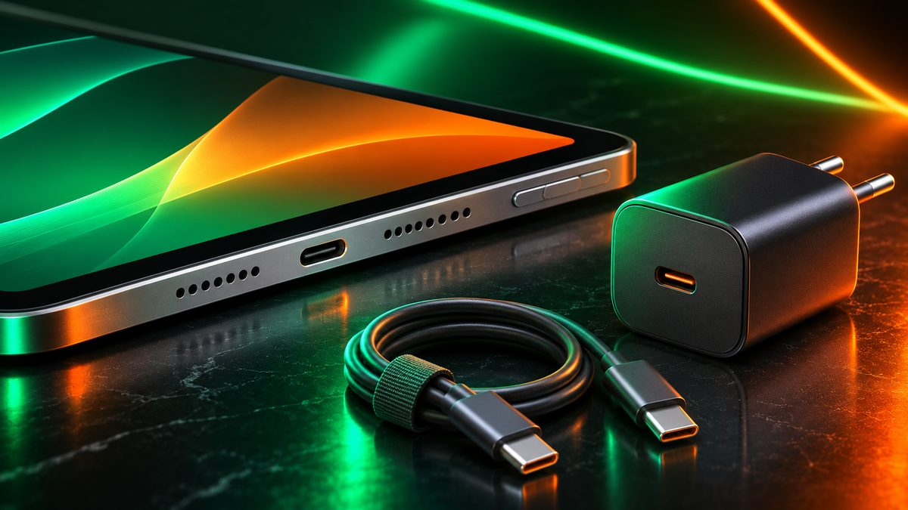
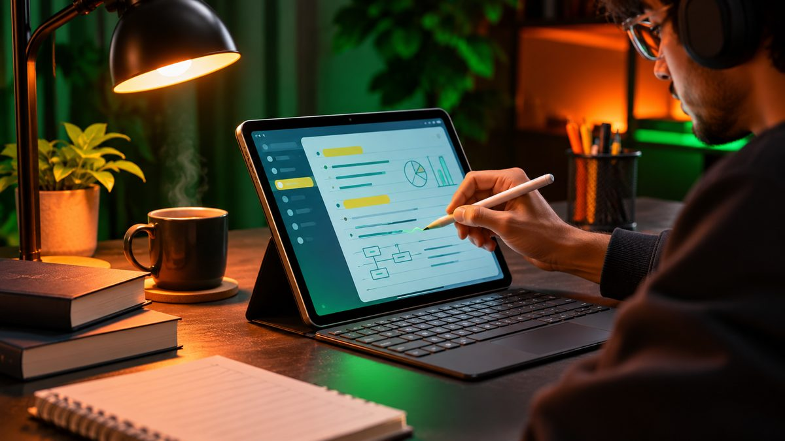

Tablet spec sheets are full of numbers, and brands love to shout about the ones that matter least. If you know which eight specs really change your daily experience, you can skip the marketing and pick the right tablet in a few minutes. Here's what to check, in plain English, and a few good tablets that tick the right boxes in India right now.

<!--more-->

This is a spec guide, not a review. We haven't tested the tablets named below; the suggestions are based on official specs and current listed prices.

## 1. Display: resolution and brightness first

You look at the screen all day, so it matters more than anything else. On an 11-inch or 12-inch tablet, look for at least **Full HD (1920 x 1200)**. A **2.5K (2560 x 1600)** panel is sharper still, which you notice when reading small text in PDFs, books or web pages.

Brightness matters too. Around 500 nits is fine indoors; if you use the tablet near a window or outdoors, more is better. A higher refresh rate (90Hz, 120Hz or 144Hz) makes scrolling look smoother, but it's a nice extra, not a reason to pay thousands more. A sharp, bright screen is worth more than a fast one.

## 2. Processor: enough power for how you use it

For video, reading, browsing and online classes, an entry chip like the MediaTek Helio G100 is enough. If you multitask, edit photos or play games, step up to a mid-range chip such as the **Dimensity 7300** or **Snapdragon 7s Gen 4**. Only buy a flagship-class chip (like the Snapdragon 8s Gen 4) if you play heavy games or do creative work.

## 3. RAM and storage: 8GB and 128GB as the sensible minimum

This is where cheap tablets cut corners. With 4GB of RAM, a tablet can slow down or reload apps when you keep a video, notes and a browser open together. **8GB of RAM and 128GB of storage** is the sensible minimum today. Avoid 64GB models; apps, downloads and offline videos fill them quickly. A microSD slot is a useful bonus for movies and documents.

## 4. Battery and charging

Tablet batteries are large: most good Android tablets now have 9,000mAh to 12,000mAh. A bigger battery generally means more screen time, but a sharper, brighter screen uses more power, so compare models in the same class.

<figure class="inline-figure">
  
  <figcaption>Illustration</figcaption>
</figure>

Charging speed matters with batteries this big. At 18W, a full charge can take hours; 33W or 45W is much more comfortable. Check whether the charger is actually in the box and how fast it is, because some brands ship a slower charger than the tablet supports.

## 5. Software updates

A tablet often lasts longer than a phone, so check how many years of Android and security updates the brand promises. For example, Xiaomi says the Redmi Pad 2 Pro gets five years of OS updates and seven years of security updates. Longer support keeps apps working and the tablet safer for years.

## 6. Stylus and keyboard support

If you plan to take handwritten notes or sketch, make sure the tablet supports an active pen with pressure levels (4,096 is common), and check whether the pen is in the box or sold separately. A Redmi Smart Pen, for example, costs around ₹3,999 extra. A keyboard case turns a tablet into a basic laptop for emails and assignments.

<figure class="inline-figure">
  
  <figcaption>Illustration</figcaption>
</figure>

## 7. Wi-Fi or SIM (cellular)

Most people use a tablet at home, in college or at the office, where Wi-Fi is enough. A SIM (LTE or 5G) version usually costs ₹2,000 to ₹6,000 more. If you need internet on the go, your phone's hotspot does the job for most people, so the Wi-Fi model is the better value for most buyers.

## 8. Speakers and HD streaming

If you watch a lot of video, four speakers make a real difference over two. Also check that the tablet supports **Widevine L1**, the DRM level that apps like Netflix and Prime Video need to stream in HD on Android. Without it, video may play in lower resolution even on a sharp screen.

> **Tip:** The same tablet name is often sold in four or five versions. Before you pay, check the exact RAM, storage, Wi-Fi or SIM, and whether a pen or charger is included. The cheapest listing is often the lowest-RAM model.

## What you can mostly ignore

- **Cameras.** Tablet cameras are fine for video calls and scanning documents. Don't pay extra for more megapixels.
- **Very high refresh rates.** 144Hz looks smooth, but a good 90Hz or 120Hz screen is plenty for most people.
- **"Up to" RAM claims.** "Extended" or "virtual" RAM uses storage and isn't the same as real RAM.

## Good options to look at right now

Tablet prices in India have gone up several times in 2026 because memory chips cost more. These are the listed prices after the latest hikes; check the live price before you buy.

### Redmi Pad 2 (8GB/128GB, Wi-Fi): best on a budget

An 11-inch 2.5K screen, a 9,000mAh battery, four speakers and pen support for around ₹20,000. It uses the entry-level Helio G100 Ultra and charges at only 18W, so it suits reading, video and classes more than gaming.



### Redmi Pad 2 Pro (8GB/128GB, Wi-Fi): best all-rounder

A 12.1-inch 2.5K 120Hz screen, the Snapdragon 7s Gen 4, a huge 12,000mAh battery with 33W charging, and five years of OS updates. It sells for around ₹27,000 to ₹28,000. The pen is sold separately.



### OnePlus Pad Go 2 (8GB/128GB, Wi-Fi): best for a big, sharp screen

A 12.1-inch 2800 x 1980 screen, the Dimensity 7300 Ultra, a 10,050mAh battery with 33W charging and support for the OnePlus stylus. After a July price hike, the 8GB/128GB Wi-Fi model is listed at around ₹29,999.



### Xiaomi Pad 8 (8GB/128GB): best for performance

If you game or edit, the Snapdragon 8s Gen 4 is the fastest chip here, with an 11.2-inch 144Hz screen, a 9,200mAh battery and 45W charging. It has had three price hikes and now sells for around ₹39,000, so only pick it if you'll use the extra power.



## Our take

**Wi-Fi or SIM tablet: which one should you buy?**

If you use the tablet mostly at home or office, the Wi-Fi one is enough. If you travel a lot and need net outside, then take the SIM one. But if net is a problem while travelling, you can use your phone hotspot and do your work, so I don't think the SIM model is really needed.

**How much RAM and storage is enough?**

These days take minimum 8GB RAM and 128GB storage. Then you can run many apps together and daily use will be smooth. A tablet with less RAM can hang when you open many apps at the same time.

**Which tablet specs are just marketing?**

I think there is no need to pay extra for camera or high refresh rate. Battery, performance and a good display are more important. I have seen people buy a tablet just for a good camera, but in daily use the display and performance matter more for them.

**Related reading:** [Best Tablets for Students in India Under ₹20,000](/best-tablets-for-students-under-20000/) · [Tablet vs Laptop for Students: Which Is Better for Study?](/tablet-vs-laptop-for-students/)

## The bottom line

When you buy a tablet, focus on a sharp, bright display, a chip that matches your use, at least 8GB of RAM and 128GB of storage, a big battery with decent charging, and a clear update promise. Add pen or keyboard support only if you'll use it, and pick Wi-Fi over SIM unless you really need data on the move. Cameras and very high refresh rates are not worth paying extra for. On a budget, the **Redmi Pad 2** (8GB) is a good start; for most people, the **Redmi Pad 2 Pro** or **OnePlus Pad Go 2** is the better balance.
