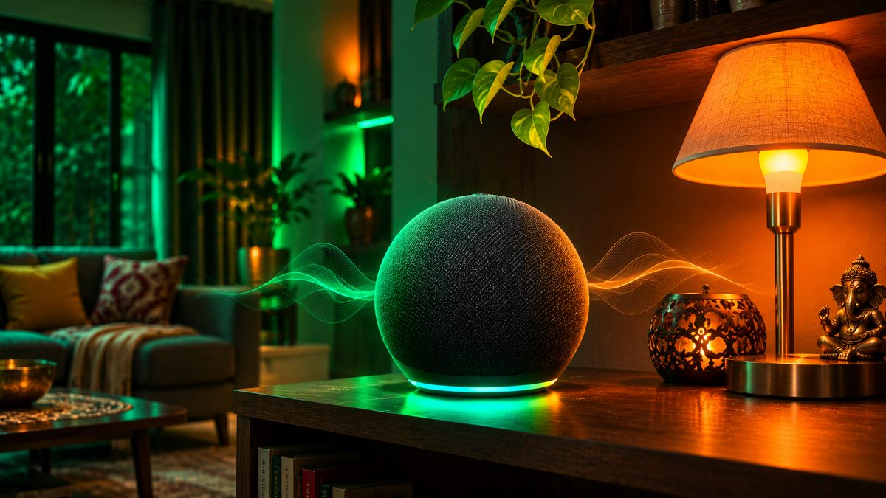
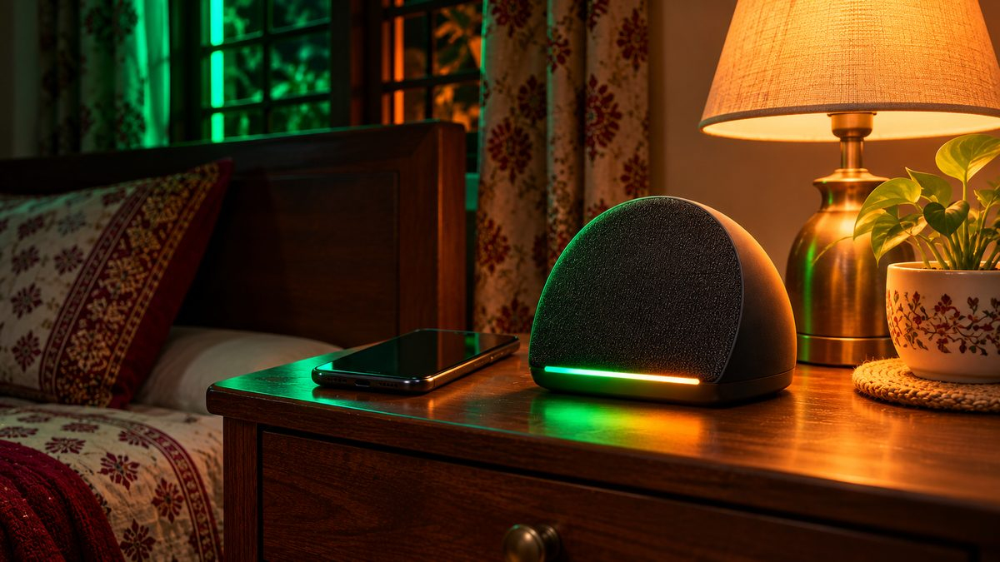

The Echo Dot and the Echo Pop are Amazon's two cheapest Alexa speakers in India, and they look like they do the same job. They mostly do, but the Dot sounds fuller and has a couple of extra sensors, while the Pop is smaller and costs less. Here's how they differ in plain English, and which one makes sense for your room and budget.

<!--more-->

This is a spec-based comparison, not a hands-on review. We haven't tested these speakers ourselves; the details come from Amazon's official information and published reviews, and prices are from listings in November 2026.

## Quick comparison

| | Echo Pop | Echo Dot (5th Gen) |
|---|---|---|
| Price (Nov 2026) | around ₹4,499 (MRP ₹4,999) | around ₹5,000 to ₹5,499 |
| Shape | Half-dome, flat front | Full ball |
| Speaker | 1.95-inch, front-firing | 1.73-inch, front-firing, fuller bass |
| Temperature sensor | No | Yes |
| Motion detection | No | Yes |
| Wi-Fi | Dual-band (2.4 and 5 GHz) | Dual-band (2.4 and 5 GHz) |
| Bluetooth | Yes | Yes |
| Matter and eero built in | Yes | Yes |
| Zigbee hub | No | No |
| 3.5mm audio out | No | No |
| Size and weight | about 99 x 83 x 91 mm, 196 g | about 100 x 100 x 89 mm, 304 g |
| Colours (vary by stock) | Charcoal, white, purple, teal | Charcoal, white, blue |

Neither has a 3.5mm jack, so if you want to plug in a bigger speaker with a cable, neither will do it. Both can pair with your phone over Bluetooth, though, so you can use them as small Bluetooth speakers too.

## Sound: the Dot is fuller, the Pop is fine for a small room

On paper the Pop has the bigger driver, but size isn't everything. The Dot's round shape gives its speaker more room inside, and reviewers consistently find it has deeper bass and a fuller sound at higher volume. The Pop fires sound out of its flat front, so it sounds best when it faces you, for example on a bedside table or desk.

<figure class="inline-figure">
  
  <figcaption>Illustration</figcaption>
</figure>

If you mostly ask Alexa for the news, cricket scores, alarms and a few bhajans or old songs in the morning, both are good enough. If you want music playing in a living room or a bigger bedroom, the Dot is the better listen.

## Smart home: almost the same, with two small extras on the Dot

Both speakers control smart plugs, bulbs, ACs and TVs that work with Alexa, and both support Matter, the newer standard that lets devices from different brands work together. Both also have a built-in eero Wi-Fi extender, but that only helps if you already use eero routers, which are not common in India.

The Dot adds two things the Pop lacks:

- **A temperature sensor.** You can ask Alexa the room temperature, or set a routine like "turn on the fan when the room is above 30°C" with a smart plug.
- **Motion detection.** The Dot can sense when someone walks into the room, which you can use in routines, such as switching on a smart light when you come home.

Neither speaker has a Zigbee hub, so devices that need a hub (some older smart bulbs and sensors) still need one. Most Wi-Fi smart plugs and bulbs sold in India don't need a hub at all.

> **Tip:** Before you buy smart bulbs or plugs to go with your Echo, check that the box says "Works with Alexa". Most Wi-Fi models set up straight from the Alexa app, with no extra hub.

## Size and where it fits

The Pop is the smaller and lighter of the two, and its half-dome shape sits neatly against a wall or on a narrow shelf. It also comes in brighter colours like purple and teal, which suit a kid's room or a study desk.

<figure class="inline-figure">
  
  <figcaption>Illustration</figcaption>
</figure>

The Dot is rounder and heavier, so it looks better in the middle of a table or shelf where sound can spread out. If you want a clock on the speaker for a bedside table, there's also an Echo Dot (5th Gen) with Clock, but it was listed as out of stock when we checked, so don't count on finding it.

## What about Alexa+?

Amazon started Alexa+, its new AI version of Alexa that understands Hindi and Hinglish, in India on September 16 as free early access. Amazon says it works on "eligible" Echo devices and will stay free for Prime members, while non-Prime users will need a Prime plan or a standalone subscription of ₹2,000 a month after early access. Amazon highlights the Echo Dot Max, Echo Studio and newer Echo Show models as designed for Alexa+. It hasn't clearly listed the Echo Dot (5th Gen) and Echo Pop in what we read, so check the Alexa app for eligibility if Alexa+ matters to you. Regular Alexa works on both either way.

## Our picks

### Echo Pop: best for a bedroom, study or tight budget

If you want Alexa for alarms, reminders, music in a small room and basic smart home control, the Pop does it for less money. It's compact, light and comes in more colours.



### Echo Dot (5th Gen): best for most homes

For a few hundred rupees more, you get fuller sound, a temperature sensor and motion detection for routines. If the speaker will sit in a living room or play music often, this is the safer pick.



### Echo Dot Max: if you want much better sound

If neither small speaker sounds big enough, the Echo Dot Max launched in India in May 2026 at ₹10,999. It has a separate 2.5-inch woofer and 0.8-inch tweeter, Wi-Fi 6E, and a built-in smart home hub with Zigbee, Thread and Matter. It costs about twice as much, so only consider it if music matters more than price.



Prices of Echo speakers drop often during Amazon sales, so check the live price before you buy.

## Our take

**Which Alexa speaker do you use at home, and for what?**

I have an Echo Dot at home. I mostly use it to listen to songs, turn the lights on and off, and sometimes to set an alarm or a timer.

**How is the sound?**

The sound is quite good for the room. For a normal bedroom or a small room it is fully enough. I never felt the need to buy a bigger speaker.

**Dot or Pop for a first-time buyer?**

If someone is buying Alexa for the first time, I will suggest the Echo Dot. It is compact in size, the sound is also good and it is enough for daily use.

**Related reading:** [Best Diwali Gift Gadgets Under ₹5,000 in India (2026)](/best-diwali-gift-gadgets-under-5000/) · [Best 43 Inch Smart TV in India (November 2026)](/best-43-inch-smart-tv-india/) · [Best Robot Vacuums Under $300 in 2026](/best-robot-vacuums-under-300/) · [Best Video Doorbells Under $150 in 2026](/best-video-doorbells-under-150/)

## The bottom line

The Echo Pop and Echo Dot (5th Gen) run the same Alexa, connect to the same smart home devices and both support Matter and Bluetooth. Buy the **Echo Pop** if the speaker goes in a bedroom or on a desk and you want to save money. Buy the **Echo Dot (5th Gen)** if you want fuller sound for music and the temperature sensor and motion detection for smarter routines; for most homes, it's worth the small extra cost. Step up to the **Echo Dot Max** only if sound quality is the main reason you're buying.
