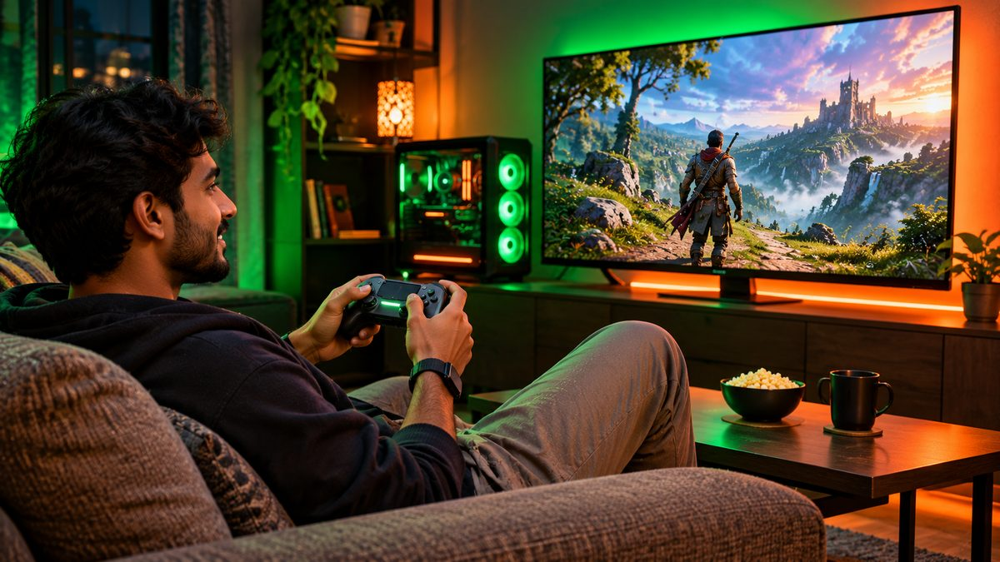
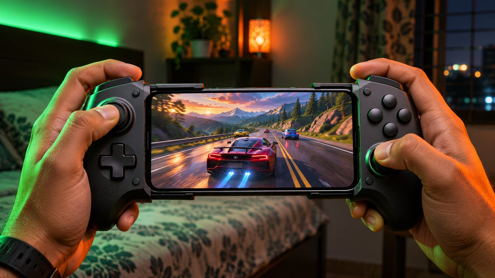

A good controller makes racing games, football games and emulators far more fun on a PC or phone, and you no longer need to spend ₹5,000 or more to get one that lasts. The trick is matching the controller to how you play: one pad for PC and phone, a clip-on for phone-only gaming, or a cheap wired pad for the desk. Here are the picks worth buying in India right now, and what to check before you pay.

<!--more-->

This is a research-based guide, not a hands-on review. We haven't tested these controllers ourselves; the details come from official support pages, product listings and published reviews, and prices are from listings checked in 2026 (dated below, because controller prices in India move a lot).

## Quick picks

| Controller | Best for | Connection | Price (India) |
|---|---|---|---|
| Cosmic Byte Ares Tri-Mode | Tight budget, PC and Android | 2.4GHz dongle, Bluetooth, USB-C | around ₹1,399 (Nov 2026) |
| 8BitDo Ultimate 2C Wired | PC on a desk | Wired USB-C | around ₹1,799 (Nov 2026) |
| EvoFox Elite X2 Pro | Best value for PC, phone and TV | 2.4GHz, Bluetooth, USB-C | around ₹2,249 (Nov 2026) |
| GameSir Nova Lite | PC, iPhone and Android | 2.4GHz, Bluetooth, USB-C | around ₹2,469 (Nov 2026) |
| Sony DualSense | PC and PS5 owners | Bluetooth, USB-C | around ₹4,390 (Nov 2026) |
| Xbox Wireless Controller | Best overall for PC games | Bluetooth, USB-C, Xbox Wireless | around ₹5,900 (Nov 2026) |
| GameSir G8 Plus | Phone-only (clip-on) gaming | Bluetooth | around ₹6,499 (Jun 2026 listing) |

## What to look for before you buy

**Hall effect sticks.** Normal thumbsticks use small physical sensors that wear out, which causes "stick drift" (your character moves when you aren't touching the stick). Hall effect sticks, and the newer TMR sticks, read position with magnets, so they're much less likely to drift. In 2026 even ₹1,500 controllers often have them, so it's worth insisting on.

**Connection type.** A 2.4GHz USB dongle is usually the most reliable and lowest-lag option for a PC. Bluetooth is what you need for phones and tablets. A wired USB-C connection is simplest for a desk PC and never needs charging. "Tri-mode" controllers do all three.

**Platform list.** Read the listing carefully. Some budget pads support PC and Android but not iPhone, and some don't work with Xbox consoles at all. If you use an iPhone, look for iOS (or MFi) support in the listing.

**Batteries.** Most budget pads have a built-in rechargeable battery. The standard Xbox controller runs on two AA batteries instead, so budget for rechargeable cells or a battery pack.

> **Tip:** Before buying a controller mainly for one mobile game, check that the game supports controllers. Many popular mobile shooters in India, such as BGMI, are designed for touch, and the common workarounds rely on third-party key-mapping apps. That can break a game's rules, so check the game's own policy first. Racing, football, cloud gaming and emulators are where controllers on phones really shine.

## Best overall for PC: Xbox Wireless Controller

If most of your gaming is on a Windows PC, the Xbox Wireless Controller is still the safest choice. PC games almost always show Xbox button prompts by default, so there's nothing to configure. It connects over Bluetooth or a USB-C cable, and it also pairs with Android phones and iPhones over Bluetooth; Apple's support page lists the Xbox Series X|S controller as compatible with iPhone and iPad.

The downsides are its price, around ₹5,900 (November 2026), and the AA batteries. It also uses standard sticks, not Hall effect ones. Buy it if you want the controller that "just works" with PC games for years.



## Best for PS5 owners: Sony DualSense

The DualSense is around ₹4,390 (November 2026), well below its ₹6,390 MRP, which makes it cheaper than the Xbox pad. Sony officially supports it on Windows 10 and 11, macOS, iPhone and iPad (iOS 14.5 or later) and Android 12 or later, over Bluetooth or USB.

There are catches. According to Sony, its special haptic feedback on PC needs a USB cable and doesn't work on Mac or phones, and its adaptive triggers don't work on Android. Some PC games also show Xbox buttons instead of PlayStation ones. It's the right pick if you already own a PS5 or want one pad for both; otherwise the cheaper options below give you more for less.

## Best value for PC, phone and TV: EvoFox Elite X2 Pro or GameSir Nova Lite

This price bracket, roughly ₹2,000 to ₹2,500, is where most people should shop. Both of these have Hall effect sticks and connect by 2.4GHz dongle, Bluetooth or cable.

- **EvoFox Elite X2 Pro** (around ₹2,249, November 2026) has Hall effect sticks and triggers and lists support for PC, Android, iOS, TVs and Switch. It doesn't work with Xbox consoles.
- **GameSir Nova Lite** (around ₹2,469, November 2026) has Hall effect sticks and supports PC, Steam, Switch, iPhone and Android. Its triggers aren't listed as Hall effect.

If you play on an iPhone as well as a PC, either works.

<figure class="inline-figure">
  
  <figcaption>Illustration</figcaption>
</figure>



## Best on a tight budget: Cosmic Byte Ares Tri-Mode

At around ₹1,399 (November 2026), the Cosmic Byte Ares Tri-Mode is one of the cheapest ways to get Hall effect sticks and triggers with dongle, Bluetooth and cable options. It supports PC and Android; on iPhone it only works with games that support MFi controllers. Its listed MRP is much higher than the selling price, so ignore the "discount" and judge it on the actual price.

If you only play on a desk PC, the **8BitDo Ultimate 2C Wired** (around ₹1,799, November 2026) is a neat alternative: no charging, Hall effect sticks and triggers, and it works with Windows PCs and Android.

## For phone-only gaming: clip-on controllers

A clip-on controller holds your phone between two grips, like a Nintendo Switch. It's more comfortable for long sessions than a phone mount on a normal pad, and it fits in a bag.

- **GameSir G8 Plus** connects over Bluetooth and has Hall effect sticks. It was listed at around ₹6,499 in India in June 2026.
- **GameSir X2s Type-C** plugs straight into your phone's USB-C port, which means no pairing and no battery, and was listed at around ₹5,991 (June 2026).

Clip-ons cost more than a full-size pad with a phone clip, so only buy one if mobile is your main platform. Many tri-mode pads above can be used with a cheap phone holder for a fraction of the price.

<figure class="inline-figure">
  
  <figcaption>Illustration</figcaption>
</figure>

## Our take

**Do you play games with a controller?**

Yes, sometimes I play games with a controller, on phone also and on PC also. I play with touch also, but with a controller it feels a bit easier.

**What would you check first before buying one?**

First I will see the price, and that it works on both phone and PC or not. Along with that, the buttons and stick should also be proper.

**Advice for someone buying in ₹2,000–2,500?**

If you are buying in ₹2,000–2,500, first check the reviews. Take one that is comfortable to hold and doesn't get spoiled quickly.

**Related reading:** [How to Improve Gaming Performance on Your Android Phone](/improve-gaming-performance-android-phone/) · [Best Gaming Phones Under ₹30,000 in India (November 2026)](/best-gaming-phones-under-30000/) · [Best Gaming Laptops Under ₹70,000 in India (November 2026): What's Left](/best-gaming-laptops-under-70000/)

## The bottom line

For most Indian gamers, a ₹2,000–2,500 tri-mode controller with Hall effect sticks, like the EvoFox Elite X2 Pro or GameSir Nova Lite, is the best buy: it works with your PC, phone and TV and won't drift. On a tight budget, the Cosmic Byte Ares Tri-Mode does the job for about ₹1,400. Spend up on the Xbox Wireless Controller if you mostly play PC games and want zero fuss, or the DualSense if you also own a PS5. Buy a clip-on like the GameSir G8 Plus only if your phone is your main gaming device, and always check the platform list and the current price before you pay.
