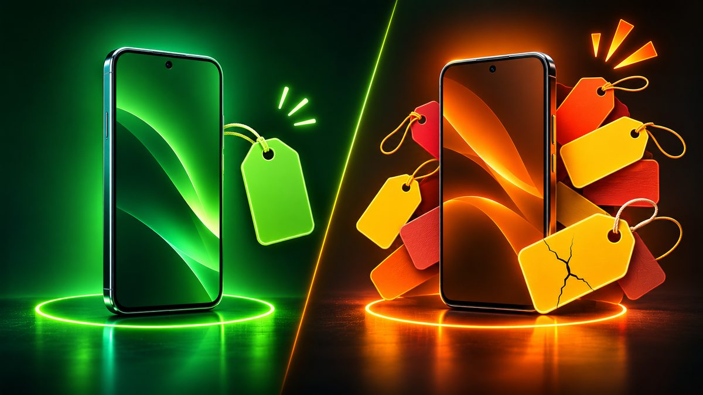
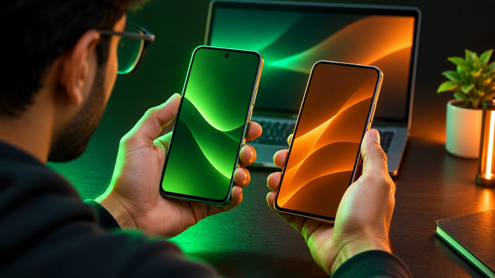

Black Friday is on November 27 this year, but phone deals have been live since Amazon and Motorola started their sales on November 19. Some of the cuts look huge, like "$450 off" a Galaxy S26 Ultra. The catch is that several phones got more expensive this fall, so a big discount isn't always a big saving. Here's which Black Friday 2026 phone deals are actually worth it, and which ones you can skip.

<!--more-->

## First, the price hikes you need to know about

On October 1, Samsung raised US prices on the whole Galaxy S26 series by $100, and the 1TB Galaxy S26 Ultra by $200. Samsung didn't give a reason, but reports blame the shortage of memory chips. So the 256GB S26 Ultra went from $1,299.99 to $1,399.99, and the base Galaxy S26 now starts at $999.99.

That matters on Black Friday. When a store says "$450 off $1,399.99", about $100 of that "saving" is just the price hike being taken back. Always compare the deal price with the **launch price** and with **earlier sale prices**, not just the crossed-out number on the page.

> **Quick test:** Before you buy, search the phone's name plus "lowest price". If the same price showed up in an earlier sale (Prime Day, back-to-school, October), the Black Friday deal is fine but not special. Don't rush.

<figure class="inline-figure">
  
  <figcaption>Illustration</figcaption>
</figure>

## The Black Friday phone deals at a glance

Prices below are unlocked models as reported between November 19 and 22, 2026. Deals change fast, so check the store before you buy.

| Phone | Black Friday price | Normal price | Worth it? |
|---|---|---|---|
| Google Pixel 11 Pro (256GB) | $749 | $1,099 | Yes, lowest price so far |
| Google Pixel 11 Pro XL | $899 | $1,299 | Yes |
| Google Pixel 11 (256GB) | $699 | $899 | Good, but seen before |
| Galaxy S26 Ultra (256GB) | $949.99 | $1,399.99 | Good, but same as June |
| Moto G Stylus (2026, 256GB) | $349.99 | $599.99 | Yes, for a budget phone |
| Nothing Phone (3) | $499 | $699 | Fair |
| iPhone 17 | Full price + $75 gift card | $899 | Only if you need an iPhone now |

## The deals that are actually worth it

### Google Pixel 11 Pro: $749 ($350 off)

This is the standout deal. The Pixel 11 Pro is down to $749 at Amazon, $350 below its $1,099 list price, and Android Authority says it's the lowest price it has ever sold for. That puts a Pro phone, with the extra telephoto camera, below what the standard Pixel 11 cost at launch. Google's own store also lists Black Friday Pixel prices, and says its phone deals run until December 5.



### Google Pixel 11 Pro XL: $899 ($400 off)

If you want a big screen, the Pro XL is $400 off at Amazon, down to $899. That's the price of a normal flagship for Google's biggest Pixel. Just know that the Pro and Pro XL share most features, so if you're fine with a smaller phone, the Pro deal above saves you another $150.



### Moto G Stylus (2026): $349.99 ($250 off)

On a budget, this is the one to look at. Motorola has the 256GB Moto G Stylus (2026) for $349.99, down from $599.99. You get a built-in stylus and plenty of storage for the price of a basic phone. It's not a flagship, so don't expect top cameras or speed, but for calls, apps and notes it's a lot of phone for the money.



## The deals that are good, but not special

### Galaxy S26 Ultra: $949.99

Amazon, Best Buy and Samsung.com all have the 256GB Galaxy S26 Ultra at $949.99, shown as "$450 off". It's a fair price for one of the best Android phones, and Samsung's own store adds $150 to spend on Galaxy accessories in the same order. But remember the price hike: compared with its $1,299.99 launch price, the real saving is $350. And Samsung already sold it for exactly $949.99 back in June. Buy it if you want it, but this isn't a once-a-year price.



### Google Pixel 11: $699

The standard Pixel 11 is $200 off at $699. It's a good price, but it's not new: Amazon had the same $699 deal at the end of October. If you missed it then, this is your second chance, not a rare one.

### Nothing Phone (3): $499

Amazon has the Nothing Phone (3) at $499, $200 off. It's a fair price for a phone with a unique design, but it's last year's model and the Pixel 11 is only $200 more.

## iPhone deals: mostly gift cards and carrier plans

Apple doesn't cut iPhone prices for Black Friday. Its Black Friday event runs from November 27 to 30 and gives an Apple gift card with some models: $50 with the iPhone 17e, $75 with the iPhone 16 or iPhone 17, and $100 with the iPhone Air. The gift card is for a future purchase, not money off the phone. The newest Pro models aren't included.

The "free iPhone" deals you'll see come from carriers. These usually need a trade-in, an unlimited plan and a 36-month contract, and the discount is paid back as monthly credits. Leave early and the credits stop. If you'd switch carriers anyway, they can be good value. If not, read our guide on [unlocked vs carrier phones](/unlocked-vs-carrier-phones/) first.

<figure class="inline-figure">
  
  <figcaption>Illustration</figcaption>
</figure>

## How to judge any phone deal in 30 seconds

1. **Compare with the launch price**, not the crossed-out price. After this fall's hikes, they're often different.
2. **Check if you've seen the price before.** A deal that showed up in June or October will likely come back.
3. **Buy unlocked from a big store** (Amazon, Best Buy, the brand's own site) unless you're happy to stay with one carrier for three years.
4. **Look at storage.** A cheap 128GB model can cost more in the long run if you run out of space.
5. **Check the return window.** Most big stores extend holiday returns into January, which gives you time to change your mind.

For more on spotting fake discounts across all gadgets, see our [Black Friday 2026 tech deals guide](/black-friday-2026-tech-deals-how-to-spot-real-discount/).

## Our take

Me, I will check the price first, before seeing the deal. Taking a phone only after seeing the discount does not seem right to me.

In Pixel 11 Pro, Galaxy S26 Ultra and Moto G Stylus, I will take the Moto G Stylus. I have to do normal work on the phone, so there is no need to take such a costly phone. If the work is done in less price, then that only is better.

I will take an unlocked phone only. Taking a phone on a 36-month contract, I don't like it. They say free phone, but after that you have to give money every month. I will like to buy the phone one time and use it as per my own wish.

**Related reading:** [Best Budget Phones Under $300 in 2026](/best-budget-phones-under-300/) · [Unlocked vs Carrier Phones: Which Should You Buy in 2026?](/unlocked-vs-carrier-phones/)

## The bottom line

The best Black Friday 2026 phone deals are on Google's phones: the Pixel 11 Pro at $749 and the Pixel 11 Pro XL at $899 are their lowest prices yet. On a budget, the Moto G Stylus (2026) at $349.99 is great value. The Galaxy S26 Ultra at $949.99 is a good price, but it's the same as June, and part of the "$450 off" just undoes October's price hike. For iPhones, expect gift cards and carrier contracts rather than real price cuts, so buy only if you need one now.
