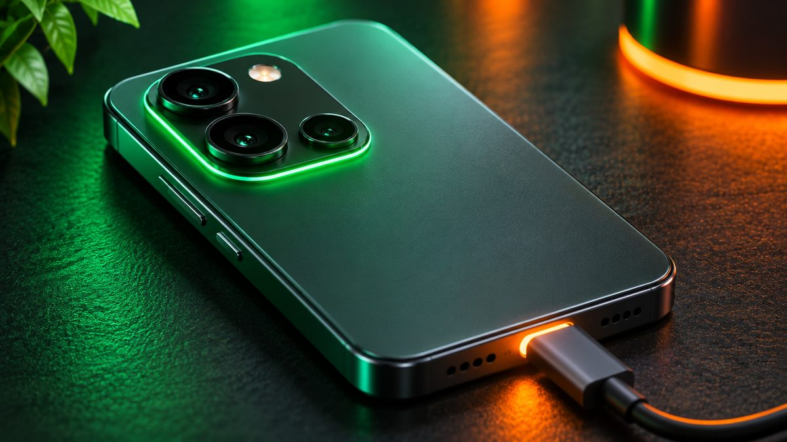

A year ago, ₹20,000 bought you a fast phone with an AMOLED screen and a good camera. In November 2026 it buys a lot less. Memory chips have become expensive, and many phones that used to sit at ₹17,000 to ₹19,000 now cost ₹23,000 or more. We checked what is actually selling under ₹20,000 on Flipkart and Amazon today, and three phones still stand out, each for a different kind of buyer.

<!--more-->

## Why ₹20,000 buys less this year

Phone brands are passing on the rising cost of RAM and storage chips. According to Digit, Counterpoint Research found that phone prices in India rose by an average of 16% in the first half of 2026, and budget phones were hit the hardest. It hasn't stopped: Inc42 reports that Samsung and Xiaomi raised prices on 48 phone variants by ₹1,000 to ₹4,000 on November 15 and 16.

You can see it in the listings. Phones that were easy picks under ₹20,000 earlier this year, like the POCO M8 5G and the iQOO Z11x, now show prices of around ₹25,000 and ₹28,000, and the CMF Phone 2 Pro is out of stock on Flipkart. So this list only includes phones that are selling under ₹20,000 right now, without counting bank offers.

## Quick comparison

| Phone | Price (Nov 24, 2026) | Chip | Display | Battery and charging | Best for |
|---|---|---|---|---|---|
| Ai+ Nova 2 Pro 5G (6GB + 128GB) | ₹17,999 on Flipkart | Dimensity 7100 | 6.9" FHD+ LCD, 144Hz | 6,000mAh, 33W | Performance and gaming |
| Samsung Galaxy M17 5G (4GB + 128GB) | ₹17,999 on Amazon | Exynos 1330 | 6.7" FHD+ Super AMOLED, 90Hz | 5,000mAh, 25W | Camera, display and updates |
| Moto G37 Power (4GB + 128GB) | ₹16,999 on Flipkart | Dimensity 6400 | 6.7" HD+ LCD, 120Hz | 7,000mAh, 30W | Battery life and clean software |

Prices change often this year, so check the live price before you pay.

## 1. Ai+ Nova 2 Pro 5G: best performance

The Nova 2 Pro comes from Ai+, the Indian brand started by former Realme India head Madhav Sheth. It has the fastest chip on this list, the Dimensity 7100, so apps open quickly and games like BGMI run smoother than on the other two. You also get a big 6.9-inch Full HD+ screen with a 144Hz refresh rate, a 6,000mAh battery and 33W charging.

The catch is software support. 91mobiles lists only one Android update and two years of security updates, which is short. Ai+ is also a new brand, so its service network is smaller than Samsung's or Motorola's. The 6GB + 128GB model is ₹17,999 on Flipkart, and the 8GB version is ₹19,999.



**Best for:** gamers and heavy users who want the most speed for the money.

<figure class="inline-figure">
  
  <figcaption>Illustration</figcaption>
</figure>

## 2. Samsung Galaxy M17 5G: best camera, display and long-term updates

The Galaxy M17 5G has the nicest screen here, a 6.7-inch Full HD+ Super AMOLED panel with Gorilla Glass Victus. Its 50MP main camera has OIS (optical image stabilisation), which helps keep photos sharp in low light and videos less shaky. Samsung also promises six Android updates and six years of security updates, by far the longest support on this list. You get NFC for tap-to-pay and IP54 splash resistance too.

The Exynos 1330 chip is fine for daily use but slower than the Dimensity 7100 in the Nova 2 Pro, and the 25W charging is the slowest here. Also note the price rise: Samsung launched the 4GB + 128GB model at ₹12,499 in October 2025, and it now sells for ₹17,999 on Amazon.



**Best for:** people who keep a phone for 3 to 4 years and care about photos and the screen.

## 3. Moto G37 Power: best battery life

If you want a phone that lasts two days, the Moto G37 Power has the biggest battery here at 7,000mAh, with 30W charging and even 6W reverse charging for topping up earbuds. It runs Motorola's clean, ad-free software, has Dolby Atmos stereo speakers, an IP64 rating and MIL-STD-810H durability testing.

The trade-offs: the screen is HD+, not Full HD+, and the Dimensity 6400 is a basic chip, fine for social media and calls but not for heavy gaming. Motorola promises only one Android update (to Android 17) and three years of security updates. The 4GB + 128GB model is ₹16,999 on Flipkart.



**Best for:** students, travellers and older parents who want long battery life and simple software.

<figure class="inline-figure">
  
  <figcaption>Illustration</figcaption>
</figure>

## Also worth a look

- **Ai+ Nova 2 Power 5G:** the same Dimensity 7100 chip as the Nova 2 Pro with a bigger 7,000mAh battery, at ₹17,999 for 6GB + 128GB on Flipkart. The screen is HD+ instead of Full HD+.
- **Phones just above ₹20,000:** the Redmi 15 (around ₹22,999, 7,000mAh, 144Hz) and the Moto G Max (launched at ₹27,999 with a Snapdragon 6s Gen 4 and 7,000mAh battery) are the next step up if you can stretch.

**One warning:** on Flipkart we found a "4GB" Moto G Max for ₹19,499 from a third-party seller. Motorola launched the G Max at ₹27,999 for 6GB + 128GB, so treat listings like this carefully, buy from the brand's own store or a trusted seller, and [check that the phone is genuine before you accept the delivery](/check-new-phone-genuine-before-accepting-delivery/).

## How to choose between them

- **Pick the Ai+ Nova 2 Pro 5G** if speed and gaming matter most.
- **Pick the Samsung Galaxy M17 5G** if you want the best screen, OIS camera and the longest updates.
- **Pick the Moto G37 Power** if battery life and clean software matter more than speed.

Not sure which specs matter? Our guide on [how to choose a smartphone under ₹20,000](/how-to-choose-a-smartphone-under-20000/) explains them in simple words. You can also compare every phone we track on our [phones by budget](/phones-by-budget/) page or take the 4-question [Phone Finder](/phone-finder/) quiz.

## Our take

In Ai+ Nova 2 Pro, Galaxy M17 and Moto G37 Power, I will think of taking the Moto G37 Power. In the phone I just need good battery and normal work should happen properly. There is no meaning of taking a costly phone every time, if the work is going on in less price.

Phone prices have already increased quite a lot. If my old phone is running fine, then I will not take a new phone now. I will run it some more, and when there will be need, then I will see.

Before taking a new brand, I will think a little. Phones of brands like Samsung and Motorola I have already seen being used, so trusting them is easy. Ai+ is a new brand, the phone can be good, but first I will see its reviews and people's experience, then I will think of taking it.

**Related reading:** [Best Phones Under ₹15,000 in India (November 2026)](/best-phones-under-15000-india/) · [How to Choose a Smartphone Under ₹20,000: 7 Specs That Actually Matter](/how-to-choose-a-smartphone-under-20000/)

## The bottom line

Under ₹20,000 in November 2026, the **Ai+ Nova 2 Pro 5G** gives you the most speed at ₹17,999, the **Samsung Galaxy M17 5G** is the safest long-term buy with its AMOLED screen, OIS camera and six years of updates, and the **Moto G37 Power** is the one to get for battery life. With prices still rising across the segment, if one of these fits your needs, buying sooner rather than later is likely to save you money.
