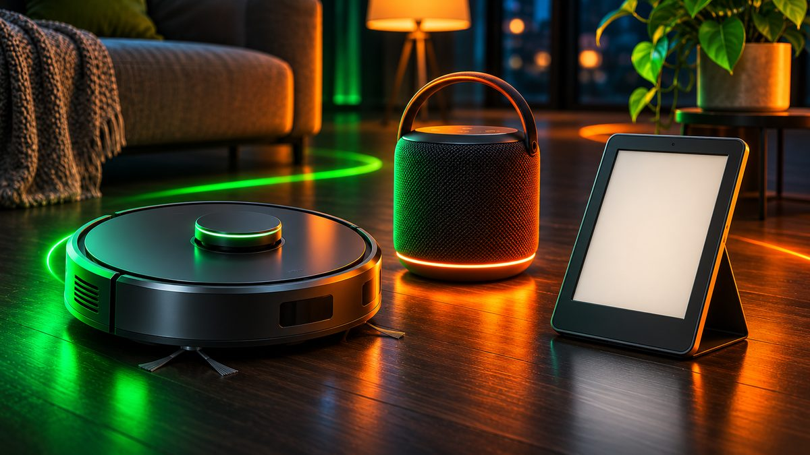

**Black Friday 2026 is on Friday, November 27, and Cyber Monday is on November 30.** Amazon's Black Friday Week sale is already running and goes on until Cyber Monday, so most of the big discounts are live right now. The problem is the same as every year: a lot of "deals" are only cheap next to an inflated list price, and many gadgets got more expensive in 2026 because of memory chip costs.

<!--more-->

So we went through the main US tech deals as of November 24 and checked each one against its regular price, its price earlier this year and, where we could, last year's Black Friday price. Below are the deals that are actually worth buying, the ones that are only okay, and the ones to skip. Prices change by the hour during this week, so always check the live price before you pay.

If you are shopping for a phone, we covered those separately in our [Black Friday 2026 phone deals guide](/black-friday-2026-phone-deals-worth-it/).

## The best deals at a glance

| Product | Black Friday price | Regular price | Where | Our verdict |
|---|---|---|---|---|
| AirPods Pro 3 | $149 | $249 | Amazon | Record low, buy |
| Apple Watch SE 3 (40mm GPS) | $179 | $249 | Amazon | Record low, buy |
| Kindle Paperwhite (16GB, 2024) | $129.99 | $199.99 | Amazon | Good deal |
| Roborock Q7 M5+ | $199.99 | $359.99 | Amazon | Great deal |
| Ring Battery Doorbell 2K | $39.99 | $99.99 | Amazon | Great deal, but needs a Ring plan |
| JBL Go 4 | $31.95 | $49.95 | Amazon, JBL | Good deal |
| Samsung Galaxy Tab A11+ (128GB) | $199 | $299 | Amazon | Good deal |
| Sony WH-CH720N | around $104 | $179.99 | Amazon | Okay, it was cheaper earlier this year |
| iPad (A16, 128GB) | $379 | $449 | Amazon | Okay, cheaper last year |
| MacBook Neo (256GB) | $649 | $699 | Amazon | Okay, still above launch price |
| TCL QM7L 65-inch | around $848 | $1,499.99 (claimed) | Amazon, Best Buy, TCL | Good, but the "was" price is inflated |
| LG C6 65-inch OLED | around $1,350 | $2,699.99 (claimed) | Walmart, Amazon | Good for an OLED, smaller real drop |

## Deals that are actually worth it

### AirPods Pro 3: $149 (was $249)

This is the best deal of the week. Amazon has the AirPods Pro 3 at $149, which is $100 off and about $20 below their previous lowest price. In the UK they are £165 (was £219). They have the strongest noise cancelling of any AirPods, a heart rate sensor and IP57 water resistance. If you use an iPhone and want earbuds, buy them now. Read our [AirPods Pro 3 vs AirPods comparison](/airpods-pro-3-vs-airpods-4/) if you are not sure which model you need.



### Apple Watch SE 3: from $179 (was $249)

The 40mm GPS Apple Watch SE 3 is $179 and the 44mm GPS model is $209, both $70 off. That beats the $199 and $229 it sold for at last year's Black Friday and at October Prime Day. It only works with an iPhone. Our [Apple Watch SE vs Galaxy Watch guide](/apple-watch-se-vs-samsung-galaxy-watch/) explains what you get and what you miss compared with the more expensive models.



### Roborock Q7 M5+: $199.99 (was $359.99)

A LiDAR robot vacuum with a self-emptying dock for $200 is a very good price. The Q7 M5+ often sells for around $250, so this is a real $50 extra drop on top of its usual discount. It is our top pick in [the best robot vacuums under $300](/best-robot-vacuums-under-300/). The Dreame D20 Air Plus is also $199.99 if the Roborock sells out.



<figure class="inline-figure">
  
  <figcaption>Illustration</figcaption>
</figure>

### Kindle Paperwhite (2024): $129.99 (was $199.99)

The 16GB Kindle Paperwhite is down $70. Note that this is the 2024 model; Amazon released a new Paperwhite this fall, and the newer models are not discounted much yet. Also remember that Amazon raised the prices of its Kindle, Echo and Fire TV devices earlier this year, so "up to 60% off" on Amazon devices partly just undoes those price hikes. Even so, the Paperwhite at $129.99 is a good price for the best Kindle for most people. See [which Kindle to buy](/which-kindle-to-buy-2026/).



### Ring Battery Doorbell 2K: $39.99 (was $99.99)

At $40 this is the cheapest good video doorbell you can buy this week. The catch: it does not save video unless you pay for a Ring plan every month. If you don't want a subscription, look at the TP-Link Tapo D225 in our [video doorbells under $150 guide](/best-video-doorbells-under-150/).

### JBL Go 4: $31.95 (was $49.95)

JBL calls this the lowest price of the year on its own store, and Amazon has the same price. The JBL Clip 5 is $49.95 (was $79.95). Both are good small speakers; see [the best Bluetooth speakers under $50](/best-bluetooth-speakers-under-50/) for the full list.

### Samsung Galaxy Tab A11+: $199 (was $299)

The 128GB Galaxy Tab A11+ is $100 off at Amazon. Samsung raised its list price earlier this year, so $199 is not an all-time low, but it is a good price for an 11-inch Android tablet with a 90Hz screen and a Dimensity 7300 chip. It is our top Android pick in [the best tablets under $300](/best-tablets-under-300/).



## Deals that are okay, but not special

### iPad (A16): $379 (was $449)

$70 off is the best iPad price of 2026, but Apple raised the iPad's price from $349 to $449 earlier this year. Last Black Friday the same iPad briefly sold for $279. Buy it if you need an iPad now, but don't expect a once-a-year bargain.

### MacBook Neo: $649 (was $699)

Amazon has the 256GB MacBook Neo at $649 and the 512GB model at $749. On November 23 the 256GB Citrus model briefly dropped to $599, but that deal has since ended. Even $649 is still $50 more than the MacBook Neo cost at launch in March. If you are a student, check Apple's education pricing too; our [college laptops under $700](/best-laptops-for-college-students-under-700/) guide covers it.

### Sony WH-CH720N: around $104 (list $179.99)

These are still our top pick in [the best noise-cancelling headphones under $100](/best-noise-cancelling-headphones-under-100/), but the "was $179.99" price is misleading. They sold for around $88 to $98 at Amazon at times earlier this year, so this week's price is not a record. If you see them under $100, that is a fair price. In the UK they are £63 (was £99), which is a better deal.

### 65-inch TVs: TCL QM7L and LG C6

The **TCL QM7L 65-inch** is around $848 to $850 at Amazon, Best Buy and TCL's own store. TCL calls its regular price $1,499.99, but it was selling for $999.99 at the end of October, so the real drop is about $150. That is still a good price for a bright mini-LED TV.

The **LG C6 65-inch OLED** is around $1,350 at Walmart and Amazon. LG's "was $2,699.99" is not a price most people paid; it was already around $1,400 in late October and mid-November. For an OLED this is still a fair price. Our [best 65-inch TV guide](/best-65-inch-tv-2026/) explains which one suits your room.

## Should you wait for Cyber Monday?

For most of these products, no. Amazon's Black Friday Week sale runs until November 30, so Cyber Monday is mostly a continuation of the same sale. Record lows like the AirPods Pro 3 at $149 sometimes sell out or go back up for a few hours, so if a deal on your list is already at its lowest price, buying now is safer than waiting.

Apple's own Black Friday event runs from November 27 to 30. Apple doesn't cut its prices; it gives an Apple gift card (up to $300 in the US) with some products. Amazon's straight discounts are usually better unless you were going to spend that gift card anyway.

## How to check a deal in 30 seconds

<figure class="inline-figure">
  
  <figcaption>Illustration</figcaption>
</figure>

1. **Compare with the price earlier this year,** not the "list price" on the page. Price trackers like Keepa or CamelCamelCamel show this for Amazon.
2. **Check the model year.** Many deals are on the older model, like the 2024 Kindle Paperwhite.
3. **Look at the seller.** Buy from Amazon itself or the brand's store, not an unknown third-party seller.
4. **Check the return window** before you buy, especially from smaller stores.

Our full guide on [how to spot a real Black Friday discount](/black-friday-2026-tech-deals-how-to-spot-real-discount/) goes through more checks.

## Our take

In AirPods Pro 3, Apple Watch SE 3, Kindle Paperwhite and the robot vacuum, I will think of taking the Kindle. I feel if it is to be used for reading, then Kindle is a thing of use. Without AirPods or watch also the work can go on, but this thing is for which work, according to that only it should be taken.

Before taking anything in sale, I check its old price for sure. Only by seeing big discount I don't take it. Many times they show big discount, but before also the thing was getting at that same price only.

If there is need of the thing now and the price is getting right, then I will take it now. But if there is no hurry, then there is no harm in waiting till Cyber Monday. Maybe the price becomes more less, although this is not sure.

**Related reading:** [Black Friday 2026 Phone Deals: Which Discounts Are Actually Worth It](/black-friday-2026-phone-deals-worth-it/) · [Black Friday 2026 Tech Deals: How to Spot a Real Discount](/black-friday-2026-tech-deals-how-to-spot-real-discount/)

## The bottom line

The strongest Black Friday 2026 tech deals are the **AirPods Pro 3 at $149**, the **Apple Watch SE 3 from $179**, the **Roborock Q7 M5+ at $199.99** and the **Kindle Paperwhite at $129.99**. The iPad, MacBook Neo and Sony headphone deals are fine, but they are mostly undoing this year's price hikes rather than giving you a real bargain. Make a list, check each price against earlier in the year, and don't buy something just because the tag is red.
