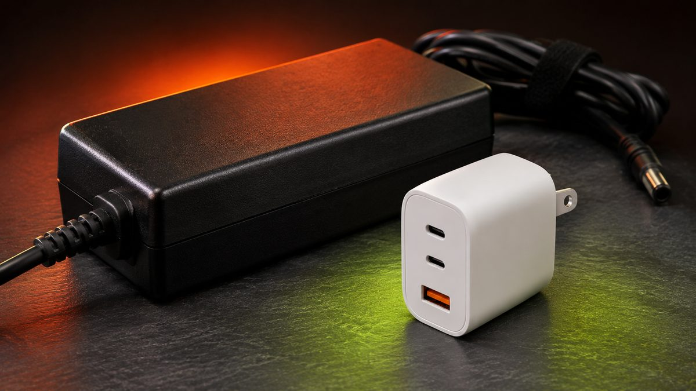
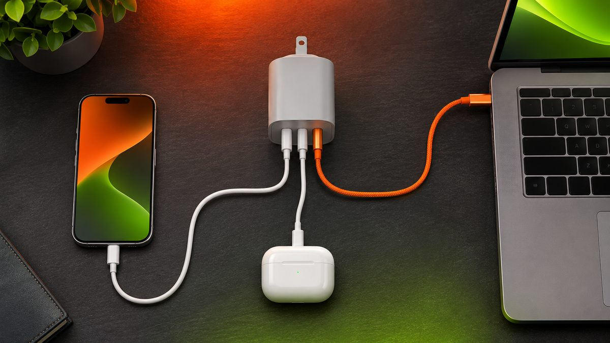

A 65W GaN charger is a small charger that can charge your phone and a USB-C laptop from the same plug. It sounds like something everybody needs, but it isn't. If you only charge a phone at home, the charger in your phone's box is usually the better choice. Here is who should buy one, what to check, and four good options in India right now.

<!--more-->

## What GaN actually changes

GaN (gallium nitride) is the material used inside the charger instead of plain silicon. It wastes less power as heat, so the same 65W fits in a much smaller box. That's the whole benefit: **size and less heat**, not "faster charging" by itself. A 65W GaN charger and a 65W old-style laptop brick put out the same power.

## Who should buy one (and who shouldn't)

**Buy one if** you carry a USB-C laptop and a phone, travel often, or want one charger on your desk for everything. One 65W charger can replace two or three chargers in your bag.

**Skip it if** you only charge your phone at home. Your phone's own charger is free, already in the box, and for many Indian phones it is also faster (see the next section).

## Check this before you buy

1. **Your phone's own fast charging.** OnePlus, OPPO, Realme, iQOO and Vivo phones reach their top speed only with their own charger and cable. On a normal USB-C PD charger they still charge, but slower. Samsung, Pixel and iPhone use standard USB-C PD (Samsung also needs PPS for its fastest speed), so a good GaN charger works well for them.
2. **Your laptop's watts.** A 13-inch MacBook Pro M1 came with a 61W charger, and Apple says any USB-C adapter works, even one with lower or higher watts. Most thin Windows laptops with USB-C charging need 45–65W. A big gaming laptop with a round-pin charger will not charge from these at all.
3. **Power per port, not the total.** "65W" is usually the total. When you plug in two devices, the power gets split (for example 45W + 20W). If you want full speed on a laptop, plug in only the laptop.
4. **A good cable.** For 60W and above you need a USB-C cable rated for it. A cheap thin cable can limit the speed.
5. **BIS mark and a known brand.** Chargers sold in India must have BIS certification. Avoid unbranded chargers from local shops; they can heat up a lot.

## Four good 65W GaN chargers in India

| Charger | Price (Nov 2026) | Ports | Weight | Good for |
|---|---|---|---|---|
| boAt 67W GaN | around ₹1,999 | 2 USB-C + 1 USB-A | – | Lowest price |
| Spigen PE2302 65W GaN | around ₹2,099 | 2 USB-C + 1 USB-A | 140g | Samsung phones (PPS) |
| Ambrane RAAP G65 | around ₹2,399 | 2 USB-C + 1 USB-A | 150g | Three devices at once |
| Belkin 65W Dual USB-C GaN | around ₹2,999 | 2 USB-C | 140g | MacBook and iPhone users |

Prices are the Amazon.in selling prices in November 2026, without bank offers. They change often, so check before you buy. Specs are from the product listings.

### boAt 67W GaN

The cheapest of the four from a known brand. It supports USB-C PD, PPS and Quick Charge 3.0. With all three ports in use the listing says the power splits as 45W + 7.5W + 7.5W, so it's best for one laptop or one phone at a time.



### Spigen PE2302 65W GaN

Light at 140g and BIS certified. It supports PPS, which Samsung phones need for their 45W "Super Fast Charging 2.0" (on a single port). A good pick if you have a Samsung phone and a USB-C laptop.



### Ambrane RAAP G65

Ambrane's 65W GaN charger with two USB-C ports and one USB-A, 150g, BIS certified. The extra USB-A port is handy for older earbuds, a smartwatch cable or a power bank.



### Belkin 65W Dual USB-C GaN

Gives the full 65W from one USB-C port, or 45W + 20W when both are used, which is enough for a MacBook and an iPhone together. It costs more, but Belkin is a well-known accessory brand.



> **Tip:** A charger can only give what your phone asks for. A 65W charger will not "overload" a phone that takes 20W; the phone simply takes 20W.

## Our take

I use the same charger which came in the box with my OnePlus 9RT. Even now my phone gets full in about 30 to 35 minutes. When battery is very low, it takes a few minutes more.

For my MacBook I am using the Apple charger only, the original one. When I go out I have to keep two chargers in my bag, one for phone and one for laptop. Honestly it is a bit of a headache.

Till now I have not used any GaN charger which can charge phone and laptop both. If I buy one, I will take one with more than one port and with enough power for the laptop also.

One time I used a cheap local charger and it was getting very hot during charging. From that day I am a little careful about chargers. Now I think it is better to buy from a good brand only.

My opinion is simple. If you have a laptop and a phone both and you travel often, a GaN charger is very useful. But if you only charge your phone and you are mostly at home, the normal phone charger is enough.

**Related reading:** [Fast Charging Explained: Watts, USB-C PD and the Right Charger](/fast-charging-explained/) · [Best Power Banks in India: How to Choose the Right One](/best-power-banks-india/)

## The bottom line

A 65W GaN charger makes sense if you carry a USB-C laptop and a phone: one small charger replaces two. If your phone is a OnePlus, OPPO, Realme or iQOO, keep its own charger for the fastest phone charging and use the GaN charger mainly for the laptop and travel. Pick a known brand with the BIS mark, check the power per port, and use a proper 60W+ USB-C cable.
